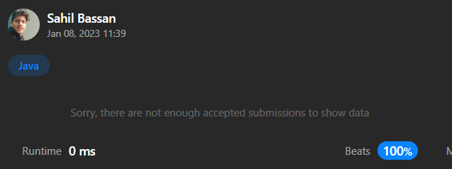

# Simple || Java || Beats 100%

**Author:** sam02202001
**Votes:** 26
**Link:** [https://leetcode.com/problems/categorize-box-according-to-criteria/solutions/3015234/](https://leetcode.com/problems/categorize-box-according-to-criteria/solutions/3015234/)

---

Make sure to Upvote the code it means a lot to me!\u270C\uFE0F
# Code with Notes
```
class Solution {
    public String categorizeBox(int length, int width, int height, int mass) {
       
        if(isBulky(length,width,height) && mass >= 100){
            return "Both";
        }else if(!(isBulky(length,width,height)) && mass < 100){
            return "Neither";
        }else if(!(isBulky(length,width,height)) && mass >= 100){
            return "Heavy";
        }else{
            return "Bulky";
        }
    }

//Function to check whether box is bulky or not
    private static boolean isBulky(int length, int width, int height){

        // Calculate volume and convert to long because 
        //the product can be very large 
        long volume = (long)length * (long)width * (long)height;

        //Check if any of dimension is greater than 10_000
        if(Math.max(length,Math.max(width,height)) > 10_000){
            return true;
        }

        //Check if volume is greater than 1_000_000_000
        if( volume >= 1000_000_000){
            return true;
        }

        //If it don't meet above two conditions it means the box
        // is not bulky so return false
        return false;
    }
}
```
# Source Code
```
class Solution {
    public String categorizeBox(int length, int width, int height, int mass) {
        if(isBulky(length,width,height) && mass >= 100)     return "Both";
        else if(!(isBulky(length,width,height)) && mass < 100)      return "Neither";
        else if(!(isBulky(length,width,height)) && mass >= 100)     return "Heavy";
        else    return "Bulky";
    
    }
    private static boolean isBulky(int length, int width, int height){
        long volume = (long)length * (long)width * (long)height;

        if(Math.max(length,Math.max(width,height)) >= 10_000)   return true;
        if( volume >= 1000_000_000) return true;
        return false;
    }
}
```

