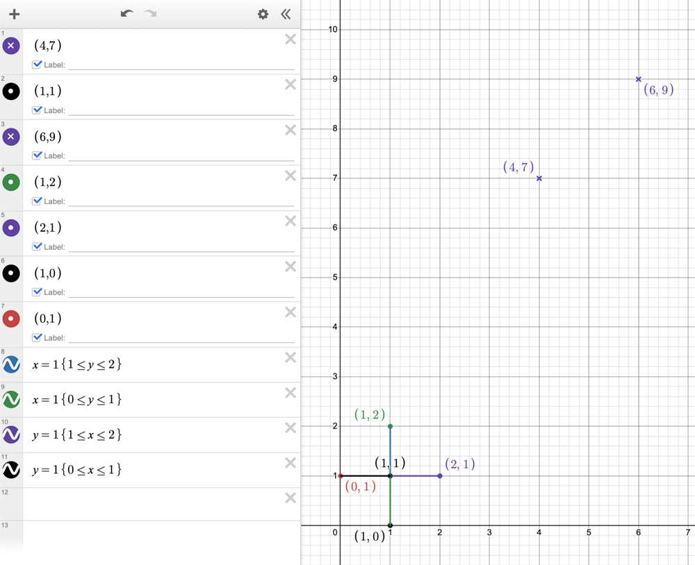

# Chech if Point is Reachable 2543

**Author:** Red_Shifted
**Votes:** 0
**Link:** [https://leetcode.com/problems/check-if-point-is-reachable/solutions/5149239/](https://leetcode.com/problems/check-if-point-is-reachable/solutions/5149239/)

---

# Intuition
- The ability to reach the origin from (`targetX`, `targetY`) depends on the divisibility of ```
targetX
``` and `targetY` by 2. Here's the reasoning:

    - If the GCD is not a power of 2, it means there's an odd factor present in the GCD. This odd factor cannot be canceled out using only steps of size (1, 0) and (0, 1), making it impossible to reach the origin with even coordinates (both `targetX` and `targetY` would need to be divisible by 2 for this to be possible).
    - If the GCD is a power of 2, then all the common factors are even, and we can reach the origin by repeatedly canceling out these even factors using steps of size (1, 0) and (0, 1).

# Approach
**Explanation:**
- The method calls the gcd function to find the GCD of targetX and targetY.
- It then returns True if the following two conditions are both met:
    - gcd(targetX, targetY) > 0: This ensures that targetX and targetY share at least one common factor greater than 1 (excluding 1). This is necessary because we can only reach the origin by canceling out common factors of targetX and targetY using steps of size (1, 0) and (0, 1).
    - gcd(targetX, targetY) & (gcd(targetX, targetY) - 1) == 0: This is a more cryptic condition that leverages a bitwise operation to check if the GCD is a power of 2
`gcd(a, b):`
This method implements the Euclidean Algorithm to calculate the Greatest Common Divisor (GCD) of two integers `a` and `b`

By combining these checks, the isReachable method accurately determines if the given point (targetX, targetY) can be reached from the origin using the allowed steps.

# Complexity
- Time complexity:
The time complexity of the entire code depends on finding the GCD, which is $$O(log min(targetX, targetY))$$

- Space complexity:
The space complexity remains constant $$(O(1))$$ because both methods use a fixed amount of additional space.

# Code

```python []
class Solution:
    def gcd(a, b):
        while b != 0:
            a, b = b, a % b
        return a
    def isReachable(self, targetX: int, targetY: int) -> bool:
        return gcd(targetX,targetY) > 0 and gcd(targetX,targetY) & (gcd(targetX,targetY) - 1) == 0
```
```C++ []
class Solution {
public:
    bool isReachable(int targetX, int targetY) {
        int num = gcd(targetX,targetY);
        return num > 0 && (num & (num - 1)) == 0;
    }
};
```
```Rust []
impl Solution {
    pub fn is_reachable(target_x: i32, target_y: i32) -> bool {
        fn gcd(mut a: i32, mut b: i32) -> i32 {
            while b != 0 {
                let temp = b;
                b = a % b;
                a = temp;
            }
            a
        }
        let num = gcd(target_x,target_y);
        num > 0 && (num & (num - 1)) == 0
    }
}
```


