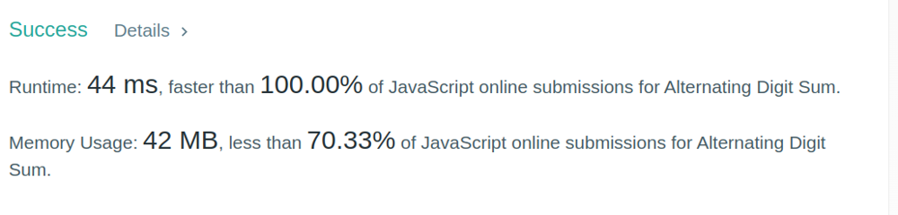

# very simple and beats 100.00% of Javascript  solution.

**Author:** being____Anonymous
**Votes:** 5
**Link:** [https://leetcode.com/problems/alternating-digit-sum/solutions/3234816/](https://leetcode.com/problems/alternating-digit-sum/solutions/3234816/)

---

var alternateDigitSum = function(n) {
    let sum =0;
let a = n.toString().split("").map(Number);
for(let i=0; i<a.length ; i++)
  {
    if(i%2==0)
    {
      sum += a[i];
    }else{
      let neg = a[i] *-1;
      sum += neg;
    }
  }
return sum;
    
};