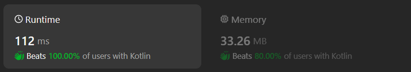

# Kotlin solution without strings and arrays

**Author:** chayangkoon
**Votes:** 0
**Link:** [https://leetcode.com/problems/maximum-difference-by-remapping-a-digit/solutions/5135041/](https://leetcode.com/problems/maximum-difference-by-remapping-a-digit/solutions/5135041/)

---




# Complexity
- Time complexity:
O(n)

- Space complexity:
O(1)

# Code
```
class Solution {
    fun minMaxDifference(num: Int): Int {
        if (num < 10) return 9
        var base = num.findHighestOfBase10()
        val digitForMin = num / base
        var digitForMax = digitForMin
        var maxNum = 0
        var minNum = 0
        var number = num
        var foundDigitForMax = false
       
        while (base >= 1) {
            val digit = number / base
            if (!foundDigitForMax && digit < 9) {
                foundDigitForMax = true
                digitForMax = digit
            } 

            val newMaxDigit = if (digit == digitForMax) 9 else digit
            maxNum = maxNum * 10 + newMaxDigit

            val newMinDigit = if (digit == digitForMin) 0 else digit
            minNum = minNum * 10 + newMinDigit

            number %= base
            base /= 10
        }

        return maxNum - minNum
    }

    private fun Int.findHighestOfBase10(): Int {
        return when {
            this >= 100_000_000 -> 100_000_000
            this >= 10_000_000 -> 10_000_000
            this >= 1_000_000 -> 1_000_000
            this >= 100_000 -> 100_000
            this >= 10_000 -> 10_000
            this >= 1_000 -> 1_000
            this >= 100 -> 100
            this >= 10 -> 10
            else -> 1
        }
    }
}
```