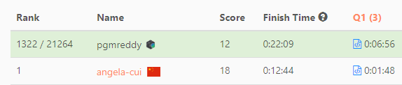
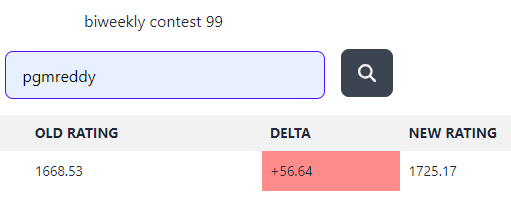

# [JavaScript] 2578. Split With Minimum Sum

**Author:** pgmreddy
**Votes:** 12
**Link:** [https://leetcode.com/problems/split-with-minimum-sum/solutions/3257467/](https://leetcode.com/problems/split-with-minimum-sum/solutions/3257467/)

---


---

# Intuition
- Collect digits from given number
- Sort digits ascending
- Concat alternative digits into 2 strings ( from 2 examples given )
- Convert 2 strings to numbers, and add them & return

# Approach
<!-- Describe your approach to solving the problem. -->

# Complexity
- Time complexity:
<!-- Add your time complexity here, e.g. $$O(n)$$ -->

- Space complexity:
<!-- Add your space complexity here, e.g. $$O(n)$$ -->

# Code
```
var splitNum = function (n) {
    // Convert to string
    let str = "" + n;

    // Collect digits, convert to numbers, sort ascending
    let arr = str
        .split("")
        .map((x) => +x)
        .sort((a, b) => a - b);

    // Concatenate into 2 strings, alternatively
    let str1 = "";
    let str2 = "";

    let i = 0;
    for (let digit of arr) {
        if (i % 2 === 0) {
            str1 += digit;
        } else {
            str2 += digit;
        }
        i++;
    }

    // Convert 2 strings to numbers, add & return
    return +str1 + +str2;
};
```

---

- Above code is from my contest submission
Link - https://leetcode.com/contest/biweekly-contest-99/ranking/53/



- Rating change:
Link - https://lccn.lbao.site/predicted/biweekly-contest-99



---

## Biweekly Contest 99 answers

- Q1 - https://leetcode.com/problems/split-with-minimum-sum/solutions/3257467/javascript-2578-split-with-minimum-sum/?orderBy=most_votes
- Q2 - https://leetcode.com/problems/count-total-number-of-colored-cells/solutions/3257488/javascript-2579-count-total-number-of-colored-cells/?orderBy=most_votes
- Q3 - https://leetcode.com/problems/count-ways-to-group-overlapping-ranges/solutions/3257499/javascript-2580-count-ways-to-group-overlapping-ranges/?orderBy=most_votes

---
