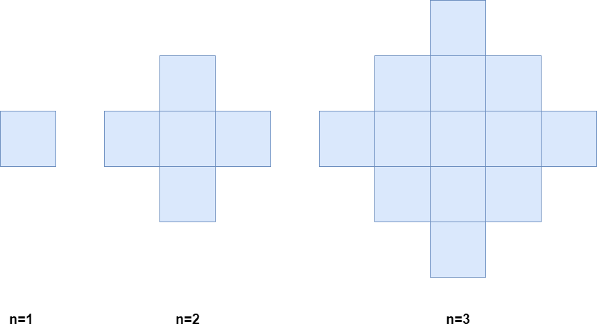

# [2579. Count Total Number of Colored Cells](https://leetcode.com/problems/count-total-number-of-colored-cells/)

| Category | Difficulty | Likes | Dislikes |
| :------: | :--------: | :---: | :------: |
| Algorithms | Medium | 841 | 95 |

**Tags:** [`math`](https://leetcode.com/tag/math)

**Companies:** `facebook`, `amazon`, `bloomberg`

## Description

There exists an infinitely large two-dimensional grid of uncolored unit cells. You are given a positive integer `n`, indicating that you must do the following routine for `n` minutes:

	- At the first minute, color **any** arbitrary unit cell blue.

	- Every minute thereafter, color blue **every** uncolored cell that touches a blue cell.

Below is a pictorial representation of the state of the grid after minutes 1, 2, and 3.



Return *the number of **colored cells** at the end of *`n` *minutes*.

 

**Example 1:**

```

Input: n = 1
Output: 1
Explanation: After 1 minute, there is only 1 blue cell, so we return 1.

```

**Example 2:**

```

Input: n = 2
Output: 5
Explanation: After 2 minutes, there are 4 colored cells on the boundary and 1 in the center, so we return 5. 

```

 

**Constraints:**

	- `1 <= n <= 10^5`

---

**Links:** [Submissions](https://leetcode.com/problems/count-total-number-of-colored-cells/) | [Solutions](https://leetcode.com/problems/count-total-number-of-colored-cells/)
