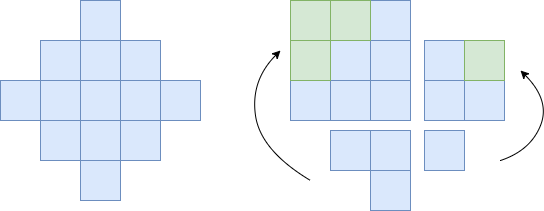
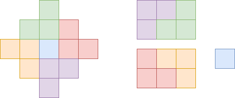

# [Java/C++/Python] Cut and Combine O(1)

**Author:** lee215
**Votes:** 50
**Link:** [https://leetcode.com/problems/count-total-number-of-colored-cells/solutions/3256196/](https://leetcode.com/problems/count-total-number-of-colored-cells/solutions/3256196/)

---

# **Intuition**
Cut and Combine.
<br>

# **Solution 1**


Cut the original graph into 4 parts:
One triangle stairs of size `n`, 
Two triangle stairs of size `n - 1`, 
One triangle stairs of size `n - 2`,

size `n` and size `n - 1` make up a sequare of size `n`
size `n - 1` and size `n - 2` make up a sequare of size `n - 1`

So the total area is `n * n + (n - 1) * (n - 1)`.

Also we need to take care that it won't overflow the range of integer,
so need to convert to long type first.
<br>


**Java**
```java
    public long coloredCells(int n) {
        return 1l * n * n + 1l * (n - 1) * (n - 1);
    }
```

**C++**
```cpp
    long long coloredCells(int n) {
        return 1l * n * n + 1l * (n - 1) * (n - 1);
    }
```

**Python**
```py
    def coloredCells(self, n: int) -> int:
        return n * n + (n - 1) * (n - 1)
```
<br>

# **Solution 2**


Cut the original graph into 5 parts:
One square of size `1`, 
Four triangle stairs of size `n - 1`, 

Two size `n - 1` make up a rectangle of size `n * (n - 1)`

So the total area is `2 * n * (n - 1) + 1`.

Also we need to take care that it won't overflow the range of integer,
so need to convert to long type first.
<br>

**Java**
```java
    public long coloredCells(int n) {
        return 2l * n * (n - 1) + 1;
    }
```

**C++**
```cpp
    long long coloredCells(int n) {
        return 2l * n * (n - 1) + 1;
    }
```

**Python**
```py
    def coloredCells(self, n: int) -> int:
        return 2 * n * (n - 1) + 1
```
<br>

# **Complexity**
Time `O(1)`
Space `O(1)`
<br>
