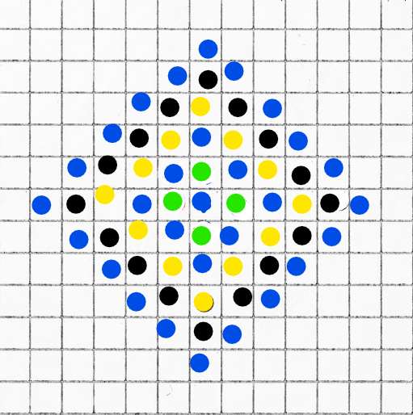

# ✅[C++/ Py/JS/Java] Image Explanation✔️|| Step By Step Math  || O(1) || Beginner Friendly🔥

**Author:** tamimarefinanik
**Votes:** 7
**Link:** [https://leetcode.com/problems/count-total-number-of-colored-cells/solutions/3256233/](https://leetcode.com/problems/count-total-number-of-colored-cells/solutions/3256233/)

---

**Check the image carefully**



In every step it increases n * 4 - 4 cells.
Here you can see the pattern :
n = 1 => 1    => 1            => 1 + (1-0) * 2 * 1  
n = 2 => 5    => 1 + 4     => 1 + (2-1) * 2 * 2
n = 3 => 13  => 5 + 8     => 1 + (3-1) * 2 * 3
n = 4 => 25  => 13 + 12 => 1 + (4-1) * 2 * 4

**c++**
```
public long ColoredCells(int n) {
    return (long)(n - 1) * 2 * n + 1;
}
```

**Javascript**
```
var coloredCells = function(n) {
    return (n - 1) * 2 * n + 1;
};
```

**Python**
```
def coloredCells(self, n):
        return (n - 1) * 2 * n + 1
```

**Java**
```
public long coloredCells(int n) {
        return (long)(n - 1) * 2 * n + 1;
    }
```

**Complexity**
**Time:** : ```O(1)```
**Space** : ```O(1)```
