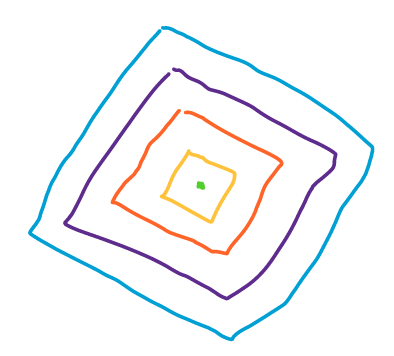

# Kotlin 1-Line with Formula and Drawing

**Author:** kotlinc
**Votes:** 4
**Link:** [https://leetcode.com/problems/count-total-number-of-colored-cells/solutions/3256504/](https://leetcode.com/problems/count-total-number-of-colored-cells/solutions/3256504/)

---

Consider the problem this way, 




# Formula

$$ 1 + \\sum_2^n (i - 1) * 4 $$

# Complexity
- Time complexity: $$O(1)$$
<!-- Add your time complexity here, e.g. $$O(n)$$ -->

- Space complexity: $$O(1)$$
<!-- Add your space complexity here, e.g. $$O(n)$$ -->

# Code
```
class Solution {
  fun coloredCells(n: Int) = 1L + (n * (n - 1L) * 2L)
}
```