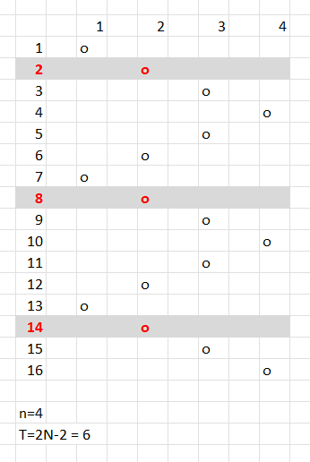

# Kotlin. Beats 100% (114 ms). Skipping unnecessary periodic cycles

**Author:** mobdev778
**Votes:** 1
**Link:** [https://leetcode.com/problems/pass-the-pillow/solutions/5427126/](https://leetcode.com/problems/pass-the-pillow/solutions/5427126/)

---


# Code

```
class Solution {
    fun passThePillow(n: Int, time: Int): Int {
        var time = time % ((n shl 1) - 2)
        return if (time < n) {
            time + 1
        } else {
            (n shl 1) - 1 - time
        }
    }
}
```

# Approach 

In the figure for n=4, we can see that the pillow ends up in the same position every "n * 2 - 2" steps:



So we can skip the repeating cycles at first:

```
var time = time % ((n shl 1) - 2)
```

Then, comparing "time" and "n", we can estimate which of the two cases we have now.

There are only two options - the pillow moves to the right. In this case, we just need to return "time + 1":
```
if (time < n) {
    return time + 1
}
```

For the case of movement to the left, the position is calculated a little more complicated:
```
return n - 1 - (time - n)
```
or
```
return n * 2 - 1 -time
```
or
```
return (n shl 1) - 1 -time
```

# Alternative approach

Since "n" does not exceed 1000, we can calculate the position through a simple loop - it will be quite fast.


```
class Solution {
    fun passThePillow(n: Int, time: Int): Int {
        var index = 1
        var inc = 1

        var time = time % ((n shl 1) - 2)
        while (time > 0) {
            index += inc
            if (index == n || index == 1) {
                inc = -inc
            }
            time--
        }
        return index
    }
}
```