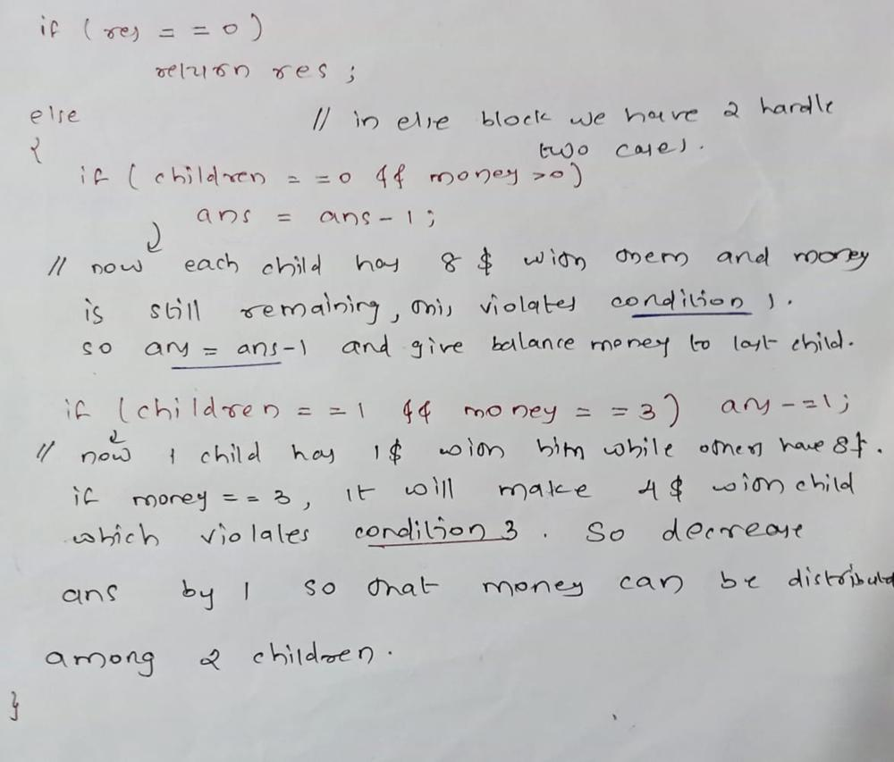

# ✅✅INTERVIEW Approach||HANDWRITTEN||EASY

**Author:** S_16
**Votes:** 12
**Link:** [https://leetcode.com/problems/distribute-money-to-maximum-children/solutions/3313943/](https://leetcode.com/problems/distribute-money-to-maximum-children/solutions/3313943/)

---

First of all,I find it to be a **tricky** question even though it is tagged as **Easy**.

The 3 conditions mentioned in the problem are:
1. All money must be distributed.
2. Everyone must receive at least 1 dollar.
3. Nobody receives 4 dollars.

# APPROACH
- if `money<children` It will violate condition 2,so `return -1`
- `money-=children`, this satisfies condition 2.
- Now each child wants 7$ to have exact 8 dollars. Start distributing 7dollar to each child using a loop and take a count of the number.
```
        int res = 0;
        while(money >= 7 && children > 0) {
            money -= 7;
            res++;
            children--;
        }
```
- Now this is the **most important step** and I have tried my best to explain it.


- now `return ans;`
        
# COMPLETE CODE
```
 int distMoney(int money, int children) {
        if(money < children) return -1;
        money -= children;

        int res = 0;
        while(money >= 7 && children > 0) {
            money -= 7;
            res++;
            children--;
        }
        if(res==0)
           return res;
        else
        {
            if(children==0 && money>0)
               res-=1;
            if(children==1 && money==3)
               res-=1;
        }
        return res;
    }
```

