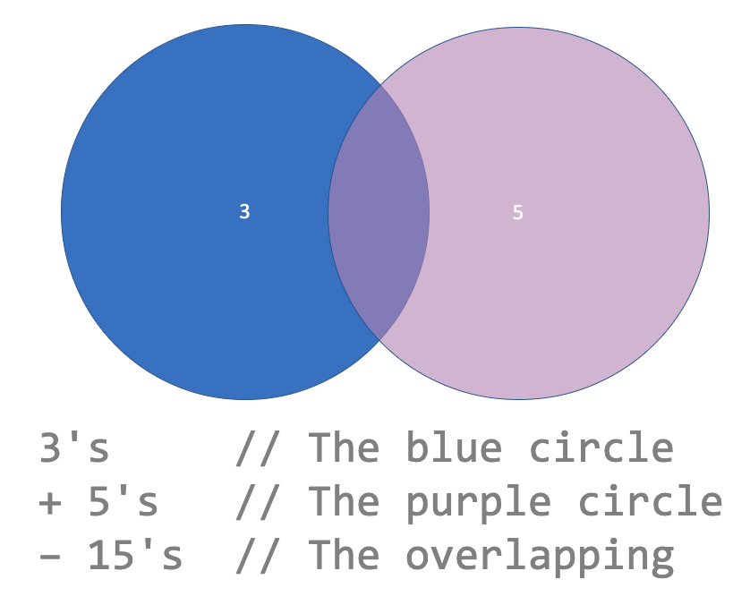
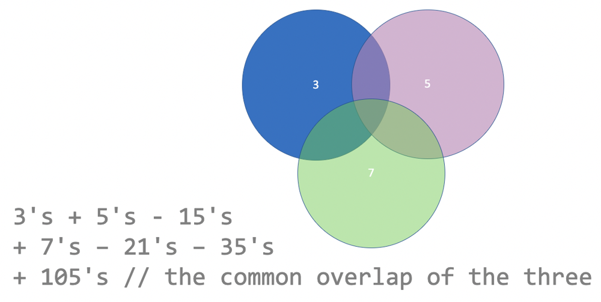

# Kotlin O(1) with Diagram

**Author:** kotlinc
**Votes:** 39
**Link:** [https://leetcode.com/problems/sum-multiples/solutions/3445711/](https://leetcode.com/problems/sum-multiples/solutions/3445711/)

---

# Complexity
- Time complexity: $$O(1)$$
<!-- Add your time complexity here, e.g. $$O(n)$$ -->

- Space complexity: $$O(1)$$
<!-- Add your space complexity here, e.g. $$O(n)$$ -->

# Approach
If we only have `3` and `5` to deal with:



Adding `7` to the picture:



# Code
```
class Solution {
  fun sumOfMultiples(n: Int): Int {
    fun sumOfDivisible(value: Int): Int {
      val low = value
      val high = n / value * value
      val count = (high + value - low) / value
      return (low + high) * count / 2
    }
    return sumOfDivisible(3) + sumOfDivisible(5) + sumOfDivisible(7) -
        (sumOfDivisible(15) + sumOfDivisible(35) + sumOfDivisible(21)) +
        sumOfDivisible(105)
  }
}
```