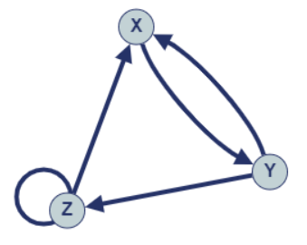

# [C++, Java, Python] Completely Explained All Cases | One-Liner Brainteaser

**Author:** shivamaggarwal513
**Votes:** 17
**Link:** [https://leetcode.com/problems/construct-the-longest-new-string/solutions/3678458/](https://leetcode.com/problems/construct-the-longest-new-string/solutions/3678458/)

---

You can see other solutions that are using recursion with DP to go to every case. But this problem is more of a brainteaser where maximum length can be found with some if-else conditions. I will try to explain what I did in contest.

# Intuition
Let `X = "AA"`, `Y = "BB"`, and `Z = "AB"`. If we have taken any of the three strings, what are the different possibilities for next string? List every possible case (there are $3$ choices of both previous and current string so total $3 \	imes 3 = 9$ cases are possible)
```
Current    Next    String    IsPossible
X          X       AAAA      0
X          Y       AABB      1
X          Z       AAAB      0
Y          X       BBAA      1
Y          Y       BBBB      0
Y          Z       BBAB      1
Z          X       ABAA      1
Z          Y       ABBB      0
Z          Z       ABAB      1
```

1. If we took `X` before, then we can take `Y`
2. If we took `Y` before, then we can take `X` or `Z`
3. If we took `Z` before, then we can take `X` or `Z`

State transition diagram for these strings will look like:

(Gives me feels of Automata)

Since `Z` has a self-loop, we can take `Z` as much as we want continuously (or as much as it is available). So, take all `Z`s together anytime. Now problem lies with `X` and `Y`.
With the graph, it is clear that to maximize the take of `X` and `Y`, we can alternatively take `XYXYXY...` or `YXYXYX...`.

So, we have 3 cases now: $x = y$, $x > y$, and $x < y$.

## Case 1: x = y
Optimal approach will be take all `Z`s together first.
From last `Z`, we can go to `X`, so take `XYXYXY...XY` then.

```
String: "ZZZ...Z XYXYXY...XY"
answer = 2 * (z + x + y)
```

## Case 2: x > y
Optimal approach will be take all `Z`s together first.
From last `Z`, we can go to `X`, so start taking `XYXYXY...` as much as we can.
Since $x > y$, there will be a point after taking the last pair of `XY` (or $yth$ pair), where all `Y`s will be exhausted but some `X` will remain. At this point we can take another `X` at last.
```
String: "ZZZ...Z XYXYXY...XY X"
answer = 2 * (z + y + y + 1)
```

## Case 3: x < y
Take all `Z`s together first.
From last `Z`, we can go to `X`, so start taking `XYXYXY...` as much as we can.
Since $x < y$, there will be a point after taking the last pair of `XY` (or $xth$ pair), where all `X`s will be exhausted. At this point, we can't do anything as we are standing at `Y`. But some `Y` are still remaining. So, we could have taken one `Y` at the very beginning, then we could have taken all `Z`s and `XY` pairs.
```
String: "Y ZZZ...Z XYXYXY...XY"
answer = 2 * (1 + z + x + x)
```

# Approach
Case 2 and 3 can be merged together by
```
answer = 2 * (2 * min(x, y) + z + 1)
```

Case 1 can also be merged, since `min(x, y) = x = y` for `x = y`
```
answer = 2 * (2 * min(x, y) + z + (x != y))
```

# Code
```C++ []
class Solution {
public:
    int longestString(int x, int y, int z) {
        return 2 * (2 * min(x, y) + z + (x != y));
    }
};
```
```Java []
class Solution {
    public int longestString(int x, int y, int z) {
        return 2 * (2 * Math.min(x, y) + z + (x != y ? 1 : 0));
    }
}
```
```Python []
class Solution:
    def longestString(self, x: int, y: int, z: int) -> int:
        return 2 * (2 * min(x, y) + z + (1 if x != y else 0))
```

# Complexity
- Time complexity: $O(1)$
- Space complexity: $O(1)$