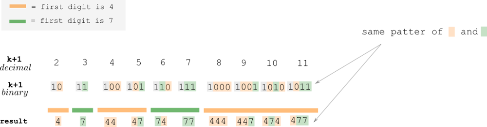
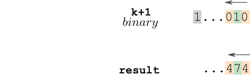
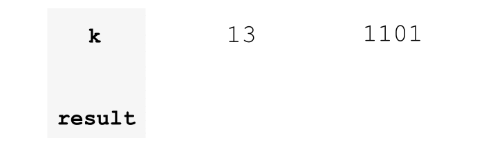

# explained by picture ^^

**Author:** andrii_khlevniuk
**Votes:** 21
**Link:** [https://leetcode.com/problems/find-the-k-th-lucky-number/solutions/3855086/](https://leetcode.com/problems/find-the-k-th-lucky-number/solutions/3855086/)

---

**time: `O(logN)`; space: `O(1)`**

The key thing to notice is that the problem is "binary" in its nature and that the sequence of `4s` and `7s` in the answer is dictated by the sequence of `0s` and `1s` in the binary representation of `k`. The tricky part is to see that it's actually the binary representation of `k+1` not `k` that we need!



<br>

You can think of the algo in a *procedural* or in a *functional* way.

*Procedural algo:*
Traverse binary representation of `k+1` from right to left, filling up the `out` string from right to left. `'1'` in `k+1` corresponds to `'4'` in the `out` string, `'0'` - corresponds to `'7'`. Don't use the leftmost bit of `k+1` - think of it as a stop codon. 



Here's a nice gif of the process:



*Functional algo:*
Use some kind of `to_binary_string` function on `k+1` and then use some kind of `replace` function to simultaneously replace all `0s` with `4s` and `1s` with `7s`. Drop the first symbol that corresponds to the leftmost bit in `k+1`.

**c++:**
Procedural:
```
string kthLuckyNumber(int k)
{
	string out{};
	++k;
	for( ; k!=1; k/=2)
		out.push_back(k&1 ? '7' : '4');
	reverse(begin(out), end(out));
	return out;
}
```
||
```
string kthLuckyNumber(int k) 
{
	string out;
	for(++k; k!=1; out.push_back(k&1 ? '7' : '4'), k/=2);
	return {rbegin(out), rend(out)};
}
```
**python:**
Procedural:
```
def kthLuckyNumber(self, k):
	out = ""
	k+=1
	while k!=1:
		out = ("7" if k&1 else "4") + out
		k//=2
	return out
```
Functional 1-liner:
```
def kthLuckyNumber(self, k):
	return "{0:b}".format(k+1).replace('0','4').replace('1','7')[1:];
```
**js:**
Procedural:
```
var kthLuckyNumber = function(k) 
{
    let out = "";
    for(++k; k!=1; k=Math.floor(k/2))
        out += k&1 ? "7" : "4";
    return out.split('').reverse().join('');
};
```
Functional 1-liner:
```
var kthLuckyNumber = function(k) 
{
    return (k+1).toString(2).replaceAll('0','4').replaceAll('1','7').slice(1);
};
```
