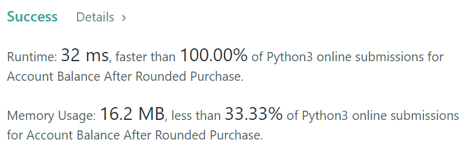

# [ Python ] ✅✅ Simple Python Solution | 100 % Faster🥳✌👍

**Author:** ASHOK_KUMAR_MEGHVANSHI
**Votes:** 3
**Link:** [https://leetcode.com/problems/account-balance-after-rounded-purchase/solutions/3875932/](https://leetcode.com/problems/account-balance-after-rounded-purchase/solutions/3875932/)

---

# If You like the Solution, Don't Forget To UpVote Me, Please UpVote! \uD83D\uDD3C\uD83D\uDE4F
# Runtime: 32 ms, faster than 100.00% of Python3 online submissions for Account Balance After Rounded Purchase.
# Memory Usage: 16.2 MB, less than 33.33% of Python3 online submissions for Account Balance After Rounded Purchase.

	class Solution:
		def accountBalanceAfterPurchase(self, purchaseAmount: int) -> int:

			purchaseAmount = ((purchaseAmount - 5) // 10 ) * 10 + 10

			result = 100 - purchaseAmount

			return result
	
	Time Complexity : O(1)
	Space Complexity : O(1)

# Thank You \uD83E\uDD73\u270C\uD83D\uDC4D