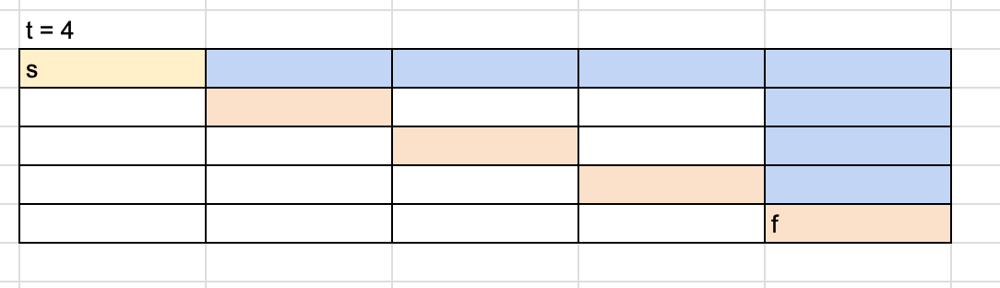

# 【Video】Give me 5 minutes -O(1) time and space - How we think about a solution

**Author:** niits
**Votes:** 87
**Link:** [https://leetcode.com/problems/determine-if-a-cell-is-reachable-at-a-given-time/solutions/4262613/](https://leetcode.com/problems/determine-if-a-cell-is-reachable-at-a-given-time/solutions/4262613/)

---

# Intuition
Use absolute value

---

# Solution Video

https://youtu.be/7nxGK97CmIw

\u25A0 Timeline of the video

`0:04` How we can calculate x and y distances
`0:55` We need to consider 2 cases and explain what if start and finish cell are the same position
`2:20` Explain case 2, what if start and finish cell are different positions
`4:53` Coding
`6:18` Time Complexity and Space Complexity

### \u2B50\uFE0F\u2B50\uFE0F Don't forget to subscribe to my channel! \u2B50\uFE0F\u2B50\uFE0F

**\u25A0 Subscribe URL**
http://www.youtube.com/channel/UC9RMNwYTL3SXCP6ShLWVFww?sub_confirmation=1

Subscribers: 2,971
My first goal is 10,000 (It's far from done \uD83D\uDE05)
Thank you for your support!

---

# Approach

## How we think about a solution

First of all, we need to calculate distance from start cell to finish cell

---

\u2B50\uFE0F Points

We don't have to care about positive and negative, so we use absolute value

```
x distance = abs(sx - fx)
y distance = abs(sy - fy)
```

For example, let's say we are now `0`, distance of `3` and `-3` are the same from `0`.

---

We have two cases to check.

### Case 1: start cell and finish cell are the same position

In this case, we have `x distance` and `y distance` with both `0`. There is one case where we cannot reach finish cell. Do you come up with the case?

The answer is `t = 1` because the description says "Each second, you must move to any of its adjacent cells". That means at least we need `2 times` to go back to the same cell. So check `t != 1`.

---

\u2B50\uFE0F Points

When `x distance` and `y distance` are both `0`, start cell and finish cell are the same place. Check `t != 1` because we need at least 2 times to go back to the same cell.

---

### Case 2: start cell and finish cell are different positions

This is a simple case. Just check `x_dist <= t and y_dist <= t`. If we meet the condition, we can return `true`, if not return `false`.

Wait! Somebody is wondering like "Are you sure we can definitely reach the finish cell?"

We can definitely reach the finish cell. Because we can move to 8 directions around each cell. For example,



We cannot reach the finish cell with the `blue` path but we can reach it with the `orange` path, because we can move diagonally.

---

\u2B50\uFE0F Points

we can move diagonally.
In this case, x distance and y distance between the start cell and the finish cell are `4` and t = `4`.

Let's say start cell is `x = 1, y = 1`. In that case, finish cell should be `x = 5, y = 5`. So,
```
x distance = abs(sx - fx)
y distance = abs(sy - fy)
\u2193
x: abs(1 - 5) = 4
y: abs(1 - 5) = 4
```
We can meet this condition `x_dist <= t and y_dist <= t`.

```
Output: true
```
---

Let's see another case. For example, try to reach `e`.
```
a,b,c
d,e,f
g,h,i
```
If we have `t = 1`, we can reach `e` from `a,b,c,d,f,g,h,i`(= 8 directions), so when we reach around the finish cell`e`, then if we still have plenty of `t`, all we have to do is just move around the finish cell`e` and when `t = 1`, just go to the finish cell `e`.

---

\u2B50\uFE0F Points

We can definitely reach the finish cell if `x_dist <= t and y_dist <= t`, because we can move to 8 directions if we have at least `t = 1`.

---


Easy!\uD83D\uDE04
Let's see a real algorithm!


---

### Algorithm Overview:

The goal of this algorithm is to determine whether a point (fx, fy) is reachable from another point (sx, sy) within a given time limit (t). The algorithm computes the horizontal and vertical distances between the two points and checks if they can be reached within the given time constraint.

#### Detailed Explanation:

1. Take input parameters `sx`, `sy`, `fx`, `fy`, and `t`, representing the starting point `(sx, sy)`, the target point `(fx, fy)`, and the time limit `t`.

2. Compute the horizontal distance between the starting and target points:
   - Calculate the absolute difference between `sx` and `fx` and store it in the variable `xDist`.

3. Compute the vertical distance between the starting and target points:
   - Calculate the absolute difference between `sy` and `fy` and store it in the variable `yDist`.

4. Check if the starting and target points are the same:
   - If `xDist` and `yDist` are both equal to 0, it means the starting and target points coincide. In this case, return `t != 1`. This implies that the points are considered reachable if the time limit is not exactly 1 unit. If `t` is equal to 1, the points are not reachable.

5. Check if the distances can be covered within the given time limit:
   - If `xDist` is less than or equal to `t` and `yDist` is less than or equal to `t`, return `true`. This means that the points can be reached within the specified time constraint.

6. If neither of the conditions in steps 4 or 5 is met, return `false`. This indicates that the points cannot be reached within the given time limit.

In summary, the algorithm calculates the horizontal and vertical distances between two points and checks if they can be reached within the specified time limit. It returns `true` if they can be reached and `false` otherwise. If the points coincide, they are considered reachable only if the time limit is not exactly 1 unit.


---


# Complexity
- Time complexity: $$O(1)$$
The time complexity of this algorithm is constant $$O(1)$$ because the number of operations performed is not dependent on the input size. Regardless of the input values, the algorithm performs a fixed number of calculations, including absolute differences and comparisons.

- Space complexity: $$O(1)$$
The space complexity of this algorithm is also constant $$O(1)$$ because it uses a fixed amount of memory to store a few integer variables (xDist and yDist). The memory used for these variables does not depend on the input size, and there are no data structures or dynamic allocations that would increase the memory usage with input size.

```python []
class Solution:
    def isReachableAtTime(self, sx: int, sy: int, fx: int, fy: int, t: int) -> bool:
        x_dist = abs(sx - fx)
        y_dist = abs(sy - fy)

        if x_dist == 0 and y_dist == 0:
            return t != 1

        return x_dist <= t and y_dist <= t        
```
```javascript []
var isReachableAtTime = function(sx, sy, fx, fy, t) {
    const xDist = Math.abs(sx - fx);
    const yDist = Math.abs(sy - fy);

    if (xDist === 0 && yDist === 0) {
        return t !== 1;
    }

    return xDist <= t && yDist <= t
};
```
```java []
class Solution {
    public boolean isReachableAtTime(int sx, int sy, int fx, int fy, int t) {
        int xDist = Math.abs(sx - fx);
        int yDist = Math.abs(sy - fy);

        if (xDist == 0 && yDist == 0) {
            return t != 1;
        }

        return xDist <= t && yDist <= t;
    }
}
```
```C++ []
class Solution {
public:
    bool isReachableAtTime(int sx, int sy, int fx, int fy, int t) {
        int xDist = abs(sx - fx);
        int yDist = abs(sy - fy);

        if (xDist == 0 && yDist == 0) {
            return t != 1;
        }

        return xDist <= t && yDist <= t;
    }
};
```

---

Thank you for reading my post.
\u2B50\uFE0F Please upvote it and don't forget to subscribe to my channel!

\u25A0 Subscribe URL
http://www.youtube.com/channel/UC9RMNwYTL3SXCP6ShLWVFww?sub_confirmation=1

\u25A0 Twitter
https://twitter.com/CodingNinjaAZ

### My next daily coding challenge post and video.

post
https://leetcode.com/problems/count-number-of-homogenous-substrings/solutions/4266765/video-give-me-5-minutes-on-time-o1-space-how-we-think-about-a-solution/

video
https://youtu.be/VcZrmO045Bo

\u25A0 Timeline of the video

`0:04` Let's find a solution pattern
`1:38` A key point to solve Count Number of Homogenous Substrings
`2:20` Demonstrate how it works with all the same characters
`4:55` What if we find different characters
`7:13` Coding
`8:21` Time Complexity and Space Complexity

### My previous daily coding challenge post and video.

post
https://leetcode.com/problems/eliminate-maximum-number-of-monsters/solutions/4259212/video-give-me-10-minutes-on-solution-how-we-think-about-a-solution/

video
https://youtu.be/2tUBAJEn-S8

\u25A0 Timeline of the video

`0:04` Heap solution I came up with at first
`2:38` Two key points with O(n) solution for Eliminate Maximum Number of Monsters
`2:59` Explain the first key point
`5:08` Explain the second key point
`6:19` How we can eliminate monsters that are out of bounds
`8:48` Let's see another case
`9:52` How we can calculate eliminated numbers
`10:56` Coding
`13:03` Time Complexity and Space Complexity
