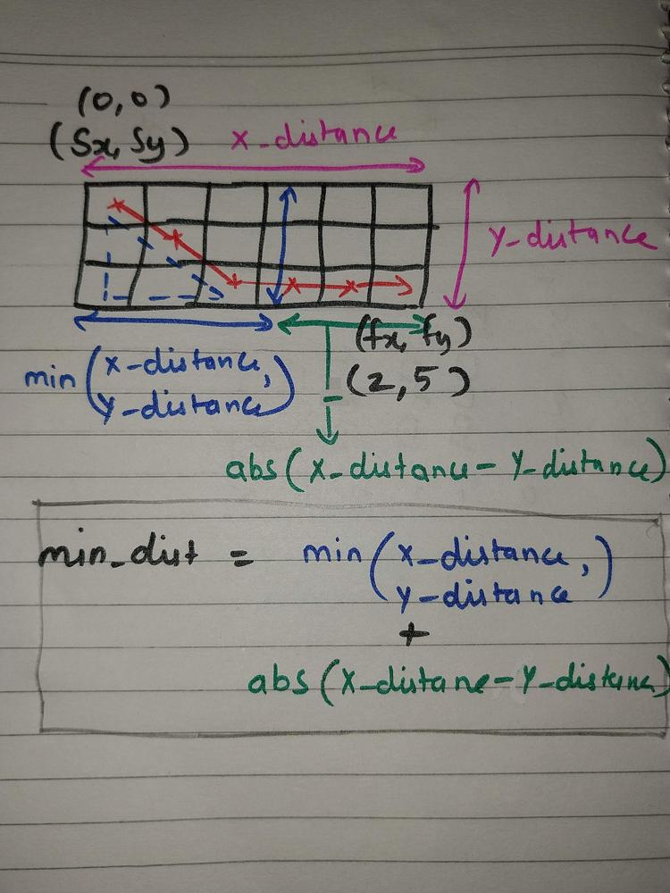
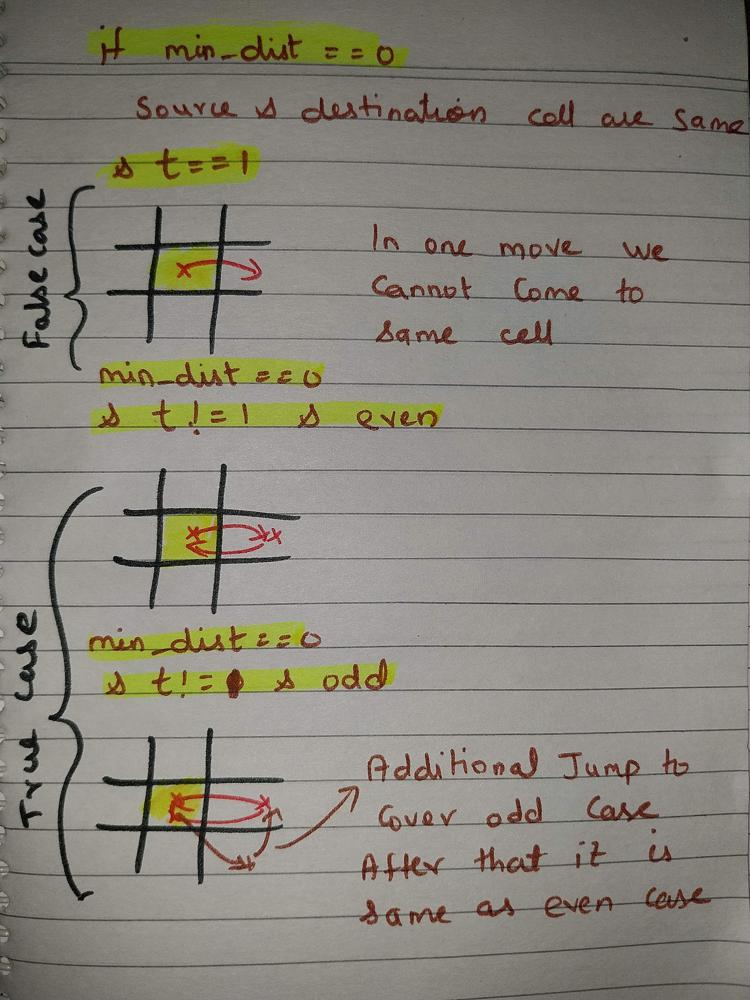
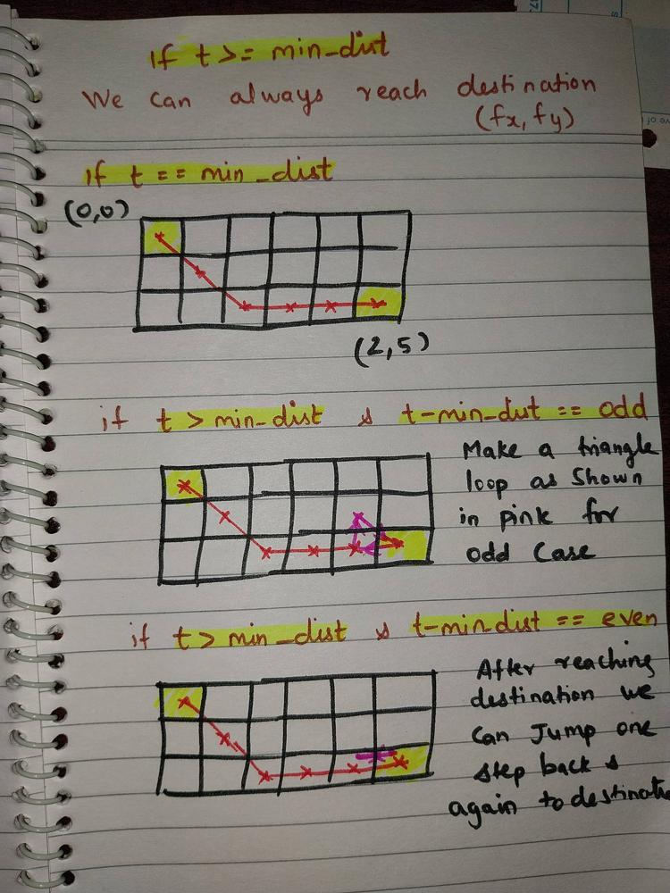
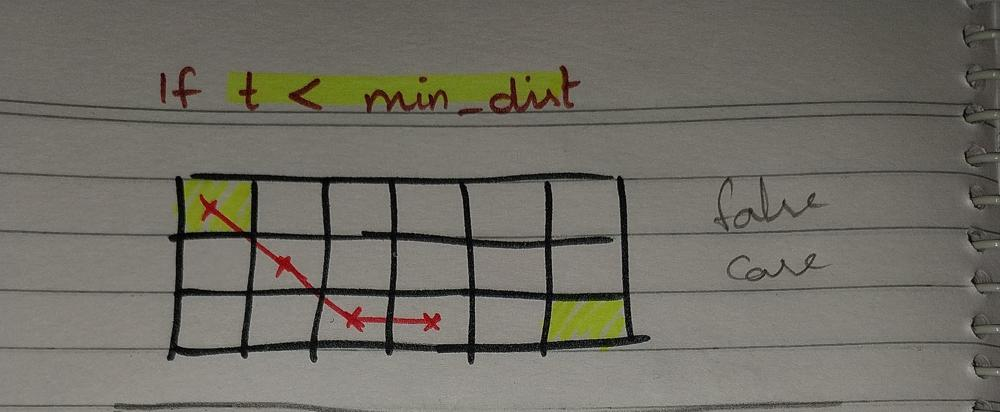

# Diagram for min_distance | Chebyshev distance | o(1) time and space

**Author:** nkrishk
**Votes:** 45
**Link:** [https://leetcode.com/problems/determine-if-a-cell-is-reachable-at-a-given-time/solutions/4024759/](https://leetcode.com/problems/determine-if-a-cell-is-reachable-at-a-given-time/solutions/4024759/)

---

# Intution

if          ```t < min_dist```, we cannot reach point  ```(fx,fy)``` (see last diagram)
if ```t >= min_dist```, we can always reach ```(fx,fy)``` (see third diagram)

spl case: ```min_dist = 0``` (see 2nd diagram)
when ```min_dist = 0``` (ie same cell) and ```t == 1``` , we return false
since we cannot move to same cell
move ```1``` distance  => alway cannot reach same position

##### update :

update (1)
This is what my inutation:
```min_dist = min(x_distance,y_distance) + abs(y_distance - x_distance)```

later i realized it is just
```min_dist = max(x_distance,y_distance)```

anyway the diagram makes some sense, i guess for the inutation

update (2) -> chessboard distance
https://en.wikipedia.org/wiki/Chebyshev_distance
The ```min_distance``` we found is nothing but the Chebyshev distance or chessboard distance.

# min_dist calculation




# use cases:

speacial case




case ```t >= min_dist``` 




case ```t < min_dist``` 




# Python3
```
class Solution:
    def isReachableAtTime(self, sx: int, sy: int, fx: int, fy: int, t: int) -> bool:
        x_distance = abs(sx-fx)
        y_distance = abs(sy-fy)
        min_dist = min(x_distance,y_distance) + abs(y_distance - x_distance)
        if min_dist == 0: 
            if t == 1:
                return False
            else:
                return True
        return t >= min_dist
```
# C++
```
class Solution {
public:
    bool isReachableAtTime(int sx, int sy, int fx, int fy, int t) {
        int x_distance = abs(sx - fx);
        int y_distance = abs(sy - fy);
        int min_dist = min(x_distance, y_distance) + abs(y_distance - x_distance);
        if (min_dist == 0) {
            if (t == 1) {
                return false;
            } else {
                return true;
            }
        }
        return t >= min_dist;
    }
};
```
# Java
```
public class Solution {
    public boolean isReachableAtTime(int sx, int sy, int fx, int fy, int t) {
        int xDistance = Math.abs(sx - fx);
        int yDistance = Math.abs(sy - fy);
        int min_dist = Math.min(xDistance, yDistance) + Math.abs(yDistance - xDistance);
        if (min_dist == 0) {
            if (t == 1) {
                return false;
            } else {
                return true;
            }
        }
        return t >= min_dist;
    }
}
```
# golang
```
func isReachableAtTime(sx int, sy int, fx int, fy int, t int) bool {
	xDistance := int(math.Abs(float64(sx - fx)))
	yDistance := int(math.Abs(float64(sy - fy)))
	min_dist := int(math.Min(float64(xDistance), float64(yDistance))) + int(math.Abs(float64(yDistance - xDistance)))
	if min_dist == 0 {
		if t == 1 {
			return false
		} else {
			return true
		}
	}
	return t >= min_dist
}
```