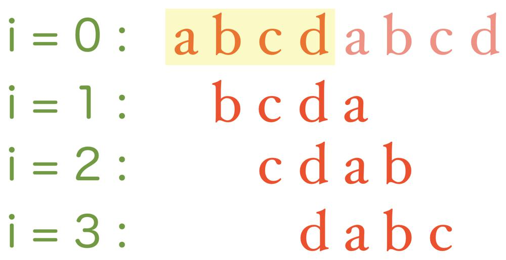

# 【C++ || Java || Python】 Short Code by Finding the Pattern

**Author:** RealFan
**Votes:** 50
**Link:** [https://leetcode.com/problems/string-transformation/solutions/4024703/](https://leetcode.com/problems/string-transformation/solutions/4024703/)

---

> **I know almost nothing about English, pointing out the mistakes in my article would be much appreciated.**

> **In addition, I'm too weak, please be critical of my ideas.**
---

# Brief Solution
**Rolling will change the beginning index of $$s$$. So enumerate each index as the beginning index, count the number of ways to obtain it. And then use [KMP](https://en.wikipedia.org/wiki/Knuth%E2%80%93Morris%E2%80%93Pratt_algorithm) algorithm to find which indexes can let $$s=t$$, summing their counting.**

# Intuition
1. Move suffix to prefix is actually a "rolling" operation. 
    Let $$s'$$ be the string obtained after $$k$$ time rollings of string $$s$$. According to the beginning index of $$s'$$ on $$s$$, it has at most $$n$$ kinds of situations.
    This is illustration, $$s="abcd"$$:
    
2. Define $$f_{k}(i)$$ as "after $$k$$ steps, the number of ways which can let $$s'$$ starting from $$s[i]$$".
3. Because $$s$$ can be rolled with the length from $$1$$ to $$n-1$$ once, easily write a recursion function:
    $$f_{k}(i) = \\sum\\limits_{j=1}^{n-1}f_{k-1}((i-j)\\%n) = \\sum\\limits_{j=0}^{n-1}f_{k-1}(j) - f_{k-1}(i)$$
4. Now we can try to calculate some values of $$f_{k}$$, suppose now $$n=4$$:
$
\\begin{array}{|c|c|c|c|c|c|} 
\\hline
\\color{red}{k} & \\color{green}{i=0} & \\color{green}{i=1} & \\color{green}{i=2} & \\color{green}{i=3} & \\color{green}{SUM} \\\\
\\hline
\\color{orange}{0} & \\color{magenta}{1} & \\color{magenta}{0} & \\color{magenta}{0} & \\color{magenta}{0} & \\color{magenta}{\	extbf{1}} \\\\
\\hline
\\color{orange}{1} & \\color{magenta}{0} & \\color{magenta}{1} & \\color{magenta}{1} & \\color{magenta}{1} & \\color{magenta}{\	extbf{3}}\\\\
\\hline
\\color{orange}{2} & \\color{magenta}{3} & \\color{magenta}{2} & \\color{magenta}{2} & \\color{magenta}{2} & \\color{magenta}{\	extbf{9}}\\\\
\\hline
\\color{orange}{3} & \\color{magenta}{6} & \\color{magenta}{7} & \\color{magenta}{7} & \\color{magenta}{7} & \\color{magenta}{\	extbf{27}}\\\\
\\hline
\\color{orange}{4} & \\color{magenta}{21} & \\color{magenta}{20} & \\color{magenta}{20} & \\color{magenta}{20} & \\color{magenta}{\	extbf{81}}\\\\
\\hline
\\end{array}
$
5. From the table, what can you find?
    - $$\\sum f_{k}(i) = (n-1)^k$$
    - For all $$i \u2260 0$$, $$f_k(i)$$ equals.
    - $$f_k(0) - f_k(\
eg 0) = (-1)^{k}$$
6. **So you can directly calculate all $$f_k(i)$$ as:
    $$f_k(1) = f_k(2)=\u2026=f_k(n-1)=\\frac{(n-1)^k-(-1)^k}{n}$$
    $$f_k(0) = f_k(1) + (-1)^k$$**
    *Explain:
    Because there are totally $$n$$ elements, and their sum is $$(n-1)^k$$. That is:
    $$f_k(0) + f_k(1) +... +f_k(n-1) = (n-1)^k$$
    And from part 5, we can transform it into:
    $$(n-1)^k=f_k(0) + (n-1) \\cdot f_k(\
eg 0)=n \\cdot f_k(\
eg 0) + (-1)^k$$
    So: $$f_k(\
eg 0) = \\frac{(n-1)^k-(-1)^k}{n}$$*

7. Now we only have one problem, how to find the beginning positions which can let $$s=t$$?
    It's a classical problem, we can let $$ss=s+s$$, then match $$t$$ with $$ss$$ by KMP algorithm, and don't forget to remove the situation of $$i=n$$.
<!-- Describe your first thoughts on how to solve this problem. -->

# Approach
1. To calculate the $$x^y$$, you need to study [fast power](https://en.wikipedia.org/wiki/Exponentiation_by_squaring) algorithm at first.
2. For division with remainder $$\\frac{x}{y} \\% M$$, if module $$M$$ is a prime number, you can use multiply $$x \\cdot y^{M-2}$$ to calculate division.
<!-- Describe your approach to solving the problem. -->

# Complexity
- Time complexity: $$O(n + \\log k)$$
<!-- Add your time complexity here, e.g. $$O(n)$$ -->
- Space complexity: $$O(n)$$
<!-- Add your space complexity here, e.g. $$O(n)$$ -->

# Code
``` C++ []
struct StringAlgorithm {
    static std::vector<int> kmp(const std::string& s, const std::string& t) {
        int m = s.size(), n = t.size();
        std::vector<int> pi(n, 0), res;
        for (int i = 1; i < n; ++i) {
            int j = pi[i - 1];
            while (j > 0 && t[j] != t[i]) j = pi[j - 1];
            if (j == 0 && t[0] != t[i]) pi[i] = 0;
            else pi[i] = j + 1;
        }
        int j = 0;
        for (int i = 0; i < m; ++i) {
            while (j >= n || (j > 0 && s[i] != t[j])) j = pi[j - 1];
            if (s[i] == t[j]) j++;
            if (j == n) res.push_back(i - n + 1);
        }
        return res;
    }    
};
class Solution {
public:
    long long pow(long long a, long long b, const long long M) {
        if (b == 0) return 1;
        if ((b & 1) == 0) return pow(a * a % M, b >> 1, M);
        return a * pow(a * a % M, b >> 1, M) % M;
    }
    int numberOfWays(string s, string t, long long k) {
        long long n = s.size(), M = 1e9 + 7;
        auto pos = StringAlgorithm::kmp(s + s.substr(0, n-1), t);
        long long f_k[2];
        f_k[1] = (pow(n-1, k, M) + (k % 2 * 2 - 1) + M) % M * pow(n, M-2, M) % M;
        f_k[0] = (f_k[1] - (k % 2 * 2 - 1) + M) % M;
        return accumulate(pos.begin(), pos.end(), 0ll, 
            [&](long long s, long long p) { return (s + f_k[!!p]) % M; } );
    }
};
```
``` Java []
class StringAlgorithm {
    public List<Integer> kmp(String s, String t) {
        int m = s.length(), n = t.length();
        int []pi = new int[n];
        for (int i = 1; i < n; ++i) {
            int j = pi[i-1];
            while (j > 0 && t.charAt(j) != t.charAt(i)) j = pi[j - 1];
            if (j == 0 && t.charAt(0) != t.charAt(i)) pi[i] = 0;
            else pi[i] = j + 1;
        }
        int j = 0;
        List<Integer> res = new ArrayList<>();
        for (int i = 0; i < m; ++i) {
            while (j >= n || (j > 0 && s.charAt(i) != t.charAt(j))) j = pi[j - 1];
            if (s.charAt(i) == t.charAt(j)) j++;
            if (j == n) res.add(i-n+1);
        }
        return res;
    }
}
class Solution {
    public long pow(long a, long b, int M) {
        if (b == 0) return 1;
        if ((b & 1) == 0) return pow(a * a % M, b >> 1, M);
        return a * pow(a * a % M, b >> 1, M) % M;
    }
    public int numberOfWays(String s, String t, long k) {
        int n = s.length(), M = 1000000007;
        List<Integer> pos = new StringAlgorithm().kmp(s + s.substring(0, n-1), t);
        long []f_k = {0, 0};
        f_k[1] = (pow(n-1, k, M) + (k % 2 * 2 - 1) + M) % M * pow(n, M-2, M) % M;
        f_k[0] = (f_k[1] - (k % 2 * 2 - 1) + M) % M;
        int res = 0;
        for (Integer p: pos) {
            if (p == 0) res = (res + (int)f_k[0]) % M;
            else res = (res + (int)f_k[1]) % M;
        }
        return res;
    }
}
```
``` Python3 []
class Solution:
    def kmp(self, s, t):
        pi, res = [0 for i in range(len(t))], []
        for i in range(1, len(t)):
            j = pi[i-1]
            while j > 0 and t[j] != t[i]: j = pi[j-1]
            pi[i] = 0 if j == 0 and t[0] != t[i] else j + 1
        m, n, j = len(s), len(t), 0
        for i in range(m):
            while j >= n or j > 0 and s[i] != t[j]: j = pi[j-1]
            if s[i] == t[j]: j += 1
            if j == n: res.append(i - n + 1)
        return res
    def numberOfWays(self, s: str, t: str, k: int) -> int:
        n, M = len(s), 10**9 + 7
        pos = self.kmp((s+s)[:-1], t)
        f_k = [0, 0]
        f_k[1] = (pow(n-1, k, M) - (-1)**k + M) * pow(n, M-2, M) % M
        f_k[0] = (f_k[1] + (-1)**k + M) % M
        return sum(f_k[not not p] for p in pos) % M
```