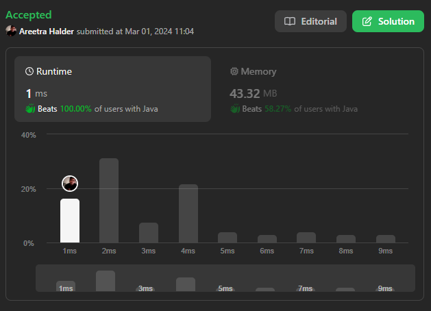

# 🔥✅✅ Beats 100% with Proof | Very Easy to Understand ✅✅🔥

**Author:** areetrahalder
**Votes:** 5
**Link:** [https://leetcode.com/problems/maximum-odd-binary-number/solutions/4803585/](https://leetcode.com/problems/maximum-odd-binary-number/solutions/4803585/)

---

# Proof - Upvote if you are watching the proof



# Intuition
<!-- Describe your first thoughts on how to solve this problem. -->
The goal is to create the maximum odd binary number by rearranging the bits. Since we need to maximize the number, we want the rightmost bit to be '1'. To achieve this, we count the number of '1's and '0's in the given binary string. We place all the '1's before the final '1' and then fill the remaining positions with '0's.

# Approach
<!-- Describe your approach to solving the problem. -->
1. Count the number of '1's and '0's in the given binary string.
2. Initialize an array to store the result.
3. Iterate through the array and fill the first `count1 - 1` positions with '1'.
4. Fill the next `count0` positions with '0'.
5. Set the last position to '1'.
6. Convert the array to a string and return the result.

# Complexity
- Time complexity: $$O(n)$$
> where n is the length of the input string.
<!-- Add your time complexity here, e.g. $$O(n)$$ -->

- Space complexity: $$O(n)$$
> as we use an array of length n to store the result.
<!-- Add your space complexity here, e.g. $$O(n)$$ -->

# Code
```Java []
class Solution {
    public String maximumOddBinaryNumber(String s) {
        int count1 = 0, count0 = 0, i = 0;
        for (char ch : s.toCharArray()) {
            if (ch == '1') {
                count1++;
            }
            else {
                count0++;
            }
        }
        char[] result = new char[s.length()];
        while(i < count1 - 1) {
            result[i++] = '1';
        }        
        while(i < count1 - 1 + count0) {
            result[i++] = '0';
        }
        result[i] = '1';
        
        return new String(result);
    }
}
```
```C []
char* maximumOddBinaryNumber(char* s) {
    int count1 = 0, count0 = 0, i = 0;
    int len = strlen(s);

    for (int j = 0; j < len; j++) {
        if (s[j] == '1') {
            count1++;
        } else {
            count0++;
        }
    }

    char* result = (char*)malloc((len + 1) * sizeof(char));
    memset(result, '0', len);
    result[len] = '\\0';

    while (i < count1 - 1) {
        result[i++] = '1';
    }

    while (i < count1 - 1 + count0) {
        result[i++] = '0';
    }

    result[i] = '1';

    return result;
}

```
```C++ []
class Solution {
public:
    string maximumOddBinaryNumber(string s) {
        int count1 = 0, count0 = 0, i = 0;

        for (char ch : s) {
            if (ch == '1') {
                count1++;
            } else {
                count0++;
            }
        }

        string result(s.length(), '0');

        while (i < count1 - 1) {
            result[i++] = '1';
        }

        while (i < count1 - 1 + count0) {
            result[i++] = '0';
        }

        result[i] = '1';

        return result;
    }
};

```
```C# []
public class Solution {
    public string MaximumOddBinaryNumber(string s) {
        int count1 = 0, count0 = 0, i = 0;

        foreach (char ch in s) {
            if (ch == '1') {
                count1++;
            } else {
                count0++;
            }
        }

        char[] result = new char[s.Length];
        while (i < count1 - 1) {
            result[i++] = '1';
        }

        while (i < count1 - 1 + count0) {
            result[i++] = '0';
        }

        result[i] = '1';

        return new string(result);
    }
}
```
```Python []
class Solution(object):
    def maximumOddBinaryNumber(self, s):
        count1 = 0
        count0 = 0
        i = 0

        # Count the number of '1's and '0's
        for ch in s:
            if ch == '1':
                count1 += 1
            else:
                count0 += 1

        # Initialize the result array
        result = [''] * len(s)

        # Fill the first (count1 - 1) positions with '1'
        while i < count1 - 1:
            result[i] = '1'
            i += 1

        # Fill the next count0 positions with '0'
        while i < count1 - 1 + count0:
            result[i] = '0'
            i += 1

        # Set the last position to '1'
        result[i] = '1'

        # Convert the array to a string and return the result
        return ''.join(result)
```
```Python3 []
class Solution:
    def maximumOddBinaryNumber(self, s: str) -> str:
        count1, count0, i = 0, 0, 0
        
        # Count the number of '1's and '0's
        for ch in s:
            if ch == '1':
                count1 += 1
            else:
                count0 += 1
        
        # Initialize the result array
        result = ['0'] * len(s)
        
        # Fill the first (count1 - 1) positions with '1'
        while i < count1 - 1:
            result[i] = '1'
            i += 1
        
        # Fill the next count0 positions with '0'
        while i < count1 - 1 + count0:
            result[i] = '0'
            i += 1
        
        # Set the last position to '1'
        result[i] = '1'
        
        # Convert the array to a string and return the result
        return ''.join(result)

```
```JavaScript []
/**
 * @param {string} s
 * @return {string}
 */
var maximumOddBinaryNumber = function(s) {
    let count1 = 0, count0 = 0, i = 0;
    for (let ch of s) {
        if (ch === '1') {
            count1++;
        } else {
            count0++;
        }
    }
    let result = new Array(s.length);
    while (i < count1 - 1) {
        result[i++] = '1';
    }
    while (i < count1 - 1 + count0) {
        result[i++] = '0';
    }
    result[i] = '1';
    
    return result.join('');
};

```
```TypeScript []
function maximumOddBinaryNumber(s: string): string {
    let count1 = 0, count0 = 0, i = 0;
    for (let ch of s) {
        if (ch === '1') {
            count1++;
        } else {
            count0++;
        }
    }
    let result: string[] = new Array(s.length);
    while (i < count1 - 1) {
        result[i++] = '1';
    }
    while (i < count1 - 1 + count0) {
        result[i++] = '0';
    }
    result[i] = '1';
    
    return result.join('');
}
```

# Upvote - Please

