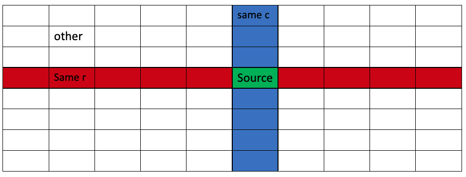
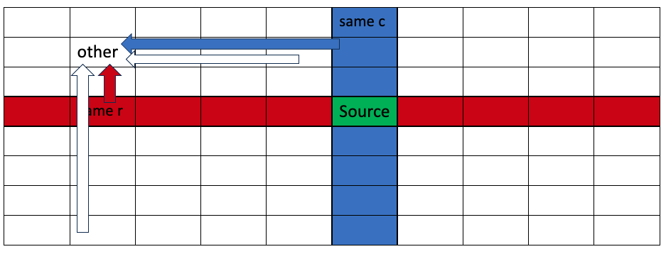

# O(K) time, O(1) space Explained with Diagrams

**Author:** lilyx998
**Votes:** 6
**Link:** [https://leetcode.com/problems/number-of-ways-to-reach-destination-in-the-grid/solutions/4209148/](https://leetcode.com/problems/number-of-ways-to-reach-destination-in-the-grid/solutions/4209148/)

---

# Intuition



We denote the matrix has `R` rows and `C` columns.

We can divide the matrix into four kinds of cells:

* `source`, which is only one cell
* `same_r` means the cells on the same row as the `source`, but not the `source`. There are `C-1` number of this kind of cells.
* `same_c` means the cells on the same column as the `source`, but not the `source`. There are `R-1` number of this kind of cells.
* All other cells are denoted as `other`.

We can see that there's some transition relationship between them in each round.

For example, 




* For an `other` cell,
    * the blue cell of the same row can become that `other` cell
    * the red cell of the same column can become that `other` cell
    * all `R-2` other cells having the same column can become that `other` cell
    * all `C-2` other cells having the same row can become that `other` cell

***


* All `same_r` and `same_c` can transition into `souce`, 

***

* For a cell of red, i.e. `same_r`
    * all `other`, quantity is `R-1`, can transition into a cell of `same_r`.
    * all `same_r`, except itself, can transition into a cell of `same_r`. 
    * `source` can transition into `same_r`.

***

* Similarly for a cell of blue, i.e. `same_c`

# Complexity
- Time complexity: $$O(k)$$
<!-- Add your time complexity here, e.g. $$O(n)$$ -->

- Space complexity: $$O(1)$$
<!-- Add your space complexity here, e.g. $$O(n)$$ -->

# Code

### C++
```c++
class Solution {
 public:
  int numberOfWays(int R, int C, int k, vector<int>& source, vector<int>& dest) {
    long MOD = 1000000007L;
    long center = 1, samer = 0, samec = 0, other = 0;
    while (k-- != 0) {
      long prev_center = center;
      long prev_samer = samer;
      long prev_samec = samec;
      long prev_other = other;
      center = (prev_samer * (C - 1) + prev_samec * (R - 1)) % MOD;
      samer = (prev_samer * (C - 2) + prev_center + prev_other * (R - 1)) % MOD;
      samec = (prev_samec * (R - 2) + prev_center + prev_other * (C - 1)) % MOD;
      other = (prev_other * (C - 2) + prev_other * (R - 2) + prev_samec + prev_samer) % MOD;
    }
    if (source[0] == dest[0] && source[1] == dest[1]) return center;
    if (source[0] == dest[0]) return samer;
    if (source[1] == dest[1]) return samec;
    return other;
  }
};
```

### Dart

```dart
class Solution {
  int numberOfWays(int R, int C, int k, List<int> source, List<int> dest) {
    const MOD = 1000000007;
    int center = 1, // for the source cell
        samer = 0,
        samec = 0,
        other = 0;
    while (k-- != 0) {
      int prev_center = center;
      int prev_samer = samer;
      int prev_samec = samec;
      int prev_other = other;
      center = (prev_samer * (C - 1) + prev_samec * (R - 1)) % MOD;
      samer = (prev_samer * (C - 2) + prev_center + prev_other * (R - 1)) % MOD;
      samec = (prev_samec * (R - 2) + prev_center + prev_other * (C - 1)) % MOD;
      other = (prev_other * (C - 2) + prev_other * (R - 2) + prev_samec +
          prev_samer) % MOD;
    }
    if (source[0] == dest[0] && source[1] == dest[1])
      return center;
    if (source[0] == dest[0])
      return samer;
    if (source[1] == dest[1])
      return samec;
    return other;
  }
}

```