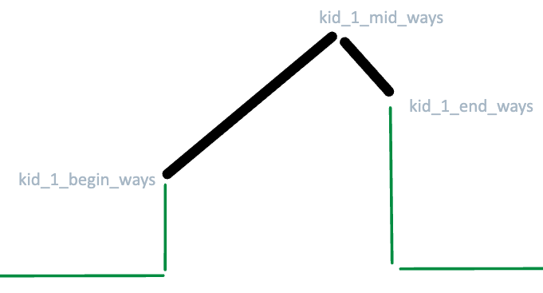
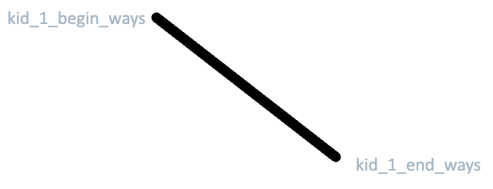
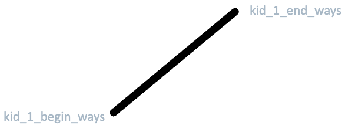

# One-side or Two-side Mountain Array (with Diagrams)

**Author:** lilyx998
**Votes:** 2
**Link:** [https://leetcode.com/problems/distribute-candies-among-children-iii/solutions/4267017/](https://leetcode.com/problems/distribute-candies-among-children-iii/solutions/4267017/)

---

# Intuition

Three possible scenarios







# Approach

Find out the two points first
* kid_1_begin_ways
* kid_1_end_ways

And check if there is a peak
* kid_1_mid_ways

Then calculate the sum of the 1-difference Arithmetic Progression

# Complexity
- Time complexity: $$O(1)$$
<!-- Add your time complexity here, e.g. $$O(n)$$ -->

- Space complexity: $$O(1)$$
<!-- Add your space complexity here, e.g. $$O(n)$$ -->

# Code
```
import 'dart:math';

class Solution {
  int distributeCandies(int n, int MAX_CAN) {
    if (n > 3 * MAX_CAN) return 0;

    // Returns the number of way if there were only two children.
    int helper2(int n) {
      if (n > 2 * MAX_CAN) return 0;
      int left = max(0, n - MAX_CAN);
      int right = min(n, MAX_CAN);
      return right + 1 - left;
    }

    final int kid_1_begin = max(0, n - 2 * MAX_CAN);
    final int kid_1_begin_ways = helper2(n - kid_1_begin);

    final int kid_1_end = min(n, MAX_CAN);
    final int kid_1_end_ways = helper2(n - kid_1_end);

    if (MAX_CAN >= (n - kid_1_end) && MAX_CAN <= (n - kid_1_begin)) {
      final int kid_1_mid_ways = MAX_CAN + 1;
      final int length_1 = kid_1_mid_ways + 1 - kid_1_begin_ways;
      final int length_2 = kid_1_mid_ways + 1 - kid_1_end_ways;
      return (kid_1_begin_ways + kid_1_mid_ways) * length_1 ~/ 2 +
          (kid_1_end_ways + kid_1_mid_ways) * length_2 ~/ 2 -
          kid_1_mid_ways;
    } else {
      final int length = kid_1_end + 1 - kid_1_begin;
      return (kid_1_begin_ways + kid_1_end_ways) * length ~/ 2;
    }
  }
}
```