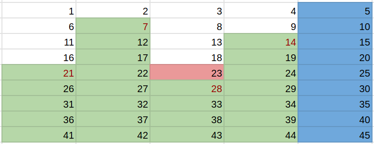

# Illustrated Explanation of p1 * p2 - p1 - p2, No Number Theory Background Required

**Author:** codeworm96
**Votes:** 17
**Link:** [https://leetcode.com/problems/most-expensive-item-that-can-not-be-bought/solutions/4480451/](https://leetcode.com/problems/most-expensive-item-that-can-not-be-bought/solutions/4480451/)

---

# Intuition
Let's take p1 = 5, p2 = 7 as an example. Arrange all positive integers in 5 columns:



All integers in the 5th column are multiples of 5, so we can get them. All integer n in the 1~4th columns, meets n % 5 == 1, n % 5 == 2, ... , n % 5 == 4.

Note that 5 * 7 (p1 * p2) is in the 5th column since it is a multiple of 5. 1 * 7, 2 * 7, ... , 4 * 7 ((p1 - 1) * p2) are located on different columns among the 1~4th columns (the red numbers) (we can prove this below). Since we can add multiples of 5 to these numbers and get the value, any integer below these numbers is obtainable (the cell is filled with green).

The answer we are looking for is the integer that just above the largest one among these numbers (the cell is marked with red). The largest one is (p1 - 1) * p2, and the step of the column is p1, so that cell is (p1 - 1) * p2 - p1. Simplify that we can get: $$(p1 - 1) * p2 - p1 = p1 * p2 - p2 - p1 = p1 * p2 - p1 - p2$$.

<hr />
1 * p2, 2 * p2, ... , (p1 - 1) * p2 are located on different columns among the 1 ~ (p1 - 1)th columns.

Proof: Since p1, p2 are primes, the least common multiple of p1, p2 is p1 * p2. Assume i * p2 and j * p2 ($$i \
eq j$$) are on the same column, which means i * p2 % p1 == j * p2 % p1. We can have (i - j) * p2 % p1 == 0, so (i - j) * p2 is a common multiple of p1, p2, and (i - j) * p2 < p1 * p2 (because i - j < p1). This is in contradiction with the fact that p1 * p2 is the least common multiple of p1, p2.

So they must be on different columns.

# Complexity
- Time complexity: $$O(1)$$

- Space complexity: $$O(1)$$

# Code
```
class Solution {
public:
    int mostExpensiveItem(int primeOne, int primeTwo) {
        return primeOne * primeTwo - primeOne - primeTwo;
    }
};
```