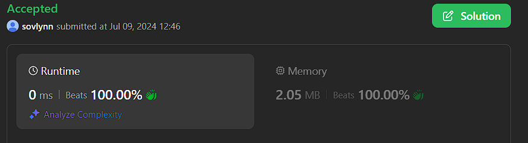

# rust 0ms simple solution with explain

**Author:** sovlynn
**Votes:** 0
**Link:** [https://leetcode.com/problems/count-the-number-of-powerful-integers/solutions/5443783/](https://leetcode.com/problems/count-the-number-of-powerful-integers/solutions/5443783/)

---




# Intuition
let $dp[i].0$ be the num with specific prefix and specific numeric limit less or equal than $n[i..]$, and $dp[i].1$ be the number with such prefix and limit with no limit.

We have.

$$dp[i].1=dp[i+1].1*(limit+1)$$
and
$$dp[i].0=min(limit+1, n[i])*dp[i+1].1+if ni<=limit{dp[i+1].0}else{0};$$

# Complexity
- Time complexity:
$$O(\\log(n))$$
- Space complexity:
$$O(\\log(n))$$

# Code
```
impl Solution {
    pub fn number_of_powerful_int(start: i64, finish: i64, limit: i32, s: String) -> i64 {
        let s=s.as_bytes();
        Self::count(finish, limit, s)-Self::count(start-1, limit, s)
    }

    fn count(n: i64, limit: i32, s: &[u8])->i64{
        let limit=limit as i64;
        let n=n.to_string();
        let n=n.as_bytes();
        if n.len()<s.len(){return 0;}
        let mut dp=vec![(0i64, 0i64); n.len()-s.len()+1];
        dp[n.len()-s.len()]=(if Self::greater(&n[(n.len()-s.len())..], s){1}else{0}, 1);

        for i in (0..dp.len()-1).rev(){
            let ni=(n[i]-b'0') as i64;
            dp[i].1=dp[i+1].1*(limit+1);
            dp[i].0=ni.min(limit+1)*dp[i+1].1+if ni<=limit{dp[i+1].0}else{0};
        }
        dp[0].0
    }

    fn greater(n: &[u8], s: &[u8])->bool{
        for i in 0..n.len(){
            if n[i]<s[i]{
                return false;
            }else if n[i]>s[i]{
                return true;
            }
        }
        true
    }
}

```