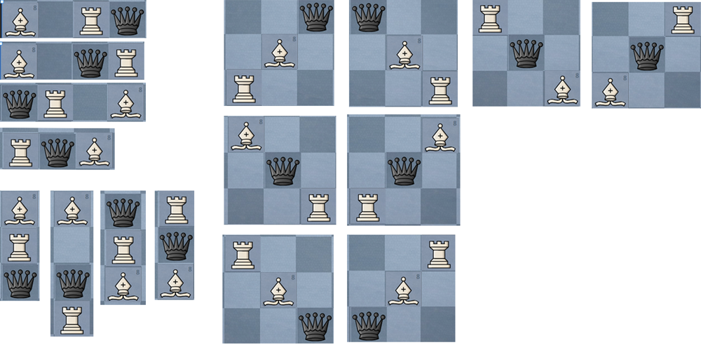

# Solution + image

**Author:** Gwilom
**Votes:** 0
**Link:** [https://leetcode.com/problems/minimum-moves-to-capture-the-queen/solutions/5700231/](https://leetcode.com/problems/minimum-moves-to-capture-the-queen/solutions/5700231/)

---

Valid edge cases



# Code
```csharp []
public class Solution 
{
    public int MinMovesToCaptureTheQueen(int r1, int r2, int b1, int b2, int q1, int q2)
    {
        bool rook = r1 == q1 && (r1 != b1 || q2 > r2 && r2 > b2 || r2 > q2 && q2 > b2 || b2 > r2 && r2 > q2 || b2 > q2 && q2 > r2)
            || r2 == q2 && (r2 != b2 || q1 > r1 && r1 > b1 || r1 > q1 && q1 > b1 || b1 > r1 && r1 > q1 || b1 > q1 && q1 > r1);
        if (rook) { return 1; }

        //sum and delta to determine if pieces are on same diag
        int r_sum = r1 + r2; int b_sum = b1 + b2; int q_sum = q1 + q2;
        int r_delta = r1 - r2; int b_delta = b1 - b2; int q_delta = q1 - q2;
        
        bool bishop = (q_sum == b_sum || q_delta == b_delta)
            && ((b_sum != r_sum && b_delta != r_delta) || q2 < b2 && b2 < r2 || b2 < q2 && q2 < r2 || r2 < b2 && b2 < q2 || r2 < q2 && q2 < b2);

        return bishop ? 1 : 2;
    }
}
```