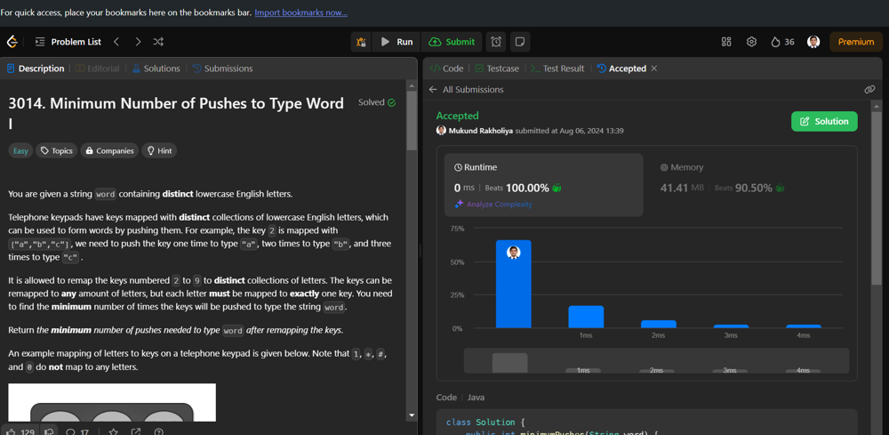

# ✅ O(1) TC & SC | 💯 Beats | ⭐ Java - C++ - Python - C# - C Kotlin | ✨ 6 Languages

**Author:** mukund_rakholiya
**Votes:** 4
**Link:** [https://leetcode.com/problems/minimum-number-of-pushes-to-type-word-i/solutions/5595817/](https://leetcode.com/problems/minimum-number-of-pushes-to-type-word-i/solutions/5595817/)

---


```
```
# Intuition
<!-- Describe your first thoughts on how to solve this problem. -->
**To determine the minimum number of button pushes required to type out a given word, we can break down the problem based on the length of the word. Each character in the word requires a different number of pushes depending on its position within the word, and we can simplify this by using predefined thresholds.**
```
```
# Approach
<!-- Describe your approach to solving the problem. -->
1. **Determine Length:**

    - Use strlen to get the length of the input string word.

2. **Calculate Pushes Based on Length:**

    - Use a series of conditional checks to determine how many pushes are needed based on the length of the word.
    - For lengths up to 8 characters, return the length as each character requires one push.
    - For lengths up to 16 characters, the first 8 characters require one push each, and the remaining characters require two pushes each.
    - For lengths up to 24 characters, the first 8 characters require one push each, the next 8 characters require two pushes each, and the remaining characters require three pushes each.
    - Special handling for words exactly 25 or 26 characters long.

3. **Return Result:**

    - The final value in a will be the minimum number of button pushes required.
    
```
```
# Complexity
- Time complexity:
<!-- Add your time complexity here, e.g. $$O(n)$$ -->
**Time complexity is $$O(1)$$ because the code is done in constant time of 1.**
- Space complexity:
<!-- Add your space complexity here, e.g. $$O(n)$$ -->
**Space complexity is $$O(1)$$ because the code is done in constant space of 1.**
```
```
# Code
```Java []
class Solution {
    public int minimumPushes(String word) {
        int n = word.length();
        int a = 0, b = n;

        if (b > 8) a = a + 8;
        else return (a + b);

        if (b > 16) a = a + 8 * 2;
        else return (a + (b - 8) * 2);

        if (b > 24) a = a + 8 * 3;
        else return (a + (b - 16) * 3);

        if (b == 25) a = a + 4;

        if (b == 26) a = a + 8;

        return a;
    }
}
```
```Python []
class Solution(object):
    def minimumPushes(self, word):
        n = len(word)
        a, b = 0, n

        if b > 8:
            a += 8
        else:
            return a + b

        if b > 16:
            a += 8 * 2
        else:
            return a + (b - 8) * 2

        if b > 24:
            a += 8 * 3
        else:
            return a + (b - 16) * 3

        if b == 25:
            a += 4

        if b == 26:
            a += 8

        return a
```
```C++ []
class Solution {
public:
    int minimumPushes(string word) {
        int n = word.length();
        int a = 0, b = n;

        if (b > 8) a += 8;
        else return (a + b);

        if (b > 16) a += 8 * 2;
        else return (a + (b - 8) * 2);

        if (b > 24) a += 8 * 3;
        else return (a + (b - 16) * 3);

        if (b == 25) a += 4;

        if (b == 26) a += 8;

        return a;
    }
};
```
```C# []
public class Solution {
    public int MinimumPushes(string word) {
         int n = word.Length;
        int a = 0, b = n;

        if (b > 8) a += 8;
        else return (a + b);

        if (b > 16) a += 8 * 2;
        else return (a + (b - 8) * 2);

        if (b > 24) a += 8 * 3;
        else return (a + (b - 16) * 3);

        if (b == 25) a += 4;

        if (b == 26) a += 8;

        return a;
    }
}
```
```Kotlin []
class Solution {
    fun minimumPushes(word: String): Int {
        val n = word.length
        var a = 0
        val b = n

        if (b > 8) a += 8
        else return a + b

        if (b > 16) a += 8 * 2
        else return a + (b - 8) * 2

        if (b > 24) a += 8 * 3
        else return a + (b - 16) * 3

        if (b == 25) a += 4

        if (b == 26) a += 8

        return a
    }
}
```
```C []
int minimumPushes(char* word) {
    int n = strlen(word);
    int a = 0, b = n;

    if (b > 8) a += 8;
    else return (a + b);

    if (b > 16) a += 8 * 2;
    else return (a + (b - 8) * 2);

    if (b > 24) a += 8 * 3;
    else return (a + (b - 16) * 3);

    if (b == 25) a += 4;

    if (b == 26) a += 8;

    return a;
}
```


