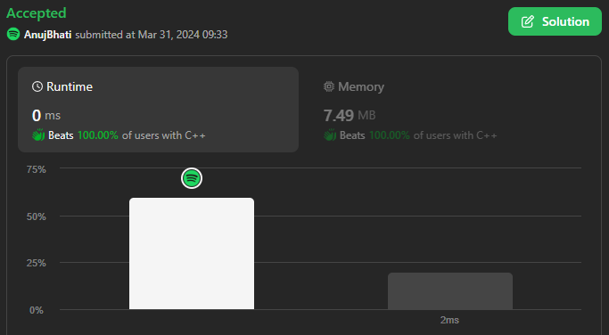
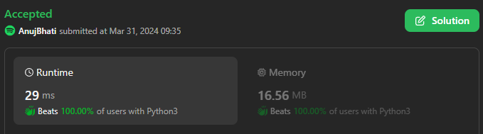
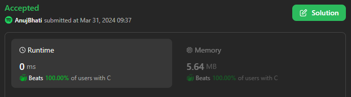
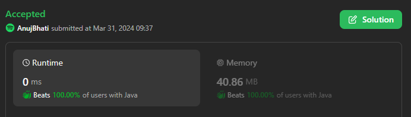
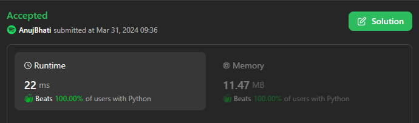

# This is best 5 languages solution C++ / Python3 / Java / C / Python / C#

**Author:** Edwards310
**Votes:** 2
**Link:** [https://leetcode.com/problems/water-bottles-ii/solutions/4949728/](https://leetcode.com/problems/water-bottles-ii/solutions/4949728/)

---

# Intuition





```c++ []
class Solution {
public:
    int maxBottlesDrunk(int a, int b) {
        int ans = 0;
        int x = 0;
        while (a) {
            ++ans, ++x, --a;
            if (x >= b) {
                x -= b;
                ++a;
                ++b;
            }
        }
        return ans;
    }
};
```
```python3 []
class Solution:
    def maxBottlesDrunk(self, numBottles: int, numExchange: int) -> int:
        res = 0
        while True:
            if numBottles >= numExchange:
                res += numExchange
                numBottles -= numExchange - 1
                numExchange += 1
            else:
                res += numBottles
                break
        return res
```
```Java []
class Solution {
    public int maxBottlesDrunk(int numBottles, int numExchange) {
        int cnt = 0;
        int c1 = numBottles, c2 = 0;
        while (c1 > 0 || c2 >= numExchange) {
            if (c1 > 0) {
                c1--;
                c2++;
                cnt++;
            } else if (c2 >= numExchange) {
                c2 -= numExchange;
                c1++;
                numExchange++;
            }
        }
        return cnt;
    }
}
```
```C []
int maxBottlesDrunk(int a, int b) {
    int ans = 0;
    int x = 0;
    while (a) {
        ++ans, ++x, --a;
        if (x >= b) {
            x -= b;
            ++a;
            ++b;
        }
    }
    return ans;
}
```
```python []
class Solution(object):
    def maxBottlesDrunk(self, numBottles, numExchange):
        """
        :type numBottles: int
        :type numExchange: int
        :rtype: int
        """
        res = 0
        while True:
            if numBottles >= numExchange:
                res += numExchange
                numBottles -= numExchange - 1
                numExchange += 1
            else:
                res += numBottles
                break
        return res
```


<!-- Describe your first thoughts on how to solve this problem. -->

# Approach
<!-- Describe your approach to solving the problem. -->

# Complexity
- Time complexity:
<!-- Add your time complexity here, e.g. $$O(n)$$ -->
    O(n)
- Space complexity:
<!-- Add your space complexity here, e.g. $$O(n)$$ -->
    O(1)
# Code
```
int maxBottlesDrunk(int a, int b) {
    int ans = 0;
    int x = 0;
    while (a) {
        ++ans, ++x, --a;
        if (x >= b) {
            x -= b;
            ++a;
            ++b;
        }
    }
    return ans;
}
```
# Please upvote if it's useful

