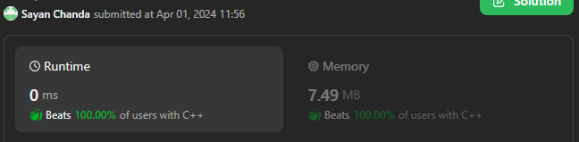
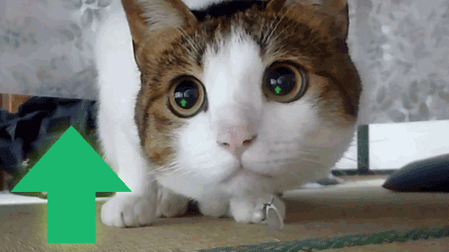

# ✅Beats 100.00% 🔥 || C++ || Java || C# || Easy Explanation || Beginner Friendly🔥🔥🔥

**Author:** Sayan98
**Votes:** 1
**Link:** [https://leetcode.com/problems/water-bottles-ii/solutions/4955742/](https://leetcode.com/problems/water-bottles-ii/solutions/4955742/)

---



# Intuition
The problem is to find the maximum number of bottles that can be drunk given a certain number of empty bottles that can be exchanged for full bottles. The key insight is to keep track of the number of empty bottles and the number of full bottles that can be obtained by exchanging the empty bottles.

# Approach
- Initialize a variable **count** to store the total number of bottles that can be drunk, initially set to numBottles.
- **numExchange** is decremented by 1 to account for the initial full bottle not being obtained through exchange.
- The loop continues as long as **numBottles** (full bottles) is greater than **0** after subtracting the exchange cost (**numExchange - 1**). This ensures we have enough full bottles to exchange for more.
- **Inside the loop**:
    - **numBottles** is decremented by the exchange cost (**numExchange - 1**).
    - **numExchange** is incremented by **1**. This simulates the exchange process, where a full bottle is "spent" and the exchange rate increases by **1**.
    - **count** is incremented to account for the newly acquired bottle through exchange.
- After the loop finishes, the final **count** is returned, representing the total number of bottles drunk.

# Complexity
- Time complexity: **O(n)**
Where **n** is the number of exchanges. This is because the loop runs for each exchange, and the number of exchanges is directly proportional to the input size.

- Space complexity: **O(1)**
- It only uses a constant amount of extra space for variables like **count**, **numBottles**, and **numExchange**.

    
```C++ []
class Solution {
public:
    int maxBottlesDrunk(int numBottles, int numExchange) {
        auto count = numBottles;
        numExchange--;
        while((numBottles -= numExchange++) > 0) count++;
        return count;
    }
};
```
```Java []
class Solution {
    public int maxBottlesDrunk(int numBottles, int numExchange) {
        var count = numBottles;
        numExchange--;
        while((numBottles -= numExchange++) > 0) count++;
        return count;
    }
}
```
```C# []
public class Solution {
    public int MaxBottlesDrunk(int numBottles, int numExchange) {
        var count = numBottles;
        numExchange--;
        while((numBottles -= numExchange++) > 0) count++;
        return count;
    }
}
```
```Dart []
class Solution {
  int maxBottlesDrunk(int numBottles, int numExchange) {
        var count = numBottles;
        numExchange--;
        while((numBottles -= numExchange++) > 0) count++;
        return count;
  }
}
```