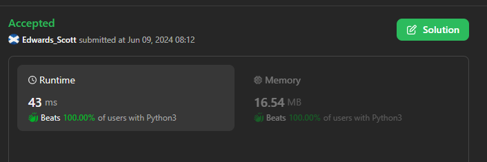
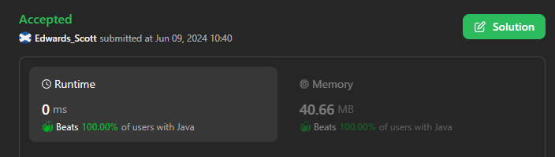
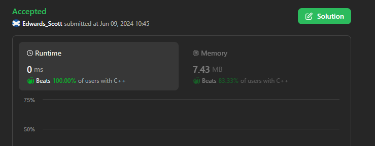
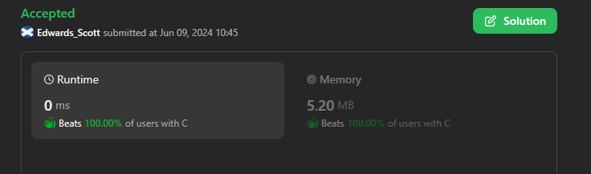

# 💢☠💫Easiest👾Faster✅💯 Lesser🧠 🎯 C++✅Python3🐍✅Java✅C✅Python🐍✅💥🔥💫Explained☠💥🔥 Beats 💯

**Author:** Edwards310
**Votes:** 4
**Link:** [https://leetcode.com/problems/find-the-child-who-has-the-ball-after-k-seconds/solutions/5282206/](https://leetcode.com/problems/find-the-child-who-has-the-ball-after-k-seconds/solutions/5282206/)

---

# Intuition





<!-- Describe your first thoughts on how to solve this problem. -->
```Python3 []
class Solution:
    def numberOfChild(self, n: int, k: int) -> int:
        cycle_length = 2 * (n - 1)  # Length of one cycle
        remainder = k % cycle_length  # Remainder after k seconds
    
        if remainder < n:  # Ball is within the range [0, n-1]
            return remainder
        else:  # Ball is within the range [n, 2 * (n - 1)]
            return cycle_length - remainder
```
```C++ []
class Solution {
public:
    int numberOfChild(int n, int k) {
        int j = 0;
        int d = 1;
        while (k--) {
            j += d;
            if (j == n - 1 || j == 0)
                d *= -1;
        }
        return j;
    }
};
```
```Java []
class Solution {
    public int numberOfChild(int n, int k) {
        int j = 0, d = 1;
        while (k-- != 0) {
            j += d;
            if (j == n - 1 || j == 0)
                d *= -1;
        }
        return j;
    }
}
```
```Python []
class Solution(object):
    def numberOfChild(self, n, k):
        """
        :type n: int
        :type k: int
        :rtype: int
        """
        c = 2 * (n -1)
        r = k % c
        return r if r < n else c - r
```
```C []
int numberOfChild(int n, int k) {
    int c = 2 * (n - 1);
    int r = k % c;
    return r < n ? r : c - r;
}
```


# Approach
<!-- Describe your approach to solving the problem. -->

# Complexity
- Time complexity:
<!-- Add your time complexity here, e.g. $$O(n)$$ -->
     O(1)
- Space complexity:
<!-- Add your space complexity here, e.g. $$O(n)$$ -->
     O(1)
# Code
```
class Solution:
    def numberOfChild(self, n: int, k: int) -> int:
        cycle_length = 2 * (n - 1)  # Length of one cycle
        remainder = k % cycle_length  # Remainder after k seconds
    
        if remainder < n:  # Ball is within the range [0, n-1]
            return remainder
        else:  # Ball is within the range [n, 2 * (n - 1)]
            return cycle_length - remainder
```
# ***Please Upvote if it's useful for you***

