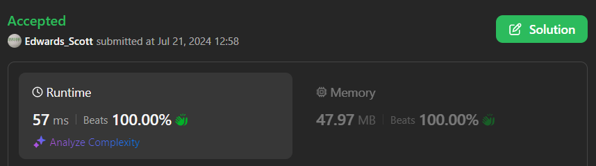

# 💢☠💫Easiest👾Faster✅💯 Lesser🧠 🎯 C++✅Python3🐍✅Java✅C✅Python🐍✅C#✅💥🔥💫Explained☠💥🔥 Beats 💯

**Author:** Edwards310
**Votes:** 2
**Link:** [https://leetcode.com/problems/vowels-game-in-a-string/solutions/5510289/](https://leetcode.com/problems/vowels-game-in-a-string/solutions/5510289/)

---

# Intuition


```C++ []
// Start Of Anuj Bhati aka Edwards310's Template...
#include <bits/stdc++.h>
using namespace std;
using namespace __gnu_pbds;

#define FOR(a, b, c) for (int a = b; a < c; a++)
#define FOR1(a, b, c) for (int a = b; a <= c; ++a)
#define Rep(i, n) FOR (i, 0, n)
#define Rep1(i, n) FOR1(i, 1, n)

// end of Anuj Bhati's aka Edwards310's Template
class Solution {
public:
    bool doesAliceWin(string s) {
        string help = "aeiou";
        int cnt = 0;
        Rep(i, s.length()){
            if(help.find(s[i]) != string::npos)
                cnt++;
        }
        return cnt;
    }
};
```
```Python3 []
class Solution:
    def doesAliceWin(self, s: str) -> bool:
        cnt = 0
        string = "aeiou"
        for c in s:
            if c in string:
                cnt += 1
        return cnt
```
```C# []
public class Solution {
    public bool DoesAliceWin(string s) {
        var cnt = 0;
        foreach(char c in s){
            if (c  == 'a' || c == 'e' || c == 'i' || c == 'o' || c == 'u')
                cnt++;
        }
        return cnt > 0;
    }
}
```
```Java []
class Solution {
    public boolean doesAliceWin(String s) {
        String help = "aeiou";
        int cnt = 0;
        for(char c : s.toCharArray()){
            if(help.indexOf(c) != -1)
                cnt++;
        }
        return cnt > 0;
    }
}
```
```Python []
class Solution(object):
    def doesAliceWin(self, s):
        """
        :type s: str
        :rtype: bool
        """
        cnt = 0
        string = "aeiou"
        for c in s:
            if c in string:
                cnt += 1

        return cnt
```
```C []
bool doesAliceWin(char* s) {
    int cnt = 0;
    while (*s) {
        if (*s == 'a' || *s == 'e' || *s == 'i' || *s == 'o' || *s == 'u')
            cnt++;
        *s++;
    }
    return cnt;
}
```

<!-- Describe your first thoughts on how to solve this problem. -->

# Approach
<!-- Describe your approach to solving the problem. -->

# Complexity
- Time complexity:
<!-- Add your time complexity here, e.g. $$O(n)$$ -->
     O(n)
- Space complexity:
<!-- Add your space complexity here, e.g. $$O(n)$$ -->
     O(1)
# Code
```
public class Solution {
    public bool DoesAliceWin(string s) {
        var cnt = 0;
        foreach(char c in s){
            if (c  == 'a' || c == 'e' || c == 'i' || c == 'o' || c == 'u')
                cnt++;
        }
        return cnt > 0;
    }
}
```