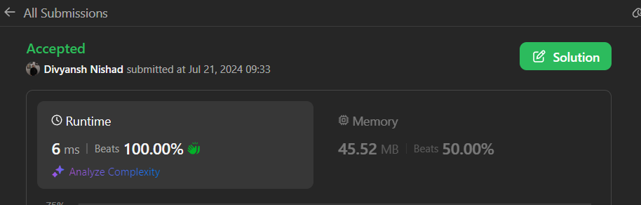

# ✅Beats 100% -Explained with [ Video ] -C++/Java/Python/JS - Single Pass - Explained in Detail

**Author:** millenium103
**Votes:** 15
**Link:** [https://leetcode.com/problems/vowels-game-in-a-string/solutions/5509406/](https://leetcode.com/problems/vowels-game-in-a-string/solutions/5509406/)

---



# Intuition
<!-- Describe your first thoughts on how to solve this problem. -->
The game is played by Alice and Bob where each has specific rules about the substrings they can remove based on the number of vowels in them. Alice can remove substrings with an odd number of vowels, and Bob can remove substrings with an even number of vowels. Both players play optimally, and Alice goes first.

The core idea of the solution is to determine whether Alice has any valid move at the beginning of the game. If Alice can make a move, she wins because she will always play optimally. Conversely, if Alice cannot make a move, she loses.

# Approach
<!-- Describe your approach to solving the problem. -->
1. **Check for Vowels**: Iterate through the string and check for the presence of vowels.
2. **Immediate Win for Alice**: If there is at least one vowel in the string, Alice can always win because she can remove any substring containing an odd number of vowels.
3. **No Vowels Scenario**: If the string has no vowels, Alice cannot make any move initially, and therefore, she loses immediately.

# Complexity
- **Time Complexity**: \\(O(n)\\)
  - The algorithm iterates through the string once to check for vowels, making it linear in relation to the length of the string.
- **Space Complexity**: \\(O(1)\\)
  - The algorithm uses a constant amount of space to store the count and the result of the vowel check.


# Example Explanation

To explain the logic using tables, we can break down the input string and check each character to determine if it is a vowel:

#### Example 1: Input "leetcoder"

| Character | Is Vowel? |
|-----------|-----------|
| l         | No        |
| e         | Yes       |
| e         | Yes       |
| t         | No        |
| c         | No        |
| o         | Yes       |
| d         | No        |
| e         | Yes       |
| r         | No        |

Since there are vowels present (`e`, `e`, `o`, `e`), Alice can make a move initially and thus wins the game.

#### Example 2: Input "bbcd"

| Character | Is Vowel? |
|-----------|-----------|
| b         | No        |
| b         | No        |
| c         | No        |
| d         | No        |

Since there are no vowels present, Alice cannot make a move initially and thus loses the game.

This approach ensures that the solution is easy to understand and follow, making it clear why Alice wins or loses based on the presence of vowels in the string.


# Code
```java []
class Solution {
    public boolean doesAliceWin(String s) {
        int count = 0;
        
        for (char c : s.toCharArray()){
            if (isVowel(c))
                return true;
        }
        
        return false;
    }
    
    private boolean isVowel(char c) {
        return c == 'a' || c == 'i' || c == 'e' || c == 'o' || c == 'u';
    }
}
```
```C++ []
class Solution {
public:
    bool doesAliceWin(string s) {
        for (char c : s) {
            if (isVowel(c)) {
                return true;
            }
        }
        return false;
    }
    
private:
    bool isVowel(char c) 
    {
        return c == 'a' || c == 'i' || c == 'e' || c == 'o' || c == 'u';
    }
};

```
```Python []
class Solution(object):
    def doesAliceWin(self, s):
        return any(c in 'aeiou' for c in s)
        

```
```JavaScript []
var doesAliceWin = function(s) {
    for (let c of s) {
        if (isVowel(c)) {
            return true;
        }
    }
    return false;
};

function isVowel(c) {
    return c === 'a' || c === 'e' || c === 'i' || c === 'o' || c === 'u';
}
```

