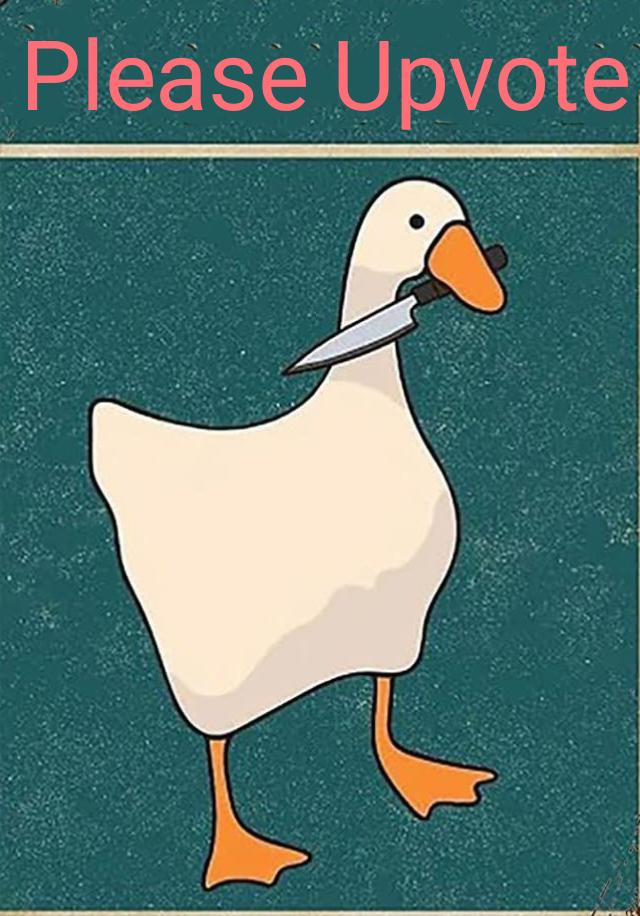

# 100% beat |3 Lines Code | Super Easy | T.C & S.C O(1) | C++, C, Python, Java and JavaScript Solution

**Author:** mammarqaisar11a55
**Votes:** 5
**Link:** [https://leetcode.com/problems/check-if-two-chessboard-squares-have-the-same-color/solutions/5718345/](https://leetcode.com/problems/check-if-two-chessboard-squares-have-the-same-color/solutions/5718345/)

---

**Time Complexity**: O(1)
**Space Complexity**: O(1)

**C++:**
```
class Solution {
public:
    bool checkTwoChessboards(string coordinate1, string coordinate2) {
        
        bool C1 = (coordinate1[0] + coordinate1[1])%2;
        bool C2 = (coordinate2[0] + coordinate2[1])%2;
        
        return C1 == C2 ? true : false;
        
    }
};
```

**Python:**

```
class Solution:
    def checkTwoChessboards(self, coordinate1: str, coordinate2: str) -> bool:
        C1 = (ord(coordinate1[0]) + ord(coordinate1[1])) % 2
        C2 = (ord(coordinate2[0]) + ord(coordinate2[1])) % 2
        
        return C1 == C2

```

**C:**

```
#include <stdbool.h>

bool checkTwoChessboards(char* coordinate1, char* coordinate2) {
    
    bool C1 = (coordinate1[0] + coordinate1[1]) % 2;
    bool C2 = (coordinate2[0] + coordinate2[1]) % 2;
    
    return C1 == C2;
}


```

**Java:**

```
class Solution {
    public boolean checkTwoChessboards(String coordinate1, String coordinate2) {
        
        boolean C1 = (coordinate1.charAt(0) + coordinate1.charAt(1)) % 2 != 0;
        boolean C2 = (coordinate2.charAt(0) + coordinate2.charAt(1)) % 2 != 0;
        
        return C1 == C2;
    }
}


```

**JavaScript:**

```
class Solution {
    checkTwoChessboards(coordinate1, coordinate2) {
        const C1 = (coordinate1.charCodeAt(0) + coordinate1.charCodeAt(1)) % 2;
        const C2 = (coordinate2.charCodeAt(0) + coordinate2.charCodeAt(1)) % 2;

        return C1 === C2;
    }
}


```

Please Upvote : ) 



Please Upvote : )

