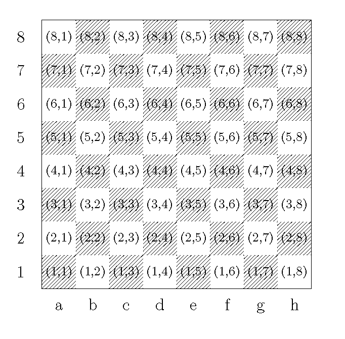

# Simple Trick - Detailed Explanation with Image

**Author:** muhammadfarhankt
**Votes:** 3
**Link:** [https://leetcode.com/problems/check-if-two-chessboard-squares-have-the-same-color/solutions/5718006/](https://leetcode.com/problems/check-if-two-chessboard-squares-have-the-same-color/solutions/5718006/)

---

## Don't look at code first, Try solving the problem using the approach and examples below



Image Reference : https://tex.stackexchange.com/questions/168281/how-to-draw-a-chessboard-with-numbers

# Approach
1. Convert the Column to a Number:
    - Each column on the chessboard corresponds to a letter from 'a' to 'h'. To work with these more easily, we convert the letter to a number by subtracting 'a' from it and adding 1. For example, 'a' becomes 1, 'b' becomes 2, and so on up to 'h' which becomes 8.
2. Use the Row as a Number:
    - The row number is already given as a number (from '1' to '8'), so we can use it directly.
3. Calculate the Color:
    - Add the column number and the row number together. If the sum is even, the square is black. If the sum is odd, the square is white.
4. Compare the Two Squares:
    - If both squares have the same sum parity (both even or both odd), they have the same color. Otherwise, they have different colors.

# Examples
1. Input: coordinate1 = "a1", coordinate2 = "c3"
- Calculation:
    - For "a1": Column 'a' = 1, Row '1' = 1. Sum = 1 + 1 = 2 (Even).
    - For "c3": Column 'c' = 3, Row '3' = 3. Sum = 3 + 3 = 6 (Even).
    - Result: Both sums are even, so both squares are black. The function returns true.
2. Input: coordinate1 = "a1", coordinate2 = "h3"
- Calculation:
    - For "a1": Column 'a' = 1, Row '1' = 1. Sum = 1 + 1 = 2 (Even).
    - For "h3": Column 'h' = 8, Row '3' = 3. Sum = 8 + 3 = 11 (Odd).
    - Result: One sum is even and the other is odd, so the squares are different colors. The function returns false.

# Complexity
- Time complexity: O(1) because we only perform a fixed number of operations regardless of the input size.
- Space complexity: O(1) because we only use a constant amount of space for variables, and no additional data structures are needed.

# Code

```Golang []
func checkTwoChessboards(coordinate1 string, coordinate2 string) bool {
    val1 := (int(coordinate1[0]) - int('a') + 1 + int(coordinate1[1]) - int('0'))
    val2 := (int(coordinate2[0]) - int('a') + 1 + int(coordinate2[1]) - int('0'))
    return (val1 % 2) == (val2 % 2)
}
```
```Java []
class Solution {
    public boolean checkTwoChessboards(String coordinate1, String coordinate2) {
        int val1 = (coordinate1.charAt(0) - 'a' + 1 + coordinate1.charAt(1) - '0');
        int val2 = (coordinate2.charAt(0) - 'a' + 1 + coordinate2.charAt(1) - '0');
        return (val1 % 2) == (val2 % 2);
    }
}
```
```C++ []
class Solution {
public:
    bool checkTwoChessboards(string coordinate1, string coordinate2) {
        int val1 = (coordinate1[0] - 'a' + 1 + coordinate1[1] - '0');
        int val2 = (coordinate2[0] - 'a' + 1 + coordinate2[1] - '0');
        return (val1 % 2) == (val2 % 2);
    }
};
```
```Python3 []
class Solution:
    def checkTwoChessboards(self, coordinate1: str, coordinate2: str) -> bool:
        val1 = (ord(coordinate1[0]) - ord('a') + 1 + int(coordinate1[1]))
        val2 = (ord(coordinate2[0]) - ord('a') + 1 + int(coordinate2[1]))
        return (val1 % 2) == (val2 % 2)
```
```Javascript []
/**
 * @param {string} coordinate1
 * @param {string} coordinate2
 * @return {boolean}
 */
var checkTwoChessboards = function(coordinate1, coordinate2) {
    const val1 = (coordinate1.charCodeAt(0) - 'a'.charCodeAt(0) + 1 + parseInt(coordinate1[1]));
    const val2 = (coordinate2.charCodeAt(0) - 'a'.charCodeAt(0) + 1 + parseInt(coordinate2[1]));
    return (val1 % 2) === (val2 % 2);
};
```
```Dart []
class Solution {
  bool checkTwoChessboards(String coordinate1, String coordinate2) {
    int val1 = (coordinate1.codeUnitAt(0) - 'a'.codeUnitAt(0) + 1 + int.parse(coordinate1[1]));
    int val2 = (coordinate2.codeUnitAt(0) - 'a'.codeUnitAt(0) + 1 + int.parse(coordinate2[1]));
    return (val1 % 2) == (val2 % 2);
  }
}
```