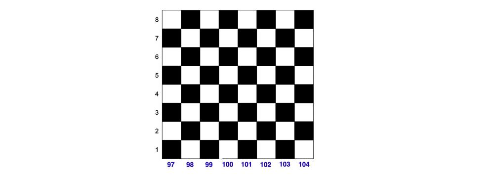

# Python3, C++ || 2 lines, even-odd parity || T/S 88% / 50%

**Author:** Spaulding_
**Votes:** 8
**Link:** [https://leetcode.com/problems/check-if-two-chessboard-squares-have-the-same-color/solutions/5718208/](https://leetcode.com/problems/check-if-two-chessboard-squares-have-the-same-color/solutions/5718208/)

---

Here's the intuition:

The rows are integer-labeled, 1 through 8, and the character-labeled, `a` through `h`. If we replace the column numbers with their respective `ord` values, the columns would be labeled 97 though 104.


From the image, we can see that the row coordinate and column coordinate of each black square has the *same* even-odd parity (both odd of both even), and while the the row coordinate and column coordinate of each white square has *different* even-odd parities.

The rest of the story is left to the reader.

_____

Here's the code:
```python3 []
class Solution:
    def checkTwoChessboards(self, coordinate1: str, coordinate2: str) -> bool:

        isBlack = lambda x: (ord(x[0]) + int(x[1])) %2 == 0

        return isBlack(coordinate1) == isBlack(coordinate2)   
```
```C++ []
class Solution {
public:
    bool checkTwoChessboards(std::string coordinate1, std::string coordinate2) {
        auto isBlack = [](const std::string& coord) {
            return (coord[0] - 'a' + 1 + (coord[1] - '0')) % 2 == 0;
        };

        return isBlack(coordinate1) == isBlack(coordinate2);
    }
};
```
[https://leetcode.com/problems/check-if-two-chessboard-squares-have-the-same-color/submissions/1374950067/](https://leetcode.com/problems/check-if-two-chessboard-squares-have-the-same-color/submissions/1374950067/)

I could be wrong, but I think that time complexity is *O*(1) and space complexity is *O*(1).