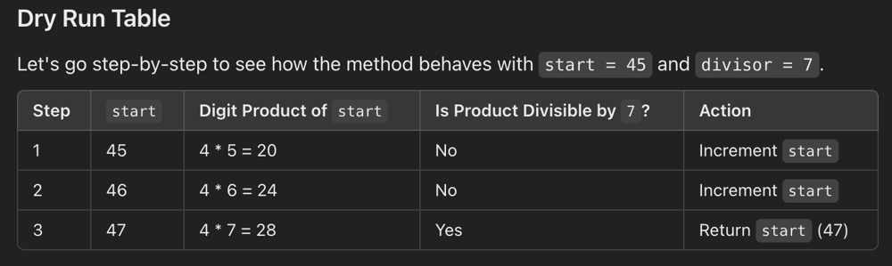

# With Dry Run Table | Easiest solution | PYTHON | JAVA | JS | CPP | 🌟 Beats 100.00% 👏

**Author:** deep94725kumar
**Votes:** 7
**Link:** [https://leetcode.com/problems/smallest-divisible-digit-product-i/solutions/6027169/](https://leetcode.com/problems/smallest-divisible-digit-product-i/solutions/6027169/)

---

# Intuition
# REMEMBER FROM LOOKING INTO CONSTRAINTS WE CAN INDENTIFY THAT IT CAN BE SOLVED BY BRUTE FORCE 

**The intuition is to start from the given number n and increment it until we find a number whose product of digits is divisible by t. We can use a loop to iterate through numbers and calculate the product of digits for each one.**

---


# Approach

<!-- Describe your approach to solving the problem. -->
- calculateDigitProduct(int number): 

    1. This function calculates the product of digits in a given number. It iterates through each digit of the number, multiplying it with the running product. 

    2. If it encounters a '0' digit, it returns 0 immediately, as any number with '0' will have a product of 0.

- smallestNumber(int start, int divisor): 

    1. This function finds the smallest number greater than or equal to start such that the product of its digits is divisible by divisor. 

    2. It uses a while loop to iterate through numbers starting from start and checks if the product of digits is divisible by divisor. 
    
    3. If it is, it returns the number. If not, it increments the number and checks again.

---
# DRY RUN 
**Start = 45 and divisor = 7.**




# Complexity
- Time complexity:
<!-- Add your time complexity here, e.g. $$O(n)$$ -->
    O(n), where n is the difference between the starting number and the smallest number satisfying the condition.

- Space complexity:
<!-- Add your space complexity here, e.g. $$O(n)$$ -->
    O(1), as we are only using a constant amount of extra space for variables.


---
# Code

```cpp []
class Solution {
public:
    int calculateDigitProduct(int number) {
        int product = 1;
        while (number > 0) {
            int digit = number % 10;
            if (digit == 0)
                return 0;
            product *= digit;
            number /= 10;
        }
        return product;
    }

    int smallestNumber(int start, int divisor) {
        while (true) {
            if (calculateDigitProduct(start) % divisor == 0) {
                return start;
            }
            start++;
        }
    }
};
```
```python []
def calculate_digit_product(number):
    """
    Calculates the product of digits in a given number.
    Returns 0 if the number contains a '0'.
    """
    product = 1
    while number > 0:
        digit = number % 10
        if digit == 0:
            return 0
        product *= digit
        number //= 10
    return product

def smallest_number(start, divisor):
    """
    Finds the smallest number greater than or equal to 'start'
    such that the product of its digits is divisible by 'divisor'.
    """
    while True:
        if calculate_digit_product(start) % divisor == 0:
            return start
        start += 1
```
```JAVA []
class Solution {
    public int calculateDigitProduct(int number) {
        int product = 1;
        while (number > 0) {
            int digit = number % 10;
            if (digit == 0) {
                return 0;
            }
            product *= digit;
            number /= 10;
        }
        return product;
    }

    public int smallestNumber(int start, int divisor) {
        while (true) {
            if (calculateDigitProduct(start) % divisor == 0) {
                return start;
            }
            start++;
        }
    }
}
```
```JAVASCRIPT []
function calculateDigitProduct(number) {
  let product = 1;
  while (number > 0) {
    let digit = number % 10;
    if (digit === 0) {
      return 0;
    }
    product *= digit;
    number = Math.floor(number / 10);
  }
  return product;
}

function smallestNumber(start, divisor) {
  while (true) {
    if (calculateDigitProduct(start) % divisor === 0) {
      return start;
    }
    start++;
  }
}
```

