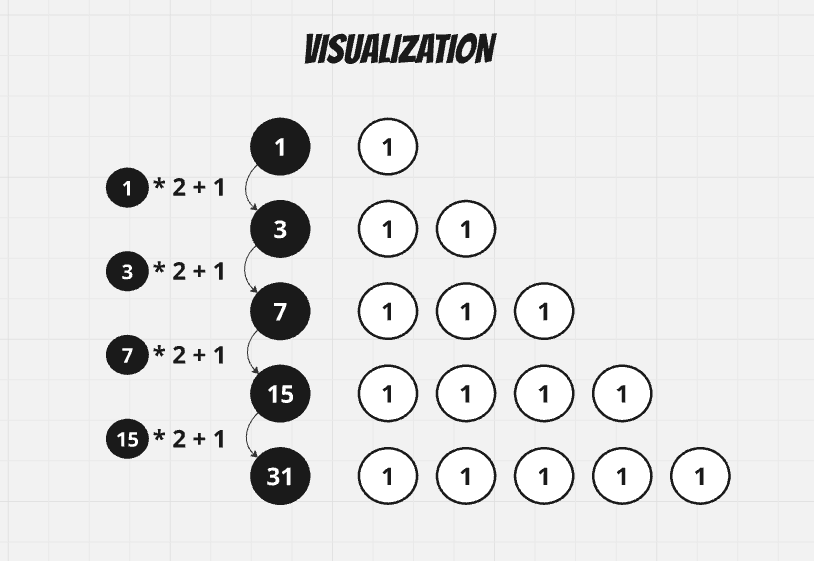

# [Swift, C++, Python3] Simplest solution 0ms O(logN)

**Author:** evkobak
**Votes:** 1
**Link:** [https://leetcode.com/problems/smallest-number-with-all-set-bits/solutions/6102971/](https://leetcode.com/problems/smallest-number-with-all-set-bits/solutions/6102971/)

---

# Intuition
The first numbers which contain only set bits are 1, 3, 7, 15, 31.
So, each next only set bits number can be calculated as `current * 2 + 1`.




# Approach
We can start from 1 and calculate next number while our number lesser than n.

# Complexity
- Time complexity:
O(logN)

- Space complexity:
O(1)


# Swift Code
```swift []
class Solution {
    func smallestNumber(_ n: Int) -> Int {
        var curr = 1
        while curr < n {
            curr = curr * 2 + 1
        }
        return curr
    }
}
```

# C++ Code
```cpp []
class Solution {
public:
    int smallestNumber(int n) {
        int curr = 1;
        while (curr < n)
            curr = curr * 2 + 1;
        return curr;
    }
};
```

# Python3 Code
```python3 []
class Solution:
    def smallestNumber(self, n: int) -> int:
        curr = 1
        while curr < n:
            curr = curr * 2 + 1
        return curr
```
