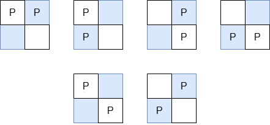

# [3426. Manhattan Distances of All Arrangements of Pieces](https://leetcode.com/problems/manhattan-distances-of-all-arrangements-of-pieces/)

| Category | Difficulty | Likes | Dislikes |
| :------: | :--------: | :---: | :------: |
| Algorithms | Hard | 40 | 10 |

**Tags:** [`math`](https://leetcode.com/tag/math), [`combinatorics`](https://leetcode.com/tag/combinatorics)

**Companies:** `google`, `rubrik`

## Description

You are given three integers `m`, `n`, and `k`.

There is a rectangular grid of size `m × n` containing `k` identical pieces. Return the sum of Manhattan distances between every pair of pieces over all **valid arrangements** of pieces.

A **valid arrangement** is a placement of all `k` pieces on the grid with **at most** one piece per cell.

Since the answer may be very large, return it **modulo** `10^9 + 7`.

The Manhattan Distance between two cells `(x_i, y_i)` and `(x_j, y_j)` is `|x_i - x_j| + |y_i - y_j|`.

 

**Example 1:**

**Input:** m = 2, n = 2, k = 2

**Output:** 8

**Explanation:**

The valid arrangements of pieces on the board are:

	- In the first 4 arrangements, the Manhattan distance between the two pieces is 1.

	- In the last 2 arrangements, the Manhattan distance between the two pieces is 2.

Thus, the total Manhattan distance across all valid arrangements is `1 + 1 + 1 + 1 + 2 + 2 = 8`.

**Example 2:**

**Input:** m = 1, n = 4, k = 3

**Output:** 20

**Explanation:**

The valid arrangements of pieces on the board are:

	- The first and last arrangements have a total Manhattan distance of `1 + 1 + 2 = 4`.

	- The middle two arrangements have a total Manhattan distance of `1 + 2 + 3 = 6`.

The total Manhattan distance between all pairs of pieces across all arrangements is `4 + 6 + 6 + 4 = 20`.

 

**Constraints:**

	- `1 <= m, n <= 10^5`

	- `2 <= m * n <= 10^5`

	- `2 <= k <= m * n`

---

**Links:** [Submissions](https://leetcode.com/problems/manhattan-distances-of-all-arrangements-of-pieces/) | [Solutions](https://leetcode.com/problems/manhattan-distances-of-all-arrangements-of-pieces/)
