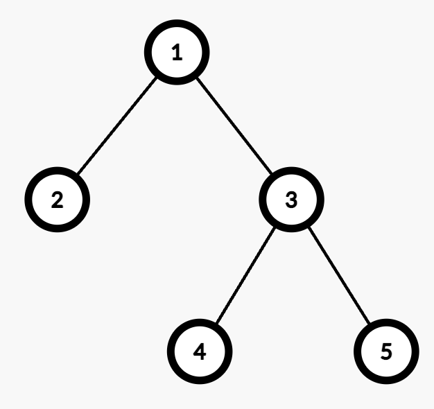

# [3558. Number of Ways to Assign Edge Weights I](https://leetcode.com/problems/number-of-ways-to-assign-edge-weights-i/)

| Category | Difficulty | Likes | Dislikes |
| :------: | :--------: | :---: | :------: |
| Algorithms | Medium | 55 | 6 |

**Tags:** [`math`](https://leetcode.com/tag/math), [`tree`](https://leetcode.com/tag/tree), [`depth-first-search`](https://leetcode.com/tag/depth-first-search)

## Description

There is an undirected tree with `n` nodes labeled from 1 to `n`, rooted at node 1. The tree is represented by a 2D integer array `edges` of length `n - 1`, where `edges[i] = [u_i, v_i]` indicates that there is an edge between nodes `u_i` and `v_i`.

Initially, all edges have a weight of 0. You must assign each edge a weight of either **1** or **2**.

The **cost** of a path between any two nodes `u` and `v` is the total weight of all edges in the path connecting them.

Select any one node `x` at the **maximum** depth. Return the number of ways to assign edge weights in the path from node 1 to `x` such that its total cost is **odd**.

Since the answer may be large, return it **modulo** `10^9 + 7`.

**Note:** Ignore all edges **not** in the path from node 1 to `x`.

 

**Example 1:**

**Input:** edges = [[1,2]]

**Output:** 1

**Explanation:**

	- The path from Node 1 to Node 2 consists of one edge (`1 &rarr; 2`).

	- Assigning weight 1 makes the cost odd, while 2 makes it even. Thus, the number of valid assignments is 1.

**Example 2:**

**Input:** edges = [[1,2],[1,3],[3,4],[3,5]]

**Output:** 2

**Explanation:**

	- The maximum depth is 2, with nodes 4 and 5 at the same depth. Either node can be selected for processing.

	- For example, the path from Node 1 to Node 4 consists of two edges (`1 &rarr; 3` and `3 &rarr; 4`).

	- Assigning weights (1,2) or (2,1) results in an odd cost. Thus, the number of valid assignments is 2.

 

**Constraints:**

	- `2 <= n <= 10^5`

	- `edges.length == n - 1`

	- `edges[i] == [u_i, v_i]`

	- `1 <= u_i, v_i <= n`

	- `edges` represents a valid tree.

---

**Links:** [Submissions](https://leetcode.com/problems/number-of-ways-to-assign-edge-weights-i/) | [Solutions](https://leetcode.com/problems/number-of-ways-to-assign-edge-weights-i/)
