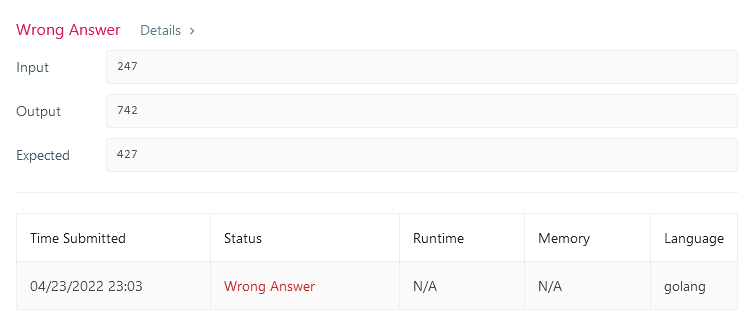

# Wrong Testcase (Solved)

**Author:** alfinm01
**Votes:** 2
**Link:** [https://leetcode.com/problems/largest-number-after-digit-swaps-by-parity/solutions/1975735/](https://leetcode.com/problems/largest-number-after-digit-swaps-by-parity/solutions/1975735/)

---

***Answer**: Apparently the testcase isn't wrong, the misunderstanding has been explained by UserASh at https://leetcode.com/problems/largest-number-after-digit-swaps-by-parity/discuss/1975735/Wrong-Testcase/1367969*

-----------------------------------------

**Wrong Testcase:**
The expected answer should be `742` thus my answer should be correct


**My Code:**
```golang
type Digit struct {
    Value int
    Index int
}

func largestInteger(num int) int {
    result := 0
    digits := make([]int, 0)
    maxParity1 := Digit{
        Value: -1,
        Index: -1,
    }
    maxParity2 := Digit{
        Value: -1,
        Index: -1,
    }
    
    i := 0
    firstParity := true
    for n := num; n > 0; n /= 10 {
        digit := n % 10
        digits = prependInt(digits, digit)
        if firstParity {
            if digit > maxParity1.Value {
                maxParity1.Value = digit
                maxParity1.Index = i
            }
        } else {
            if digit > maxParity2.Value {
                maxParity2.Value = digit
                maxParity2.Index = i
            }
        }
        i++
        firstParity = !firstParity
    }
    
    if len(digits)%2 == 0 {
        maxParity1, maxParity2 = maxParity2, maxParity1
    }
    
    for i := 0; i < len(digits); i += 2 {
        if digits[i] <= maxParity1.Value {
            digits[i], digits[len(digits)-1-maxParity1.Index] = maxParity1.Value, digits[i]
            break
        }
    }
    
    for i := 1; i < len(digits); i += 2 {
        if digits[i] <= maxParity2.Value {
            digits[i], digits[len(digits)-1-maxParity2.Index] = maxParity2.Value, digits[i]
            break
        }
    }
    
    for _, digit := range digits {
        result = result*10 + digit
    }
    
    return result
}

func prependInt(x []int, y int) []int {
    x = append(x, 0)
    copy(x[1:], x)
    x[0] = y
    
    return x
}
```

**Local Accepted Testcases:**
```
// Input
1234
65875
1
2
10
11
123456
654321
999999888
999999988
999999998
999999999
1000000000
```
```
// Output
3412
87655
1
2
10
11
563412
654321
999999888
999999988
999999998
999999999
1000000000
```