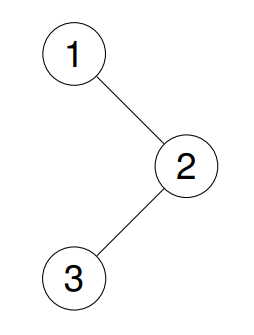

# [94. Binary Tree Inorder Traversal](https://leetcode.com/problems/binary-tree-inorder-traversal/)

| Category | Difficulty | Likes | Dislikes |
| :------: | :--------: | :---: | :------: |
| Algorithms | Easy | 14634 | 878 |

**Tags:** [`stack`](https://leetcode.com/tag/stack), [`tree`](https://leetcode.com/tag/tree), [`depth-first-search`](https://leetcode.com/tag/depth-first-search), [`binary-tree`](https://leetcode.com/tag/binary-tree)

**Companies:** `facebook`, `amazon`, `google`, `microsoft`, `bloomberg`, `tcs`, `adobe`

## Description

Given the `root` of a binary tree, return *the inorder traversal of its nodes' values*.

 

**Example 1:**

**Input:** root = [1,null,2,3]

**Output:** [1,3,2]

**Explanation:**

**Example 2:**

**Input:** root = [1,2,3,4,5,null,8,null,null,6,7,9]

**Output:** [4,2,6,5,7,1,3,9,8]

**Explanation:**

**Example 3:**

**Input:** root = []

**Output:** []

**Example 4:**

**Input:** root = [1]

**Output:** [1]

 

**Constraints:**

	- The number of nodes in the tree is in the range `[0, 100]`.

	- `-100 <= Node.val <= 100`

 

**Follow up:** Recursive solution is trivial, could you do it iteratively?

---

**Links:** [Submissions](https://leetcode.com/problems/binary-tree-inorder-traversal/) | [Solutions](https://leetcode.com/problems/binary-tree-inorder-traversal/)
