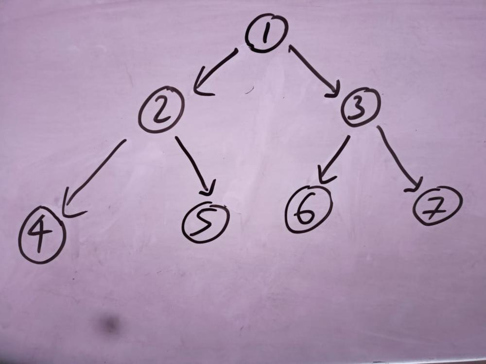
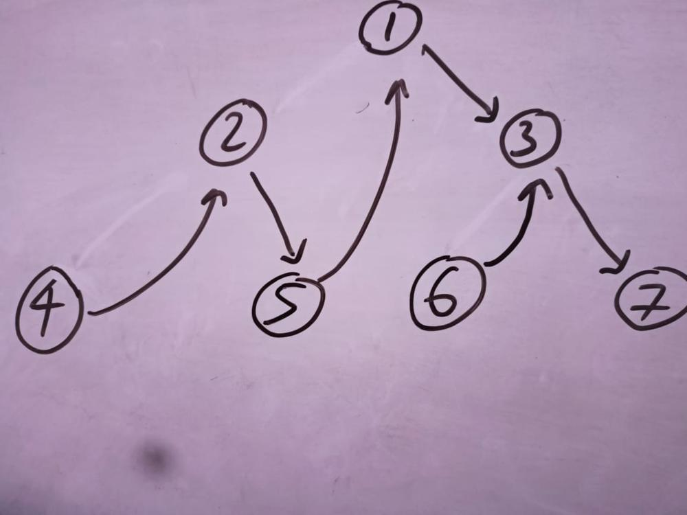

# 3 solutions | 1 recursive | 2 iterative | O(1) space complexity | morris-traversal | explained code

**Author:** crabbyD
**Votes:** 109
**Link:** [https://leetcode.com/problems/binary-tree-inorder-traversal/solutions/1377500/](https://leetcode.com/problems/binary-tree-inorder-traversal/solutions/1377500/)

---

We can solve this problem in three ways lets 1st talk about he recursive method :

**1st approach recursive**

```
void helper(TreeNode* root,vector<int>& ans)
    {
        if(root==NULL)
        {
            return ;
        }
        helper(root->left,ans);
        ans.push_back(root->val);
        helper(root->right,ans);
    }
    vector<int> inorderTraversal(TreeNode* root) {
        vector<int> ans;
        helper(root,ans);
        return ans;
            
    }
```


this approach is pretty self explanitory and i don't think it needs any explanation. 


**2nd approach**


Just use a stack

```
 vector<int> v;
    vector<int> inorderTraversal(TreeNode* root) {
        stack<TreeNode*> s;
        while(root||!s.empty()){
            if(root!=NULL){
                s.push(root);
                root=root->left;
            }
            else{
                root=s.top();
                s.pop();
                v.push_back(root->val);
                root=root->right;
            }
          }
         return v;
    }
```

and keep the nodes in the stack and just perform the left and the right operation and then just pop the stack.


**3rd approach and the most optimised approach with T.C. O(n) and S.C O(1)**

I have just used the morris-traversal technique.
In this approach we don't need to make any stack or vector we can just manipulate the leaf node and get the desired result.

After a successful Morris approach your tree will look something like this

**Before morris algorithm**


**After morris algorithm**



so now we can just iterate our root which is at **4** and go till we get a null.


```
vector<int> inorderTraversal(TreeNode* root) {
        vector<int> ans;
        TreeNode* temp;
        while(root)
        {
            if(root->left)
            {
                temp=root->left;
                while(temp->right)
                {
                    temp=temp->right;
                }
                temp->right=root;
                temp=root->left;
                root->left=NULL;
                root=temp;
            }
            else
            {
                ans.push_back(root->val);
                root=root->right;
                
            }
        }
        return ans;
```

This is the code to implement this approach. Please comment down if you have any confusions.

**Please consider upvoting if you liked my effort of explaining this problem this will give me motivation to upload more such solutions.**

**#happy_coding**

