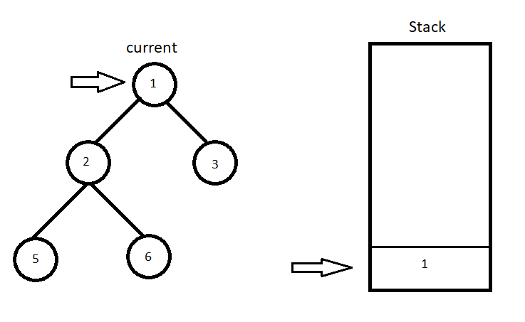
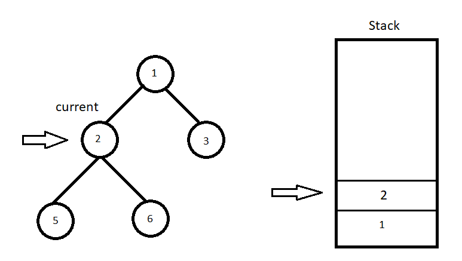
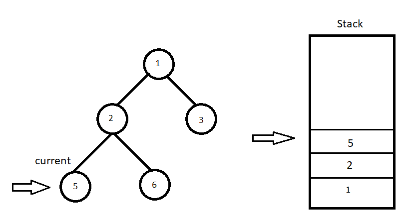
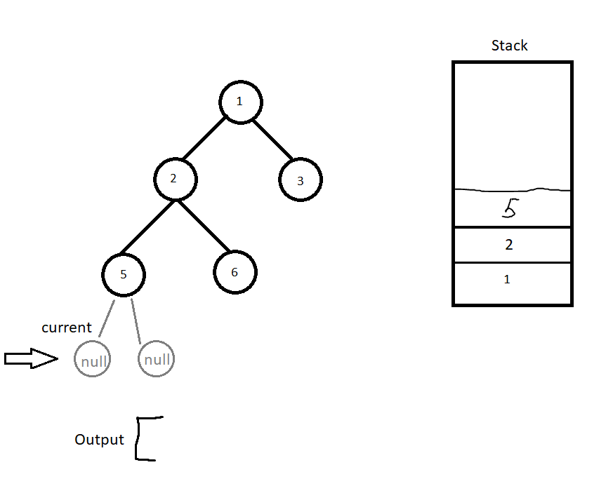
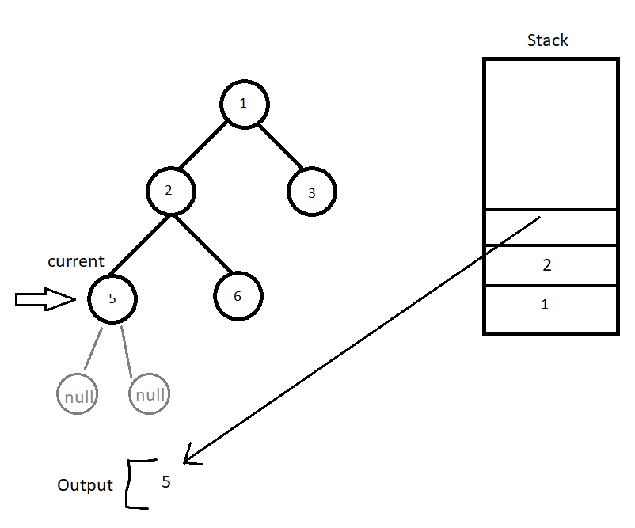
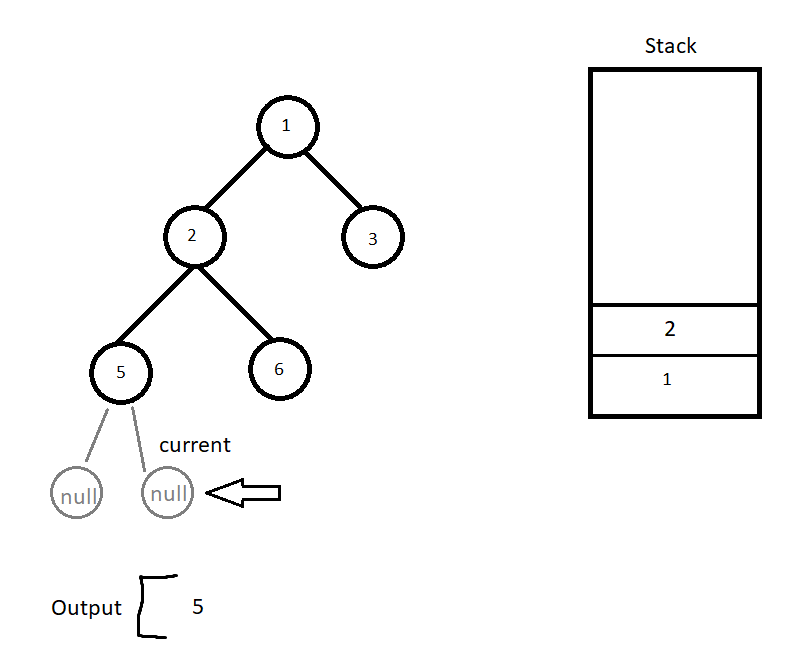
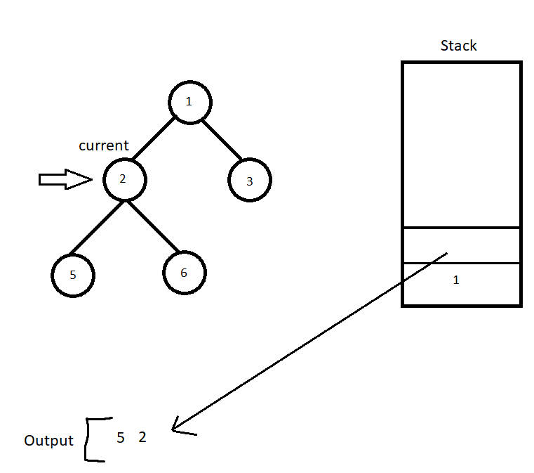
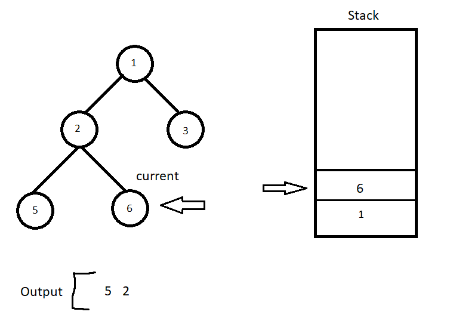

# (= PHP | iteratively solution with explanation

**Author:** Meacue
**Votes:** 2
**Link:** [https://leetcode.com/problems/binary-tree-inorder-traversal/solutions/4382050/](https://leetcode.com/problems/binary-tree-inorder-traversal/solutions/4382050/)

---

# Approach
<!-- Describe your approach to solving the problem. -->
The essence of inorder traversal is to reach the leftmost leaf of the tree. 

Along the way, we will add the value of the current node to the stack.

Along the way, we will add the current node to the stack. To subsequently traverse the tree from bottom to top using a stack.

We pop the last element from the stack and write its value to the output array. 
Next we will go to the right side of the current node.
# Explanation step by step
```php []
while ($current) {
    $stack[] = $current;
    $current = $current->left;
}
```
In current we save the current node. At the beginning it will be a node with value 1.

The while loop will return true if the current variable stores a tree node. If 'null' is stored, the check will return false.









At the current stage, current will store null, which means that we have reached the end of the tree on the left side.
```php []
$current = array_pop($stack);
$output[] = $current->val;
$current = $current->right;
```

We pop the last node from the stack and save it to the current variable.
Write value of the node to the returned array.



And then we go along the right side of the current node.



\u0421ycle repeats






etc.

In the end we will return the 'output' array [5,2,6,1,3]

# Code
```
/**
 * Definition for a binary tree node.
 * class TreeNode {
 *     public $val = null;
 *     public $left = null;
 *     public $right = null;
 *     function __construct($val = 0, $left = null, $right = null) {
 *         $this->val = $val;
 *         $this->left = $left;
 *         $this->right = $right;
 *     }
 * }
 */
class Solution {

    /**
     * @param TreeNode $root
     * @return Integer[]
     */
    function inorderTraversal($root) {
        // foreach ($root as $node) {
        //     print_r($node->left);
        // }

        $stack = [];
        $output = [];

        $current = $root;
        
        while ($stack || $current) {

            while ($current) {
                $stack[] = $current;
                $current = $current->left;
            }
            $current = array_pop($stack);
            $output[] = $current->val;
            $current = $current->right;
        }

        return $output;
    }
}
```