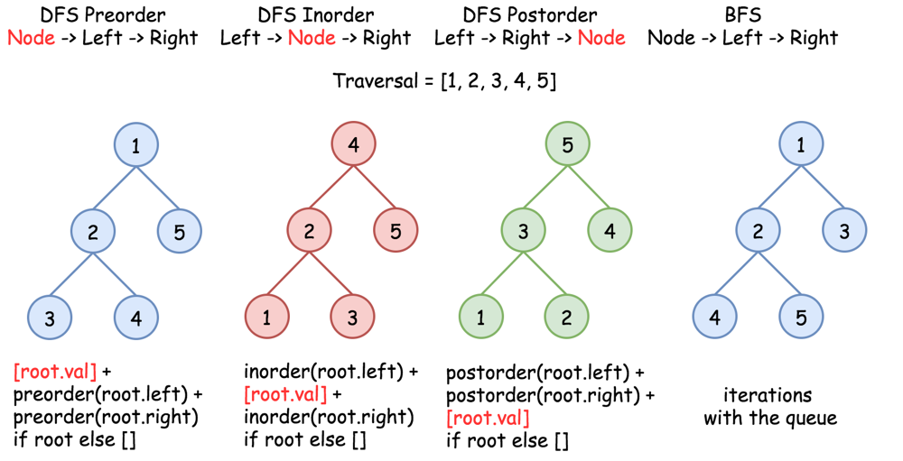

# All DFS traversals (preorder, inorder, postorder) in Python in 1 line

**Author:** andvary
**Votes:** 1090
**Link:** [https://leetcode.com/problems/binary-tree-inorder-traversal/solutions/283746/](https://leetcode.com/problems/binary-tree-inorder-traversal/solutions/283746/)

---



```
def preorder(root):
  return [root.val] + preorder(root.left) + preorder(root.right) if root else []
```

```
def inorder(root):
  return  inorder(root.left) + [root.val] + inorder(root.right) if root else []
```

```
def postorder(root):
  return  postorder(root.left) + postorder(root.right) + [root.val] if root else []
```
