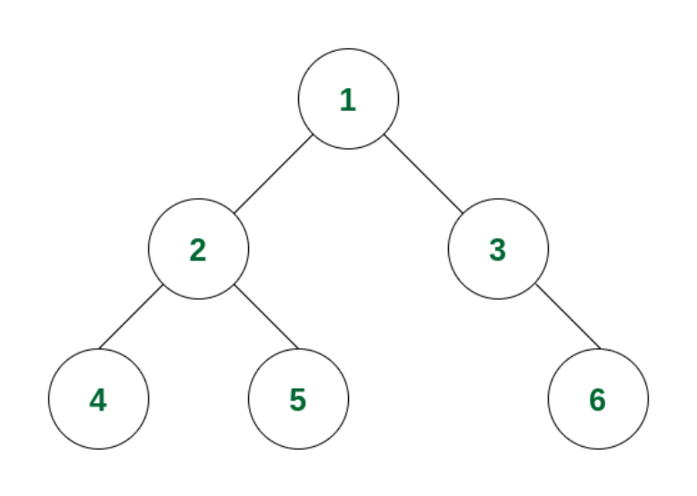
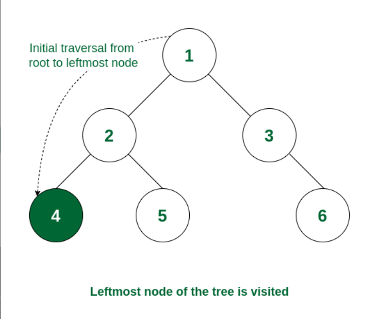
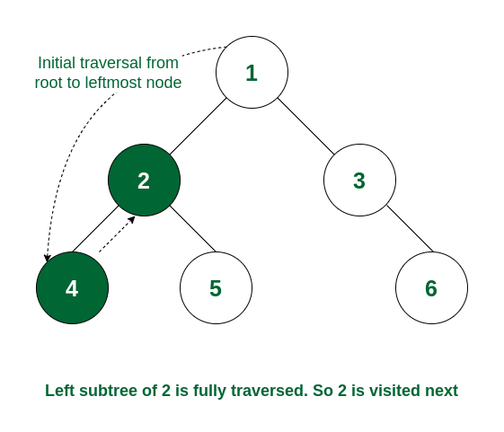
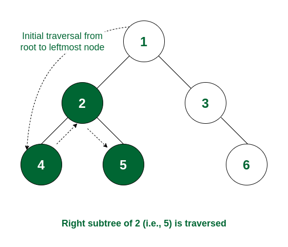
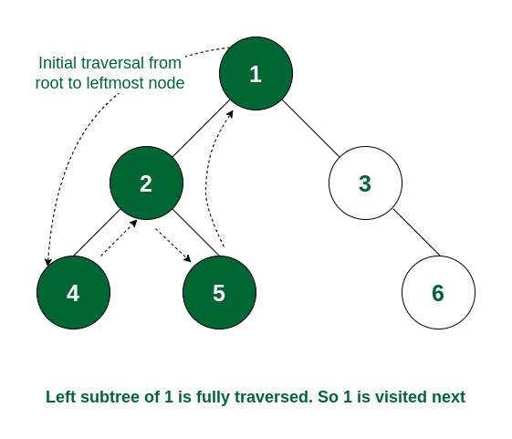
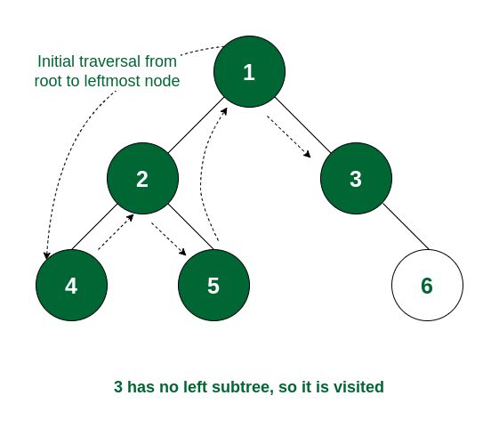
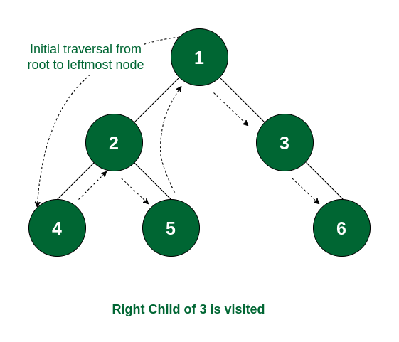

# Easy , Beginner & Dry run || In Order Traversal || Time O(n) & Space O(n) || Gits✅✅😎😎

**Author:** GiteshSK_12
**Votes:** 5
**Link:** [https://leetcode.com/problems/binary-tree-inorder-traversal/solutions/4677221/](https://leetcode.com/problems/binary-tree-inorder-traversal/solutions/4677221/)

---

# Guys if the solution and explanation is helpful the upvote me.
# Approach \uD83D\uDC48
- In the question given, the root of a binary tree is provided, and the goal is to return a list of the nodes' values in inorder traversal. We will use recursion to solve this problem.

- To accomplish this, we need to understand the inorder traversal process, which involves recursively going through all nodes of the tree by first visiting the left subtree, then the root node, and finally the right subtree.

# What is inorder traversal - \uD83D\uDC48
- The post order traversal technique follows the Left Right Root policy. Here, Left Right Root means the left subtree of the root node is traversed first, then the right subtree, and finally, the root node is traversed. Here, the Postorder name itself suggests that the tree's root node would be traversed at last.

# How does Inorder Traversal of Binary Tree Work? \uD83D\uDC48
Consider the following tree:




**Step 1:** 
- The traversal will go from 1 to its left subtree i.e., 2, then from 2 to its left subtree root, i.e., 4. Now 4 has no left subtree, so it will be visited. It also does not have any right subtree. So no more traversal from 4




**Step 2:** 
- As the left subtree of 2 is visited completely, now it read data of node 2 before moving to its right subtree.




**Step 3:** 
- Now the right subtree of 2 will be traversed i.e., move to node 5. For node 5 there is no left subtree, so it gets visited and after that, the traversal comes back because there is no right subtree of node 5.




**Step 4:**
- As the left subtree of node 1 is, the root itself, i.e., node 1 will be visited.



**Step 5:** 
- Left subtree of node 1 and the node itself is visited. So now the right subtree of 1 will be traversed i.e., move to node 3. As node 3 has no left subtree so it gets visited.




**Step 6:** 
- The left subtree of node 3 and the node itself is visited. So traverse to the right subtree and visit node 6. Now the traversal ends as all the nodes are traversed.




- So the order of traversal of nodes is 4 -> 2 -> 5 -> 1 -> 3 -> 6.

# Code Explanation: \uD83D\uDC48
**Functionality:** 
- This method performs the recursive inorder traversal. It first checks if the current `if(root == null)return;` is null. If it is, the method returns immediately, as there is nothing to process. If the node is not null, it recursively calls itself with the left child of the current node, effectively traversing the left subtree. After traversing the left subtree, the method adds the current node's value to arr. Finally, it recursively calls itself with the right child of the current node, traversing the right subtree.

**InorderTraversal Method**

**Signature:** 

- `public List<Integer> inorderTraversal(TreeNode root)`

**Parameter:**

**TreeNode root:** 

- The root node of the binary tree that is to be traversed inorder.

**Returns :** 

- A list of integers representing the values of the binary tree nodes, collected inorder.

**Functionality:** 
- This method initializes the list arr that will hold the result of the inorder traversal. It checks if the root is null and, if so, returns the empty list immediately. If the root is not null, it calls the helper method with the root node and the list arr. After the helper method completes the inorder traversal, arr contains all the node values in inorder, which is then returned.

# Complexity \uD83D\uDC48
- Time complexity: O(n)


- Space complexity: O(log n) to O(n)


# Code \uD83D\uDC48
```C++ []
/**
 * Definition for a binary tree node.
 * struct TreeNode {
 *     int val;
 *     TreeNode *left;
 *     TreeNode *right;
 *     TreeNode() : val(0), left(nullptr), right(nullptr) {}
 *     TreeNode(int x) : val(x), left(nullptr), right(nullptr) {}
 *     TreeNode(int x, TreeNode *left, TreeNode *right) : val(x), left(left), right(right) {}
 * };
 */
class Solution {
public:
    void helper(TreeNode* root ,vector<int>& arr){
        if(root == NULL)return ;
        helper(root->left , arr);
        arr.push_back(root->val);
        helper(root->right , arr);
    }
    vector<int> inorderTraversal(TreeNode* root) {
        vector<int>arr;
        if(root == NULL)return arr;
        helper(root , arr);
        return arr;
    }
};
```
```Java []
/**
 * Definition for a binary tree node.
 * public class TreeNode {
 *     int val;
 *     TreeNode left;
 *     TreeNode right;
 *     TreeNode() {}
 *     TreeNode(int val) { this.val = val; }
 *     TreeNode(int val, TreeNode left, TreeNode right) {
 *         this.val = val;
 *         this.left = left;
 *         this.right = right;
 *     }
 * }
 */
class Solution {
    public void helper(TreeNode root , List<Integer> arr){
        if(root == null)return;
        helper(root.left , arr);
        arr.add(root.val);
        helper(root.right , arr);  
    }
    public List<Integer> inorderTraversal(TreeNode root) {
        ArrayList<Integer> arr = new ArrayList<Integer>();
        if(root == null)return arr;
        helper(root , arr);
        return arr;
    }
}
```
```javascript []
/**
 * Definition for a binary tree node.
 * function TreeNode(val, left, right) {
 *     this.val = (val===undefined ? 0 : val)
 *     this.left = (left===undefined ? null : left)
 *     this.right = (right===undefined ? null : right)
 * }
 */
/**
 * @param {TreeNode} root
 * @return {number[]}
 */
function helper(root, ans) {
        if (root === null) return;
        helper(root.left, ans); 
        ans.push(root.val);     
        helper(root.right, ans); 
}
var inorderTraversal = function(root) {
    const ans = []
    if(root === null)return ans
    helper(root , ans)
    return ans
};
```
```C# []
/**
 * Definition for a binary tree node.
 * public class TreeNode {
 *     public int val;
 *     public TreeNode left;
 *     public TreeNode right;
 *     public TreeNode(int val=0, TreeNode left=null, TreeNode right=null) {
 *         this.val = val;
 *         this.left = left;
 *         this.right = right;
 *     }
 * }
 */
public class Solution {
    public void helper(TreeNode root ,IList<int> arr){
        if(root == null)return ;
        helper(root.left , arr);
        arr.Add(root.val);
        helper(root.right , arr);
    }
    public IList<int> InorderTraversal(TreeNode root) {
        List<int> arr = new List<int>();
        if(root == null)return arr;
        helper(root , arr);
        return arr; 
    }
}
```
```python []
# Definition for a binary tree node.
# class TreeNode(object):
#     def __init__(self, val=0, left=None, right=None):
#         self.val = val
#         self.left = left
#         self.right = right
class Solution(object):
    def helper(self , root , List):
        if root == None : return 
        self.helper(root.left , List)
        List.append(root.val)
        self.helper(root.right , List)
    def inorderTraversal(self, root):
        """
        :type root: TreeNode
        :rtype: List[int]
        """
        List = []
        if root == None: return List
        self.helper(root , List)
        return List
```
```python3 []
# Definition for a binary tree node.
# class TreeNode:
#     def __init__(self, val=0, left=None, right=None):
#         self.val = val
#         self.left = left
#         self.right = right
class Solution:
    def helper(self , root , List):
        if root == None : return 
        self.helper(root.left , List)
        List.append(root.val)
        self.helper(root.right , List)
    def inorderTraversal(self, root: Optional[TreeNode]) -> List[int]:
        List = []
        if root == None: return List
        self.helper(root , List)
        return List
```
```ruby []
# Definition for a binary tree node.
# class TreeNode
#     attr_accessor :val, :left, :right
#     def initialize(val = 0, left = nil, right = nil)
#         @val = val
#         @left = left
#         @right = right
#     end
# end
# @param {TreeNode} root
# @return {Integer[]}
def helper(root , arr)
    if root == nil
        return 
    end
    helper(root.left , arr)
    arr.push(root.val)
    helper(root.right, arr)
end
def inorder_traversal(root)
    arr = []
    if root == nil
        return arr
    end
    helper(root , arr)
    return arr
end
```
# Dry Run \uD83D\uDE0E

**Start with the root node (1):** 
- Since root is not null, the inorderTraversal method initializes an empty list arr and calls `helper(root, arr)` with the root node.

**Enter the helper method with node 1:**

- Since node 1 is not null, proceed.
- Call `helper(root.left, arr)`. Since node 1's left child is null, this call returns immediately.
- Add node 1's value to arr. Now, arr = [1].
- Call `helper(root.right, arr)` to process the right subtree.

**Enter the helper method with node 2:**

- Node 2 is not null, proceed.
- Call helper(root.left, arr) to process node 2's left child, which is node 3.

**Enter the helper method with node 3:**

- Node 3 is not null, proceed.
- Call `helper(root->left , arr);`. Node 3's left child is null, so return immediately.
- Add node 3's value to arr. Now, arr = [1, 3].
- Call `helper(root.right, arr)`. Node 3's right child is null, so return immediately.
- 
**Back to node 2's context after processing its left subtree (node 3):**
- Add node 2's value to arr. Now, arr = [1, 3, 2].
- Call `helper(root.right, arr)`. Node 2's right child is null, so return immediately.
- Finish traversing the tree: After completing the traversal, the inorderTraversal method returns arr, which now contains [1, 3, 2].

# Guys if the solution and explanation is helpful the upvote me.


