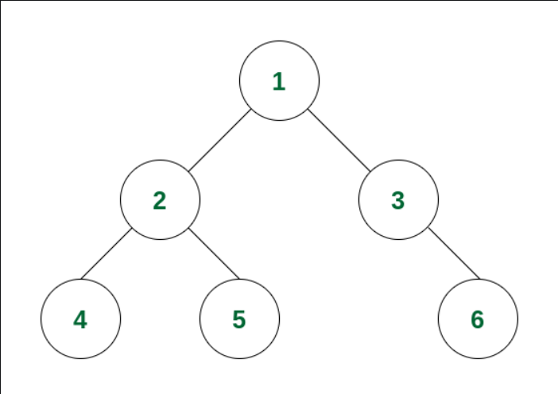
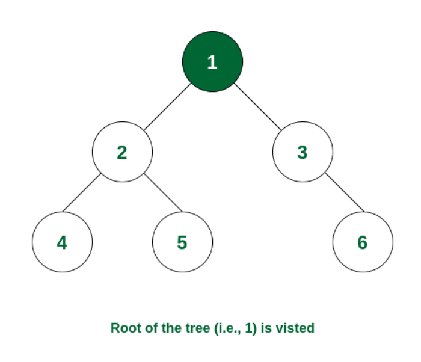
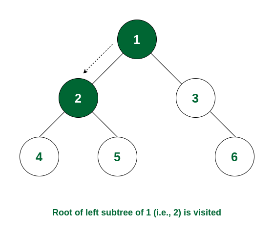
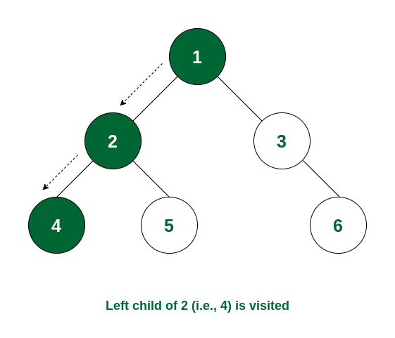
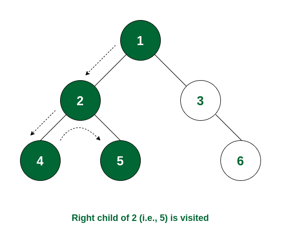
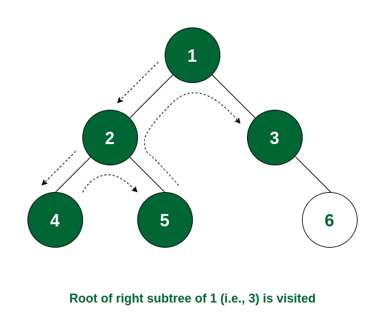
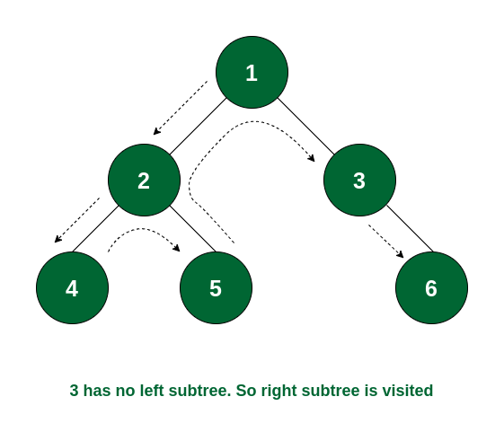

# Easy , Beginner friendly & Dry run ||Pre Order Traversal || Time O(n) & Space O(n) || Gits✅✅😎😎

**Author:** GiteshSK_12
**Votes:** 10
**Link:** [https://leetcode.com/problems/binary-tree-preorder-traversal/solutions/4679939/](https://leetcode.com/problems/binary-tree-preorder-traversal/solutions/4679939/)

---

# Guys if the solution and explanation is helpful the upvote me.\u2764\uFE0F\u2764\uFE0F


# Approach \uD83D\uDC48

- In the question given, the root of a binary tree is provided, and the goal is to return a list of the nodes' values in pre-order traversal. We will use recursion to solve this problem.

- To accomplish a pre-order traversal, we need to understand its process, which involves recursively going through all nodes of the tree by first visiting the root node, then the left subtree, and finally the right subtree.

# What is Pre-Order traversal - \uD83D\uDC48

- In preorder traversal, first, root node is visited, then left sub-tree and after that right sub-tree is visited. The process of preorder traversal can be represented as -
        `root \u2192 left \u2192 right`  

- Root node is always traversed first in preorder traversal, while it is the last item of postorder traversal. Preorder traversal is used to get the prefix expression of a tree.

# How does Pre-Order Traversal of Binary Tree Work? \uD83D\uDC48

Consider the following tree:



**Step 1:** 
- At first the root will be visited, i.e. node 1.



**Step 2:** 
- After this, traverse in the left subtree. Now the root of the left subtree is visited i.e., node 2 is visited.



**Step 3:** 
- Again the left subtree of node 2 is traversed and the root of that subtree i.e., node 4 is visited.



**Step 4:** 
- There is no subtree of 4 and the left subtree of node 2 is visited. So now the right subtree of node 2 will be traversed and the root of that subtree i.e., node 5 will be visited.



**Step 5:** 
- The left subtree of node 1 is visited. So now the right subtree of node 1 will be traversed and the root node i.e., node 3 is visited.



**Step 6:**
- Node 3 has no left subtree. So the right subtree will be traversed and the root of the subtree i.e., node 6 will be visited. After that there is no node that is not yet traversed. So the traversal ends.



So the order of traversal of nodes is 1 -> 2 -> 4 -> 5 -> 3 -> 6.

# Code Explanation: \uD83D\uDC48

**The helper Method:** 
- This method is designed to perform the recursive pre-order traversal. It accepts a TreeNode (representing the current node being visited) and an ArrayList<Integer> (to collect the values of the nodes in pre-order).
 
- The method works as follows:

    - **Base Case:** If the current node (root) is null, it returns immediately, as there is nothing to process. This condition is crucial for ending the recursion, especially when dealing with leaf nodes' children, which are null.

    - **Process the Current Node:** If the current node is not null, its value is added to the ans list. This step corresponds to the "Root" part of the pre-order traversal.

    - **Recursive Calls:** The method then makes recursive calls first to the left child (helper(root.left, ans)) and then to the right child (helper(root.right, ans)). These calls ensure that all nodes in the left subtree are visited before moving to the right subtree, adhering to the pre-order traversal order.

**The preorderTraversal Method:** 
- This is the public method that initiates the traversal. It does the following:

    - **Initialize the ArrayList:** An ArrayList<Integer> named ans is created to store the values of the nodes visited during the traversal.

    - **Check for Empty Tree:** If the input root is null, indicating an empty tree, the method returns the empty ans list immediately.

    - **Start Recursive Traversal:** If the tree is not empty, it calls the helper method with the root of the tree and the ans list. After this method call completes, ans will contain the values of all the nodes in pre-order.

    - **Return the List:** Finally, the method returns the ans list, which now holds the result of the pre-order traversal.

# Complexity \uD83D\uDC48
Time complexity: O(n)

Space complexity: O(log n) to O(n)

# Code \uD83D\uDC48
```C++ []
/**
 * Definition for a binary tree node.
 * struct TreeNode {
 *     int val;
 *     TreeNode *left;
 *     TreeNode *right;
 *     TreeNode() : val(0), left(nullptr), right(nullptr) {}
 *     TreeNode(int x) : val(x), left(nullptr), right(nullptr) {}
 *     TreeNode(int x, TreeNode *left, TreeNode *right) : val(x), left(left), right(right) {}
 * };
 */
class Solution {
public:
    void helper(TreeNode* root ,vector<int>& arr){
        if(root == NULL)return ;
        arr.push_back(root->val);
        helper(root->left , arr);
        helper(root->right , arr);
    }
    vector<int> preorderTraversal(TreeNode* root) {
        vector<int>arr;
        if(root == NULL)return arr;
        helper(root , arr);
        return arr;
    }
};
```
```Java []
/**
 * Definition for a binary tree node.
 * public class TreeNode {
 *     int val;
 *     TreeNode left;
 *     TreeNode right;
 *     TreeNode() {}
 *     TreeNode(int val) { this.val = val; }
 *     TreeNode(int val, TreeNode left, TreeNode right) {
 *         this.val = val;
 *         this.left = left;
 *         this.right = right;
 *     }
 * }
 */
class Solution {
    public void helper(TreeNode root , ArrayList<Integer> ans){
        if(root == null)return;
        ans.add(root.val);
        helper(root.left , ans);
        helper(root.right , ans);
    }
    public List<Integer> preorderTraversal(TreeNode root) {
        ArrayList<Integer> ans = new ArrayList<>();
        if(root == null)return ans;
        helper(root , ans);
        return ans;
    }
}
```
```javascript []
/**
 * Definition for a binary tree node.
 * function TreeNode(val, left, right) {
 *     this.val = (val===undefined ? 0 : val)
 *     this.left = (left===undefined ? null : left)
 *     this.right = (right===undefined ? null : right)
 * }
 */
/**
 * @param {TreeNode} root
 * @return {number[]}
 */
function helper(root, ans) {
    if (root === null) return;
    ans.push(root.val); 
    helper(root.left, ans);     
    helper(root.right, ans); 
}
var preorderTraversal = function(root) {
    const ans = []
    if(root === null)return ans
    helper(root , ans)
    return ans
};
```
```C# []
/**
 * Definition for a binary tree node.
 * public class TreeNode {
 *     public int val;
 *     public TreeNode left;
 *     public TreeNode right;
 *     public TreeNode(int val=0, TreeNode left=null, TreeNode right=null) {
 *         this.val = val;
 *         this.left = left;
 *         this.right = right;
 *     }
 * }
 */
public class Solution {
    public void helper(TreeNode root , IList<int> ans){
        if(root == null)return;
        ans.Add(root.val);
        helper(root.left , ans);
        helper(root.right , ans);
    }
    public IList<int> PreorderTraversal(TreeNode root) {
        List<int> ans = new List<int>();
        if(root == null)return ans;
        helper(root , ans);
        return ans;
    }
}
```
```python []
# Definition for a binary tree node.
# class TreeNode(object):
#     def __init__(self, val=0, left=None, right=None):
#         self.val = val
#         self.left = left
#         self.right = right
class Solution(object):
    def helper(self , root , ans):
        if root == None: return
        ans.append(root.val)
        self.helper(root.left , ans)
        self.helper(root.right , ans)

    def preorderTraversal(self, root):
        """
        :type root: TreeNode
        :rtype: List[int]
        """
        ans = []
        if root == None : return ans
        self.helper(root , ans)
        return ans
    
```
```python3 []
# Definition for a binary tree node.
# class TreeNode:
#     def __init__(self, val=0, left=None, right=None):
#         self.val = val
#         self.left = left
#         self.right = right
class Solution:
    def helper(self , root , ans):
        if root == None: return
        ans.append(root.val)
        self.helper(root.left , ans)
        self.helper(root.right , ans)
    def preorderTraversal(self, root: Optional[TreeNode]) -> List[int]:
        ans = []
        if root == None : return ans
        self.helper(root , ans)
        return ans
```
```ruby []
# Definition for a binary tree node.
# class TreeNode
#     attr_accessor :val, :left, :right
#     def initialize(val = 0, left = nil, right = nil)
#         @val = val
#         @left = left
#         @right = right
#     end
# end
# @param {TreeNode} root
# @return {Integer[]}
def helper(root , ans)
    if root == nil
        return
    end
    ans.append(root.val)
    helper(root.left , ans)
    helper(root.right , ans)
end
def preorder_traversal(root)
    ans = []
    if root == nil 
        return ans
    end
    helper(root , ans)
    return ans
end
```
# Dry Run \uD83D\uDE0E

**1. Initialization:**
- The preorderTraversal method is called with the root node of the binary tree.
- Since the root is not null, an ArrayList<Integer> named ans is created to store the traversal result.
- `ArrayList<Integer> ans = new ArrayList<>();`

**2. First helper Call with Root Node (1):**

- The helper method is called with the root node (which has the value 1) and the ans list.
- Since root is not null, root.val (which is 1) is added to ans. Now, ans = [1]. `ans.add(root.val);`
- The method then recursively calls itself for `root.left`, which is null, and immediately returns due to the base case.
- Next, it calls itself for `root.right`, which is the node with the value 2.

**3. Recursive helper Call with Node (2):**

- For the node with the value 2, since it's not null, 2 is added to ans. Now, ans = [1, 2].
- The method then recursively calls itself for `root.left` of node 2, which is the node with the value 3.

**4. Recursive helper Call with Node (3):**

- For the node with the value 3, since it's not null, 3 is added to ans. Now, ans = [1, 2, 3].
- The method then attempts to call itself for both `root.left` and `root.right` of node 3, both of which are null. Both recursive calls immediately return due to the base case.

**5. Backtracking and Completion:**

- After processing node 3, the recursion unwinds back to node 2, and since both its left and right children (only left in this case) have been processed, it returns to the first call (node 1).
- With both the right subtree of node 1 processed (there's no left subtree), the initial call to helper completes.

**6. Return Result:**

- The preorderTraversal method now returns the ans list, which contains the pre-order traversal result: [1, 2, 3].

# Guys if the solution and explanation is helpful the upvote me.


