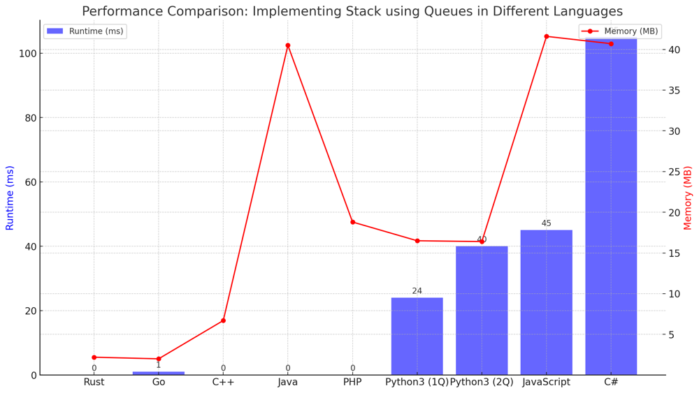

# ✅ 99.74% One-Queue Approach

**Author:** vanAmsen
**Votes:** 145
**Link:** [https://leetcode.com/problems/implement-stack-using-queues/solutions/3969470/](https://leetcode.com/problems/implement-stack-using-queues/solutions/3969470/)

---

# Interview Guide - Implement Stack using Queues:

## Problem Understanding

### **Description**:  
The task is to implement a stack (Last In, First Out - LIFO) using queues. The stack should support the following functions: `push`, `pop`, `top`, and `empty`. These operations should behave just as they do in a typical stack data structure.

## Key Points to Consider

### 1. Understand the Constraints
- The stack must be implemented using only standard queue operations.
- The integer values pushed onto the stack are between 1 and 9.
- There will be at most 100 calls to each of the stack's functions (`push`, `pop`, `top`, and `empty`).
- All calls to `pop` and `top` will be made when the stack is not empty.

### 2. Approaches to Solve the Problem

#### Two-Queue Approach
- **How it Works**: Utilize two queues and move elements between them to mimic stack operations.
- **Time Complexity**: $$O(n)$$ for `pop` and `top`, $$O(1)$$ for `push` and `empty`.
- **When to Use**: Choose this approach when the frequency of `push` and `empty` operations is higher than `pop` and `top`.

#### One-Queue Approach
- **How it Works**: Use a single queue and reorganize (rotate) its elements when pushing a new element.
- **Time Complexity**: $$O(n)$$ for `push`, $$O(1)$$ for `pop`, `top`, and `empty`.
- **When to Use**: Choose this approach when you expect `pop` and `top` operations to be more frequent than `push`.

### 4. Thought Process
- The two-queue approach is more straightforward but involves more element transfers for `pop` and `top`.
- The one-queue approach requires more work during the `push` operation but makes `pop` and `top` more efficient.
  
## Conclusion
The problem is a good exercise in understanding how one data structure can be implemented using another while maintaining its essential characteristics with both one-queue and two-queue approaches.

---

# Live Coding in Python
https://youtu.be/8cwvQWfsPfs?si=KDUxRZDvlPSljfM8

---

# Approach: Two-Queue Approach

## Key Data Structures
- Two queues, often implemented using Python's `deque` from the `collections` library.

## Enhanced Breakdown

### 1. Initialization:
- Create two empty queues, referred to as `q1` and `q2`. `q1` will serve as the main queue where new elements are pushed, while `q2` will serve as an auxiliary queue for temporary operations.

### 2. Base Cases:
- For the `empty` function, directly check the length or size of `q1`. If it's empty, return `True`, otherwise return `False`.

### 3. Main Algorithm:

#### Push Operation
- For the `push` operation, simply add the new element to the back (enqueue) of `q1`.

#### Pop Operation
- For the `pop` operation, you need to access the last element pushed into `q1`, which is at the back.
- To do this, dequeue from `q1` and enqueue into `q2` until only one element remains in `q1`.
- The remaining element is the one to be popped. Dequeue it from `q1`.

#### Top Operation
- Similar to the `pop` operation, but after accessing the last element, it should be enqueued back into `q2`.

### 4. Wrap-up:
- After each `pop` and `top` operation, swap `q1` and `q2` to make `q2` the new main queue and `q1` the new auxiliary queue.

## Complexity
### Time Complexity:
- $$O(n)$$ for the `pop` and `top` operations as you have to move $$n-1$$ elements between the two queues.
- $$O(1)$$ for the `push` and `empty` operations as they are direct enqueue and length check operations.

### Space Complexity:
- $$O(n)$$ for storing the elements in the queues.

---

# Approach: One-Queue Approach

## Key Data Structures
- A single queue, again best implemented using Python's `deque` from the `collections` library.

## Enhanced Breakdown

### 1. Initialization:
- Create a single empty queue, referred to as `q`.

### 2. Base Cases:
- Similar to the Two-Queue Approach, directly check if the queue `q` is empty for the `empty` operation.

### 3. Main Algorithm:

#### Push Operation
- Enqueue the new element at the back of `q`.
- To ensure that the last element can be accessed from the front, rotate the queue by dequeueing and enqueuing each element except the newly pushed element.

#### Pop and Top Operations
- Simply dequeue from the front for `pop` and peek at the front for `top`.

### 4. Wrap-up:
- There's no need to swap or move elements for `pop` and `top`, making these operations faster compared to the Two-Queue Approach.

## Complexity
### Time Complexity:
- $$O(n)$$ for the `push` operation due to the rotation required to bring the last element to the front.
- $$O(1)$$ for the `pop`, `top`, and `empty` operations.

### Space Complexity:
- $$O(n)$$ for storing the elements in the queue.
---

# Performance

| Language  | Approach | Runtime (ms) | Memory (MB) |
|-----------|----------|--------------|-------------|
| Rust      | 1Q       | 0 ms         | 2.2 MB      |
| Go        | 1Q       | 1 ms         | 2 MB        |
| C++       | 1Q       | 0 ms         | 6.7 MB      |
| Java      | 1Q       | 0 ms         | 40.5 MB     |
| PHP       | 1Q       | 0 ms         | 18.8 MB     |
| Python3   | 1Q       | 24 ms        | 16.5 MB     |
| Python3   | 2Q       | 40 ms        | 16.4 MB     |
| JavaScript| 1Q       | 45 ms        | 41.6 MB     |
| C#        | 1Q       | 105 ms       | 40.7 MB     |



---

# Code One-Queue
``` Python []
class MyStack:

    def __init__(self):
        self.q = deque()

    def push(self, x: int) -> None:
        self.q.append(x)
        for _ in range(len(self.q) - 1):
            self.q.append(self.q.popleft())

    def pop(self) -> int:
        return self.q.popleft()

    def top(self) -> int:
        return self.q[0]

    def empty(self) -> bool:
        return len(self.q) == 0
```
``` C++ []
#include <queue>

class MyStack {
private:
    std::queue<int> q;

public:
    MyStack() {}

    void push(int x) {
        q.push(x);
        for (int i = 0; i < q.size() - 1; ++i) {
            q.push(q.front());
            q.pop();
        }
    }

    int pop() {
        int val = q.front();
        q.pop();
        return val;
    }

    int top() {
        return q.front();
    }

    bool empty() {
        return q.empty();
    }
};
```
``` Go []
type MyStack struct {
    q []int
}

func Constructor() MyStack {
    return MyStack{}
}

func (this *MyStack) Push(x int) {
    this.q = append(this.q, x)
    for i := 0; i < len(this.q)-1; i++ {
        this.q = append(this.q, this.q[0])
        this.q = this.q[1:]
    }
}

func (this *MyStack) Pop() int {
    val := this.q[0]
    this.q = this.q[1:]
    return val
}

func (this *MyStack) Top() int {
    return this.q[0]
}

func (this *MyStack) Empty() bool {
    return len(this.q) == 0
}
```
``` Rust []
use std::collections::VecDeque;

pub struct MyStack {
    q: VecDeque<i32>,
}

impl MyStack {
    pub fn new() -> Self {
        MyStack { q: VecDeque::new() }
    }

    pub fn push(&mut self, x: i32) {
        self.q.push_back(x);
        for _ in 0..self.q.len() - 1 {
            let val = self.q.pop_front().unwrap();
            self.q.push_back(val);
        }
    }

    pub fn pop(&mut self) -> i32 {
        self.q.pop_front().unwrap()
    }

    pub fn top(&self) -> i32 {
        *self.q.front().unwrap()
    }

    pub fn empty(&self) -> bool {
        self.q.is_empty()
    }
}
```
``` Java []
public class MyStack {
    private Queue<Integer> q;

    public MyStack() {
        q = new LinkedList<>();
    }

    public void push(int x) {
        q.add(x);
        for (int i = 1; i < q.size(); i++) {
            q.add(q.remove());
        }
    }

    public int pop() {
        return q.remove();
    }

    public int top() {
        return q.peek();
    }

    public boolean empty() {
        return q.isEmpty();
    }
}
```
``` JavaScript []
class MyStack {
    constructor() {
        this.q = [];
    }

    push(x) {
        this.q.push(x);
        for (let i = 0; i < this.q.length - 1; i++) {
            this.q.push(this.q.shift());
        }
    }

    pop() {
        return this.q.shift();
    }

    top() {
        return this.q[0];
    }

    empty() {
        return this.q.length === 0;
    }
}
```
``` PHP []

class MyStack {
    private $q = [];

    public function push($x) {
        array_push($this->q, $x);
        for ($i = 0; $i < count($this->q) - 1; $i++) {
            array_push($this->q, array_shift($this->q));
        }
    }

    public function pop() {
        return array_shift($this->q);
    }

    public function top() {
        return $this->q[0];
    }

    public function empty() {
        return empty($this->q);
    }
}

```
``` C# []
public class MyStack {
    private Queue<int> q;

    public MyStack() {
        q = new Queue<int>();
    }

    public void Push(int x) {
        q.Enqueue(x);
        for (int i = 0; i < q.Count - 1; i++) {
            q.Enqueue(q.Dequeue());
        }
    }

    public int Pop() {
        return q.Dequeue();
    }

    public int Top() {
        return q.Peek();
    }

    public bool Empty() {
        return q.Count == 0;
    }
}
```

# Code Two-Queue
``` Python []
class MyStack:

    def __init__(self):
        self.q1 = deque()
        self.q2 = deque()

    def push(self, x: int) -> None:
        self.q1.append(x)

    def pop(self) -> int:
        while len(self.q1) > 1:
            self.q2.append(self.q1.popleft())
        
        popped_element = self.q1.popleft()
        
        # Swap q1 and q2
        self.q1, self.q2 = self.q2, self.q1
        
        return popped_element

    def top(self) -> int:
        while len(self.q1) > 1:
            self.q2.append(self.q1.popleft())
        
        top_element = self.q1[0]
        
        self.q2.append(self.q1.popleft())
        
        # Swap q1 and q2
        self.q1, self.q2 = self.q2, self.q1
        
        return top_element

    def empty(self) -> bool:
        return len(self.q1) == 0
```

This exercise challenges you to think critically about basic data structures like stacks and queues. Implementing a stack using queues not only tests your understanding of these structures but also your ability to creatively use one to emulate the other. The multiple approaches available serve as a lesson in computational trade-offs, essential knowledge for technical interviews and real-world problem-solving. Dive in and explore these solutions, as each has its unique learning points. Happy coding! \uD83D\uDE80\uD83D\uDCA1\uD83C\uDF1F