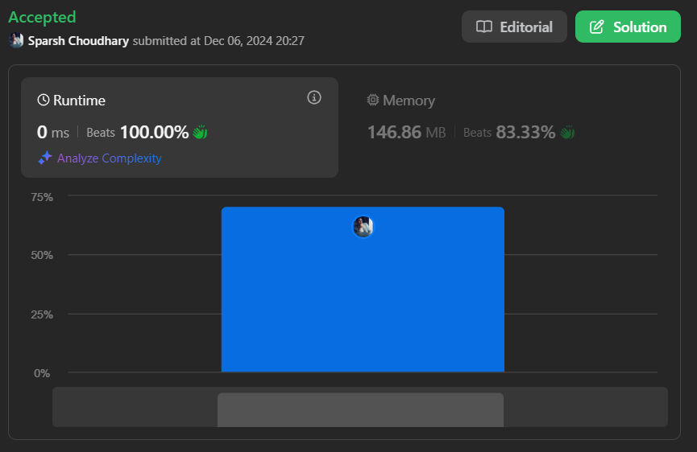

# 🔥BEATS 💯 % 🎯 |✨SUPER EASY BEGINNERS 👏

**Author:** CodeWithSparsh
**Votes:** 2
**Link:** [https://leetcode.com/problems/implement-stack-using-queues/solutions/6120179/](https://leetcode.com/problems/implement-stack-using-queues/solutions/6120179/)

---




---

# Intuition
To implement a stack using **queues**, we need to mimic the **LIFO (Last In, First Out)** behavior of a stack using the **FIFO (First In, First Out)** behavior of queues. This requires carefully managing the order of elements in the queues during push and pop operations.

---

# Approach
1. **Push Operation:**
   - Add the element to the primary queue (`_queue1`).

2. **Pop Operation:**
   - Move all elements except the last one from `_queue1` to `_queue2`.
   - Remove and return the last element from `_queue1` (this acts as the "top" of the stack).
   - Swap the roles of `_queue1` and `_queue2`.

3. **Top Operation:**
   - Similar to `pop`, but instead of removing the last element, just return it after moving elements between queues.

4. **Empty Check:**
   - Return `true` if both `_queue1` and `_queue2` are empty.

---

# Complexity
- **Time Complexity:**
  - **Push:** $$O(1)$$ (direct addition to `_queue1`).
  - **Pop/Top:** $$O(n)$$ (transfer elements between `_queue1` and `_queue2`).
- **Space Complexity:** $$O(n)$$ (storage required for two queues).

---


```dart []
class MyStack {
  List<int> _queue1 = []; // Main queue for managing stack elements
  List<int> _queue2 = []; // Temporary queue for swapping elements

  MyStack();

  /// Push element x to the top of the stack.
  void push(int x) {
    _queue1.add(x);
  }

  /// Removes the element on the top of the stack and returns it.
  int pop() {
    while (_queue1.length > 1) {
      // Move all elements except the last one from queue1 to queue2
      _queue2.add(_queue1.removeAt(0));
    }
    int topElement = _queue1.removeAt(0); // The last element is the "top" of the stack
    _queue1 = _queue2;
    _queue2 = [];
    return topElement;
  }

  /// Returns the element on the top of the stack.
  int top() {
    while (_queue1.length > 1) {
      // Move all elements except the last one from queue1 to queue2
      _queue2.add(_queue1.removeAt(0));
    }
    int topElement = _queue1.first; // Peek the last element
    _queue2.add(_queue1.removeAt(0)); // Move it to queue2
    // Swap the roles of the queues
    _queue1 = _queue2;
    _queue2 = [];
    return topElement;
  }

  /// Returns true if the stack is empty, false otherwise.
  bool empty() {
    return _queue1.isEmpty && _queue2.isEmpty;
  }
}
```


```python []
class MyStack:
    def __init__(self):
        self.queue1 = []  # Main queue for managing stack elements
        self.queue2 = []  # Temporary queue for swapping elements

    def push(self, x: int) -> None:
        self.queue1.append(x)

    def pop(self) -> int:
        while len(self.queue1) > 1:
            self.queue2.append(self.queue1.pop(0))
        top_element = self.queue1.pop(0)
        self.queue1, self.queue2 = self.queue2, []
        return top_element

    def top(self) -> int:
        while len(self.queue1) > 1:
            self.queue2.append(self.queue1.pop(0))
        top_element = self.queue1[0]
        self.queue2.append(self.queue1.pop(0))
        self.queue1, self.queue2 = self.queue2, []
        return top_element

    def empty(self) -> bool:
        return not self.queue1 and not self.queue2
```


```javascript []
class MyStack {
  constructor() {
    this.queue1 = []; // Main queue for managing stack elements
    this.queue2 = []; // Temporary queue for swapping elements
  }

  push(x) {
    this.queue1.push(x);
  }

  pop() {
    while (this.queue1.length > 1) {
      this.queue2.push(this.queue1.shift());
    }
    const topElement = this.queue1.shift();
    this.queue1 = this.queue2;
    this.queue2 = [];
    return topElement;
  }

  top() {
    while (this.queue1.length > 1) {
      this.queue2.push(this.queue1.shift());
    }
    const topElement = this.queue1[0];
    this.queue2.push(this.queue1.shift());
    this.queue1 = this.queue2;
    this.queue2 = [];
    return topElement;
  }

  empty() {
    return this.queue1.length === 0 && this.queue2.length === 0;
  }
}
```


```java []
import java.util.LinkedList;
import java.util.Queue;

class MyStack {
    private Queue<Integer> queue1;
    private Queue<Integer> queue2;

    public MyStack() {
        queue1 = new LinkedList<>();
        queue2 = new LinkedList<>();
    }

    public void push(int x) {
        queue1.offer(x);
    }

    public int pop() {
        while (queue1.size() > 1) {
            queue2.offer(queue1.poll());
        }
        int topElement = queue1.poll();
        queue1 = queue2;
        queue2 = new LinkedList<>();
        return topElement;
    }

    public int top() {
        while (queue1.size() > 1) {
            queue2.offer(queue1.poll());
        }
        int topElement = queue1.peek();
        queue2.offer(queue1.poll());
        queue1 = queue2;
        queue2 = new LinkedList<>();
        return topElement;
    }

    public boolean empty() {
        return queue1.isEmpty() && queue2.isEmpty();
    }
}
```


```cpp []
#include <queue>
using namespace std;

class MyStack {
private:
    queue<int> queue1;
    queue<int> queue2;

public:
    MyStack() {}

    void push(int x) {
        queue1.push(x);
    }

    int pop() {
        while (queue1.size() > 1) {
            queue2.push(queue1.front());
            queue1.pop();
        }
        int topElement = queue1.front();
        queue1.pop();
        swap(queue1, queue2);
        return topElement;
    }

    int top() {
        while (queue1.size() > 1) {
            queue2.push(queue1.front());
            queue1.pop();
        }
        int topElement = queue1.front();
        queue2.push(queue1.front());
        queue1.pop();
        swap(queue1, queue2);
        return topElement;
    }

    bool empty() {
        return queue1.empty() && queue2.empty();
    }
};
```


```go []
type MyStack struct {
    queue1 []int // Main queue for managing stack elements
    queue2 []int // Temporary queue for swapping elements
}

func Constructor() MyStack {
    return MyStack{
        queue1: []int{},
        queue2: []int{},
    }
}

func (this *MyStack) Push(x int) {
    this.queue1 = append(this.queue1, x)
}

func (this *MyStack) Pop() int {
    for len(this.queue1) > 1 {
        this.queue2 = append(this.queue2, this.queue1[0])
        this.queue1 = this.queue1[1:]
    }
    topElement := this.queue1[0]
    this.queue1 = this.queue2
    this.queue2 = []int{}
    return topElement
}

func (this *MyStack) Top() int {
    for len(this.queue1) > 1 {
        this.queue2 = append(this.queue2, this.queue1[0])
        this.queue1 = this.queue1[1:]
    }
    topElement := this.queue1[0]
    this.queue2 = append(this.queue2, this.queue1[0])
    this.queue1 = this.queue2
    this.queue2 = []int{}
    return topElement
}

func (this *MyStack) Empty() bool {
    return len(this.queue1) == 0 && len(this.queue2) == 0
}
```
---

 {:style='width:250px'}