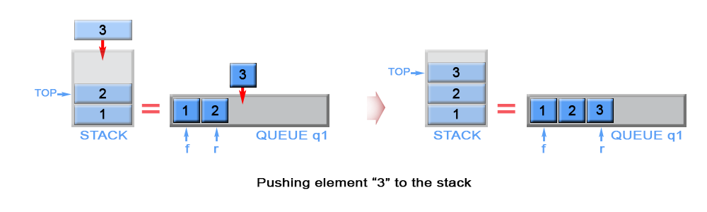
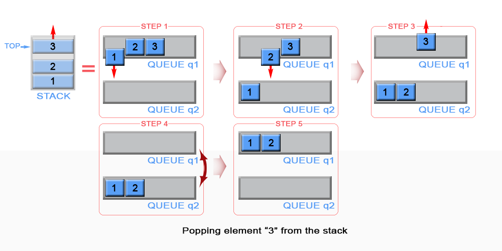
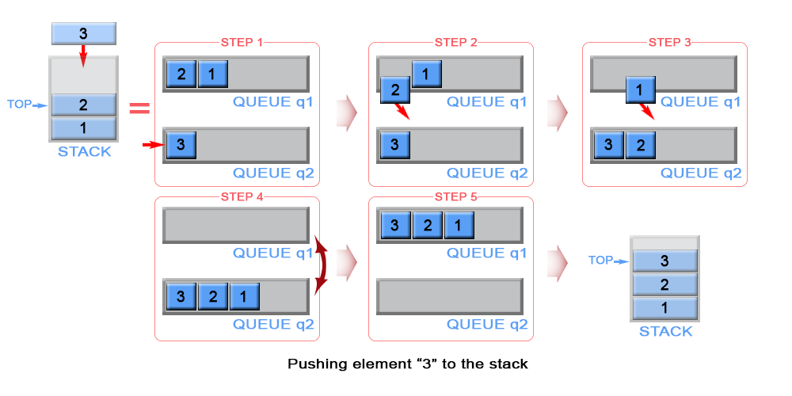
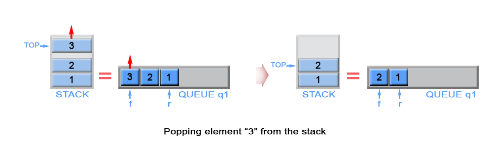
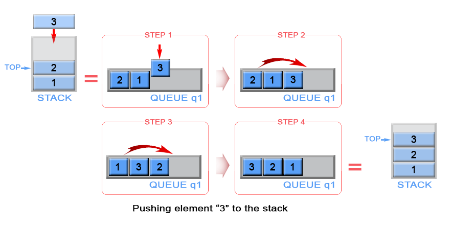

# Official Solution

**Link:** [https://leetcode.com/problems/implement-stack-using-queues/solution/](https://leetcode.com/problems/implement-stack-using-queues/solution/)

---

[TOC]

## Summary
This article is for beginners. It introduces the following ideas:
Stack, Queue.

## Solution
---
### Approach #1 (Two Queues, push - $$O(1)$$, pop $$O(n)$$ )

**Intuition**

Stack is **LIFO** (last in - first out) data structure, in which elements are added and removed from the same end, called `top`.
In general stack is implemented using array or linked list, but in the current article we will review a different approach for implementing stack using queues. In contrast queue is **FIFO** (first in - first out) data structure, in which elements are added only from the one side - `rear` and removed from the other - `front`. In order to implement stack using queues, we need to maintain two queues `q1` and `q2`. Also we will keep top stack element in a constant memory.

**Algorithm**

**Push**

The new element is always added to the rear of queue `q1` and it is kept as `top` stack element

{:width="539px"}

*Figure 1. Push an element in stack*

<iframe src="https://leetcode.com/playground/hA8Av9g7/shared" frameBorder="0" name="hA8Av9g7" width="100%" height="207"></iframe>
**Complexity Analysis**

* Time complexity : $$O(1)$$. Queue is implemented as linked list and `add` operation has $$O(1)$$ time complexity.

* Space complexity : $$O(1)$$

**Pop**

We need to remove the element from the top of the stack. This is the last inserted element in `q1`.
Because queue is FIFO (first in - first out) data structure, the last inserted element could be removed only after all elements, except it, have been removed. For this reason we need to maintain additional queue `q2`, which will serve as a temporary storage to enqueue the removed elements from q1. The last inserted element in `q2` is kept as top. Then the algorithm removes the last element in `q1`. We swap `q1` with `q2` to avoid copying all elements from `q2` to `q1`.

{:width="539px"}

*Figure 2. Pop an element from stack*

<iframe src="https://leetcode.com/playground/GVEP7KC5/shared" frameBorder="0" name="GVEP7KC5" width="100%" height="241"></iframe>

**Complexity Analysis**

* Time complexity : $$O(n)$$. The algorithm  dequeues n elements from `q1` and enqueues $$n - 1$$ elements to `q2`, where $$n$$ is the stack size. This gives $$2n - 1$$ operations.
* Space complexity : $$O(1)$$.

---
### Approach #2 (Two Queues, push - $$O(n)$$, pop $$O(1)$$ )

**Algorithm**

**Push**

The algorithm inserts each new element to queue `q2` and keep it as the `top` element. In case queue `q1` is not empty (there are elements in the stack), we remove all elements from `q1` and add them to `q2`. In this way the new inserted element (`top` element in the stack) will be always positioned at the front of `q2`. We swap `q1` with `q2` to avoid copying all elements from `q2` to `q1`.

{:width="539px"}

*Figure 3. Push an element in stack*

<iframe src="https://leetcode.com/playground/PmACxrs7/shared" frameBorder="0" name="PmACxrs7" width="100%" height="224"></iframe>

**Complexity Analysis**

* Time complexity : $$O(n)$$. The algorithm  removes n elements from `q1` and inserts $$n + 1$$ elements to `q2`, where n is the stack size. This gives $$2n + 1$$ operations. The operations `add` and `remove` in linked lists has $$O(1)$$ complexity.

* Space complexity : $$O(1)$$.

**Pop**

The algorithm dequeues an element from  queue `q1` and keeps front element of `q1` as `top`.

{:width="539px"}

*Figure 4. Pop an element from stack*

<iframe src="https://leetcode.com/playground/cJSgWsjg/shared" frameBorder="0" name="cJSgWsjg" width="100%" height="173"></iframe>

**Complexity Analysis**

* Time complexity : $$O(1)$$.
* Space complexity : $$O(1)$$.

In both approaches `empty` and `top` operations have the same implementation.

**Empty**

Queue `q1` always contains all stack elements, so the algorithm checks `q1` size to return if the stack is empty.

<iframe src="https://leetcode.com/playground/daUayMBx/shared" frameBorder="0" name="daUayMBx" width="100%" height="122"></iframe>

Time complexity : $$O(1)$$.

Space complexity : $$O(1)$$.

**Top**

The `top` element is kept in constant memory and is modified each time when we push or pop an element.

<iframe src="https://leetcode.com/playground/2egrNy7x/shared" frameBorder="0" name="2egrNy7x" width="100%" height="122"></iframe>

Time complexity : $$O(1)$$.
 The `top` element has been calculated in advance and only returned in `top` operation.

Space complexity : $$O(1)$$.

---
### Approach #3 (One Queue, push - $$O(n)$$, pop $$O(1)$$ )

The mentioned above two approaches have one weakness, they use two queues. This could be optimized as we use only one queue, instead of two.

**Algorithm**

**Push**

When we push an element into a queue, it will be stored at back of the queue due to queue's properties.
But we need to implement a stack, where last inserted element should be in the front of the queue, not at the back. To achieve this we can invert the order of queue elements when pushing a new element.

{:width="539px"}

*Figure 5. Push an element in stack*

<iframe src="https://leetcode.com/playground/KWjfiLLE/shared" frameBorder="0" name="KWjfiLLE" width="100%" height="241"></iframe>

**Complexity Analysis**

* Time complexity : $$O(n)$$. The algorithm  removes n elements and inserts $$n + 1$$ elements to `q1` , where n is the stack size. This gives $$2n + 1$$ operations. The operations `add` and `remove` in linked lists has $$O(1)$$ complexity.

* Space complexity : $$O(1)$$.

**Pop**

 The last inserted element is always stored at the front of `q1` and we can pop it for constant time.

<iframe src="https://leetcode.com/playground/9VzMVJRW/shared" frameBorder="0" name="9VzMVJRW" width="100%" height="122"></iframe>

**Complexity Analysis**

* Time complexity : $$O(1)$$.
* Space complexity : $$O(1)$$.

**Empty**

Queue `q1` contains all stack elements, so the algorithm checks if `q1` is empty.

<iframe src="https://leetcode.com/playground/Bo3j7qez/shared" frameBorder="0" name="Bo3j7qez" width="100%" height="122"></iframe>

Time complexity : $$O(1)$$.
Space complexity : $$O(1)$$.

**Top**

The `top` element is always positioned at the front of `q1`. Algorithm return it.

<iframe src="https://leetcode.com/playground/CyVTnqYt/shared" frameBorder="0" name="CyVTnqYt" width="100%" height="122"></iframe>

Time complexity : $$O(1)$$.
Space complexity : $$O(1)$$.

Analysis written by: @elmirap.