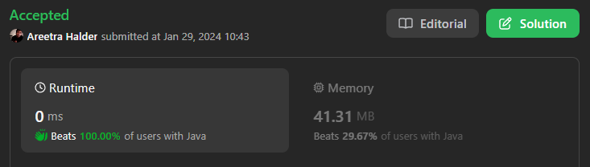

# 🔥✅✅Beats 100% with Proof | Very Easy to Understand ✅✅🔥

**Author:** areetrahalder
**Votes:** 10
**Link:** [https://leetcode.com/problems/implement-queue-using-stacks/solutions/4642223/](https://leetcode.com/problems/implement-queue-using-stacks/solutions/4642223/)

---

# Proof - Upvote if you are watching the proof



# Intuition
<!-- Describe your first thoughts on how to solve this problem. -->
The idea is to use two stacks, one for input (`inputStack`) and one for output (`outputStack`). When pushing an element, we will reverse the order of elements using the two stacks, and when popping or peeking, we will directly use the output stack.

# Approach
<!-- Describe your approach to solving the problem. -->
* Initialize two stacks: inputStack and outputStack.
* For the push operation:
    * While outputStack is not empty, pop elements from outputStack and push them to inputStack.
    * Push the new element (x) onto inputStack.
    * While inputStack is not empty, pop elements from inputStack and push them to outputStack.
* For the pop operation, simply pop from outputStack.
* For the peek operation, return the top element of outputStack.
* For the empty operation, check if outputStack is empty.

# Complexity
- Time complexity: Amortized $$O(n)$$
> The amortized time complexity of the push operation is O(1) because each element is moved between the stacks at most twice (once during the push operation, and once during the pop or peek operation). Therefore, on average, each element is moved a constant number of times, making the overall time complexity constant on average.
<!-- Add your time complexity here, e.g. $$O(n)$$ -->

- Space complexity: $$O(n)$$
<!-- Add your space complexity here, e.g. $$O(n)$$ -->
> where n is the number of elements in the queue.

# Code
```Java []
class MyQueue {

    Stack<Integer> inputStack;
    Stack<Integer> outputStack;

    public MyQueue() {
        this.inputStack = new Stack<>();
        this.outputStack = new Stack<>();
    }
    
    public void push(int x) {
        while(!this.outputStack.isEmpty()){
            this.inputStack.push(this.outputStack.pop());
        }
        this.inputStack.push(x);
        while(!this.inputStack.isEmpty()){
            this.outputStack.push(this.inputStack.pop());
        }
    }
    
    public int pop() {
        return this.outputStack.pop();
    }
    
    public int peek() {
        return this.outputStack.peek();
    }
    
    public boolean empty() {
        return this.outputStack.isEmpty();
    }
}

/**
 * Your MyQueue object will be instantiated and called as such:
 * MyQueue obj = new MyQueue();
 * obj.push(x);
 * int param_2 = obj.pop();
 * int param_3 = obj.peek();
 * boolean param_4 = obj.empty();
 */
```
```C []
#define MAX_SIZE 100

typedef struct {
    int inputStack[MAX_SIZE];
    int outputStack[MAX_SIZE];
    int inputTop;
    int outputTop;
} MyQueue;

MyQueue* myQueueCreate() {
    MyQueue* queue = (MyQueue*)malloc(sizeof(MyQueue));
    queue->inputTop = -1;
    queue->outputTop = -1;
    return queue;
}

void myQueuePush(MyQueue* obj, int x) {
    while (obj->outputTop != -1) {
        obj->inputStack[++obj->inputTop] = obj->outputStack[obj->outputTop--];
    }
    obj->inputStack[++obj->inputTop] = x;
    while (obj->inputTop != -1) {
        obj->outputStack[++obj->outputTop] = obj->inputStack[obj->inputTop--];
    }
}

int myQueuePop(MyQueue* obj) {
    return obj->outputStack[obj->outputTop--];
}

int myQueuePeek(MyQueue* obj) {
    return obj->outputStack[obj->outputTop];
}

bool myQueueEmpty(MyQueue* obj) {
    return obj->outputTop == -1;
}

void myQueueFree(MyQueue* obj) {
    free(obj);
}
```
```C++ []
#include <stack>

class MyQueue {
private:
    std::stack<int> inputStack;
    std::stack<int> outputStack;

public:
    MyQueue() {
        // Constructor
    }
    
    void push(int x) {
        // Move elements from outputStack to inputStack
        while (!outputStack.empty()) {
            inputStack.push(outputStack.top());
            outputStack.pop();
        }
        
        // Push the new element onto inputStack
        inputStack.push(x);
        
        // Move elements back from inputStack to outputStack
        while (!inputStack.empty()) {
            outputStack.push(inputStack.top());
            inputStack.pop();
        }
    }
    
    int pop() {
        // Pop from outputStack
        int front = outputStack.top();
        outputStack.pop();
        return front;
    }
    
    int peek() {
        // Return the top element of outputStack
        return outputStack.top();
    }
    
    bool empty() {
        // Check if outputStack is empty
        return outputStack.empty();
    }
};
```
```C# []
public class MyQueue {

    private Stack<int> inputStack;
    private Stack<int> outputStack;

    public MyQueue() {
        inputStack = new Stack<int>();
        outputStack = new Stack<int>();
    }
    
    public void Push(int x) {
        // Move elements from outputStack to inputStack
        while(outputStack.Count > 0) {
            inputStack.Push(outputStack.Pop());
        }
        
        // Push the new element onto inputStack
        inputStack.Push(x);
        
        // Move elements from inputStack to outputStack
        while(inputStack.Count > 0) {
            outputStack.Push(inputStack.Pop());
        }
    }
    
    public int Pop() {
        return outputStack.Pop();
    }
    
    public int Peek() {
        return outputStack.Peek();
    }
    
    public bool Empty() {
        return outputStack.Count == 0;
    }
}

/**
 * Your MyQueue object will be instantiated and called as such:
 * MyQueue obj = new MyQueue();
 * obj.Push(x);
 * int param_2 = obj.Pop();
 * int param_3 = obj.Peek();
 * bool param_4 = obj.Empty();
 */
```
```Javascript []
var MyQueue = function() {
    this.inputStack = [];
    this.outputStack = [];
};

/** 
 * @param {number} x
 * @return {void}
 */
MyQueue.prototype.push = function(x) {
    while (this.outputStack.length > 0) {
        this.inputStack.push(this.outputStack.pop());
    }
    this.inputStack.push(x);
    while (this.inputStack.length > 0) {
        this.outputStack.push(this.inputStack.pop());
    }
};

/**
 * @return {number}
 */
MyQueue.prototype.pop = function() {
    return this.outputStack.pop();
};

/**
 * @return {number}
 */
MyQueue.prototype.peek = function() {
    return this.outputStack[this.outputStack.length - 1];
};

/**
 * @return {boolean}
 */
MyQueue.prototype.empty = function() {
    return this.outputStack.length === 0;
};

/** 
 * Your MyQueue object will be instantiated and called as such:
 * var obj = new MyQueue()
 * obj.push(x)
 * var param_2 = obj.pop()
 * var param_3 = obj.peek()
 * var param_4 = obj.empty()
 */
```
```Typescript []
class MyQueue {
    private inputStack: number[];
    private outputStack: number[];

    constructor() {
        this.inputStack = [];
        this.outputStack = [];
    }

    push(x: number): void {
        // Move elements from outputStack to inputStack
        while (this.outputStack.length > 0) {
            this.inputStack.push(this.outputStack.pop()!);
        }

        // Push the new element onto inputStack
        this.inputStack.push(x);

        // Move elements from inputStack to outputStack
        while (this.inputStack.length > 0) {
            this.outputStack.push(this.inputStack.pop()!);
        }
    }

    pop(): number {
        return this.outputStack.pop()!;
    }

    peek(): number {
        return this.outputStack[this.outputStack.length - 1];
    }

    empty(): boolean {
        return this.outputStack.length === 0;
    }
}
```
```Python []
class MyQueue(object):

    def __init__(self):
        self.input_stack = []
        self.output_stack = []

    def push(self, x):
        # While outputStack is not empty, pop elements from outputStack and push them to inputStack
        while self.output_stack:
            self.input_stack.append(self.output_stack.pop())

        # Push the new element (x) onto inputStack
        self.input_stack.append(x)

        # While inputStack is not empty, pop elements from inputStack and push them to outputStack
        while self.input_stack:
            self.output_stack.append(self.input_stack.pop())

    def pop(self):
        return self.output_stack.pop()

    def peek(self):
        return self.output_stack[-1]

    def empty(self):
        return not bool(self.output_stack)


# Your MyQueue object will be instantiated and called as such:
# obj = MyQueue()
# obj.push(x)
# param_2 = obj.pop()
# param_3 = obj.peek()
# param_4 = obj.empty()

```
```Python3 []
from typing import List

class MyQueue:

    def __init__(self):
        self.input_stack: List[int] = []
        self.output_stack: List[int] = []

    def push(self, x: int) -> None:
        while self.output_stack:
            self.input_stack.append(self.output_stack.pop())
        self.input_stack.append(x)
        while self.input_stack:
            self.output_stack.append(self.input_stack.pop())

    def pop(self) -> int:
        return self.output_stack.pop()

    def peek(self) -> int:
        return self.output_stack[-1]

    def empty(self) -> bool:
        return not bool(self.output_stack)

# Your MyQueue object will be instantiated and called as such:
# obj = MyQueue()
# obj.push(x)
# param_2 = obj.pop()
# param_3 = obj.peek()
# param_4 = obj.empty()
```

# Upvote - Please


