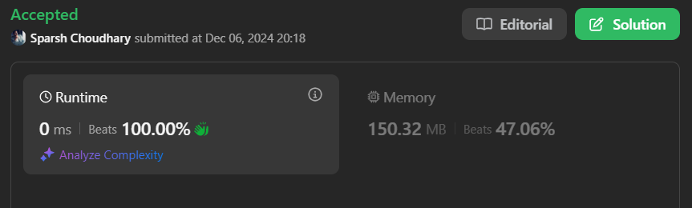

# 🔥BEATS 💯 % 🎯 |✨SUPER EASY BEGINNERS 👏

**Author:** CodeWithSparsh
**Votes:** 2
**Link:** [https://leetcode.com/problems/implement-queue-using-stacks/solutions/6120135/](https://leetcode.com/problems/implement-queue-using-stacks/solutions/6120135/)

---




---

# Intuition
A queue operates in **FIFO (First In, First Out)** order, while a stack operates in **LIFO (Last In, First Out)** order. To simulate a queue using stacks, we can use two stacks:
1. One for push operations (\\(_stack1\\)).
2. One for pop and peek operations (\\(_stack2\\)).

The key insight is that when we need to pop or peek, we reverse the elements from \\(_stack1\\) into \\(_stack2\\), allowing us to access the oldest element.

---

# Approach
1. **Push Operation:**
   - Add the element directly to \\(_stack1\\).

2. **Pop Operation:**
   - If \\(_stack2\\) is empty, transfer all elements from \\(_stack1\\) to \\(_stack2\\) (this reverses their order).
   - Remove and return the top element of \\(_stack2\\).

3. **Peek Operation:**
   - If \\(_stack2\\) is empty, transfer all elements from \\(_stack1\\) to \\(_stack2\\).
   - Return the top element of \\(_stack2\\).

4. **Empty Check:**
   - The queue is empty only if both \\(_stack1\\) and \\(_stack2\\) are empty.

---

# Complexity
- **Time complexity:**
  - **Push:** $$O(1)$$ (direct addition to \\(_stack1\\)).
  - **Pop/Peek:** $$O(n)$$ in the worst case (when \\(_stack2\\) is empty, and all elements need to be moved from \\(_stack1\\) to \\(_stack2\\)). Amortized complexity is $$O(1)$$ per operation since each element is moved at most once.

- **Space complexity:** $$O(n)$$ (storage required for the two stacks).

---


```dart []
class MyQueue {
  List<int> _stack1 = []; // Main stack for push operations
  List<int> _stack2 = []; // Temporary stack for reverse operations

  MyQueue();

  /// Push element x to the back of the queue.
  void push(int x) {
    _stack1.add(x); // Push directly to stack1
  }

  /// Removes the element from the front of the queue and returns it.
  int pop() {
    if (_stack2.isEmpty) {
      while (_stack1.isNotEmpty) {
        _stack2.add(_stack1.removeLast());
      }
    }
    return _stack2.removeLast();
  }

  /// Get the front element of the queue.
  int peek() {
    if (_stack2.isEmpty) {
      while (_stack1.isNotEmpty) {
        _stack2.add(_stack1.removeLast());
      }
    }
    return _stack2.last;
  }

  /// Returns whether the queue is empty.
  bool empty() {
    return _stack1.isEmpty && _stack2.isEmpty;
  }
}
```


```python []
class MyQueue:
    def __init__(self):
        self.stack1 = []  # Main stack for push operations
        self.stack2 = []  # Temporary stack for reverse operations

    def push(self, x: int) -> None:
        self.stack1.append(x)  # Push directly to stack1

    def pop(self) -> int:
        if not self.stack2:
            while self.stack1:
                self.stack2.append(self.stack1.pop())
        return self.stack2.pop()

    def peek(self) -> int:
        if not self.stack2:
            while self.stack1:
                self.stack2.append(self.stack1.pop())
        return self.stack2[-1]

    def empty(self) -> bool:
        return not self.stack1 and not self.stack2
```


```javascript []
class MyQueue {
  constructor() {
    this.stack1 = []; // Main stack for push operations
    this.stack2 = []; // Temporary stack for reverse operations
  }

  push(x) {
    this.stack1.push(x); // Push directly to stack1
  }

  pop() {
    if (this.stack2.length === 0) {
      while (this.stack1.length > 0) {
        this.stack2.push(this.stack1.pop());
      }
    }
    return this.stack2.pop();
  }

  peek() {
    if (this.stack2.length === 0) {
      while (this.stack1.length > 0) {
        this.stack2.push(this.stack1.pop());
      }
    }
    return this.stack2[this.stack2.length - 1];
  }

  empty() {
    return this.stack1.length === 0 && this.stack2.length === 0;
  }
}
```


```java []
import java.util.Stack;

class MyQueue {
    private Stack<Integer> stack1;
    private Stack<Integer> stack2;

    public MyQueue() {
        stack1 = new Stack<>();
        stack2 = new Stack<>();
    }

    public void push(int x) {
        stack1.push(x); // Push directly to stack1
    }

    public int pop() {
        if (stack2.isEmpty()) {
            while (!stack1.isEmpty()) {
                stack2.push(stack1.pop());
            }
        }
        return stack2.pop();
    }

    public int peek() {
        if (stack2.isEmpty()) {
            while (!stack1.isEmpty()) {
                stack2.push(stack1.pop());
            }
        }
        return stack2.peek();
    }

    public boolean empty() {
        return stack1.isEmpty() && stack2.isEmpty();
    }
}
```


```cpp []
#include <stack>
using namespace std;

class MyQueue {
private:
    stack<int> stack1; // Main stack for push operations
    stack<int> stack2; // Temporary stack for reverse operations

public:
    MyQueue() {}

    void push(int x) {
        stack1.push(x); // Push directly to stack1
    }

    int pop() {
        if (stack2.empty()) {
            while (!stack1.empty()) {
                stack2.push(stack1.top());
                stack1.pop();
            }
        }
        int top = stack2.top();
        stack2.pop();
        return top;
    }

    int peek() {
        if (stack2.empty()) {
            while (!stack1.empty()) {
                stack2.push(stack1.top());
                stack1.pop();
            }
        }
        return stack2.top();
    }

    bool empty() {
        return stack1.empty() && stack2.empty();
    }
};
```


```go []
type MyQueue struct {
    stack1 []int // Main stack for push operations
    stack2 []int // Temporary stack for reverse operations
}

func Constructor() MyQueue {
    return MyQueue{
        stack1: []int{},
        stack2: []int{},
    }
}

func (this *MyQueue) Push(x int) {
    this.stack1 = append(this.stack1, x) // Push directly to stack1
}

func (this *MyQueue) Pop() int {
    if len(this.stack2) == 0 {
        for len(this.stack1) > 0 {
            this.stack2 = append(this.stack2, this.stack1[len(this.stack1)-1])
            this.stack1 = this.stack1[:len(this.stack1)-1]
        }
    }
    val := this.stack2[len(this.stack2)-1]
    this.stack2 = this.stack2[:len(this.stack2)-1]
    return val
}

func (this *MyQueue) Peek() int {
    if len(this.stack2) == 0 {
        for len(this.stack1) > 0 {
            this.stack2 = append(this.stack2, this.stack1[len(this.stack1)-1])
            this.stack1 = this.stack1[:len(this.stack1)-1]
        }
    }
    return this.stack2[len(this.stack2)-1]
}

func (this *MyQueue) Empty() bool {
    return len(this.stack1) == 0 && len(this.stack2) == 0
}
```

---

 {:style='width:250px'}