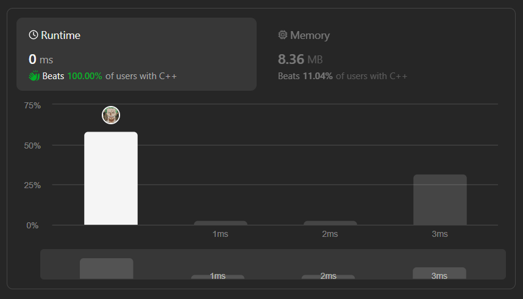

# ✅☑Beats 100% Users || C++/Java/Python/JavaScript] || EXPLAINED🔥

**Author:** MarkSPhilip31
**Votes:** 101
**Link:** [https://leetcode.com/problems/implement-queue-using-stacks/solutions/4641109/](https://leetcode.com/problems/implement-queue-using-stacks/solutions/4641109/)

---

# PLEASE UPVOTE IF IT HELPED

---


---


# Approaches
(Also explained in the code)

1. **Initialization:**

    - We have two stacks, `s1` and `s2`, where `s1` acts as the primary stack for enqueue operations, and `s2` helps in reversing the order of elements for efficient dequeuing.
1. **Enqueue Operation (Push):**

    - When a new element is pushed into the queue (`push` operation):
        - All elements from `s1` are popped and pushed onto `s2`. This effectively reverses the order of elements.
        - The new element is pushed onto the now-empty `s1`.
        - Finally, elements are popped from `s2` and pushed back onto `s1` to maintain the original order.
1. **Dequeue Operation (Pop):**

    - When an element is dequeued (`pop` operation):
        - The top element from `s1` is directly popped.
1. **Peek Operation:**

    - The top element of `s1` is returned for the `peek` operation.
1. **Empty Check:**

    - The `empty` operation checks whether `s1` is empty.


# Complexity
- Time complexity:
Enqueue (push): $$O(n)$$ 
Dequeue (pop): $$O(1)$$
Peek (peek): $$O(1)$$
Empty Check (empty): $$O(1)$$
*(where n is the number of elements in the queue.)*
    

- Space complexity:
   $$O(n)$$
    


# Code
```C++ []

class MyQueue {
private:
    stack<int> s1;
    stack<int> s2;

public:
    MyQueue() {}

    void push(int x) {
        while (!s1.empty()) {
            s2.push(s1.top());
            s1.pop();
        }
        s1.push(x);
        while (!s2.empty()) {
            s1.push(s2.top());
            s2.pop();
        }
    }

    int pop() {
        int temp = s1.top();
        s1.pop();
        return temp;
    }

    int peek() {
        return s1.top();
    }

    bool empty() {
        return s1.empty();
    }
};


```
```Java []


class MyQueue {
    private Stack<Integer> s1;
    private Stack<Integer> s2;

    public MyQueue() {
        s1 = new Stack<>();
        s2 = new Stack<>();
    }

    public void push(int x) {
        while (!s1.isEmpty()) {
            s2.push(s1.pop());
        }
        s1.push(x);
        while (!s2.isEmpty()) {
            s1.push(s2.pop());
        }
    }

    public int pop() {
        return s1.pop();
    }

    public int peek() {
        return s1.peek();
    }

    public boolean empty() {
        return s1.isEmpty();
    }
}


```
```python []
class MyQueue:
    def __init__(self):
        self.s1 = []
        self.s2 = []

    def push(self, x):
        while self.s1:
            self.s2.append(self.s1.pop())
        self.s1.append(x)
        while self.s2:
            self.s1.append(self.s2.pop())

    def pop(self):
        return self.s1.pop()

    def peek(self):
        return self.s1[-1]

    def empty(self):
        return not self.s1


```
```javascript []

class MyQueue {
    constructor() {
        this.s1 = [];
        this.s2 = [];
    }

    push(x) {
        while (this.s1.length > 0) {
            this.s2.push(this.s1.pop());
        }
        this.s1.push(x);
        while (this.s2.length > 0) {
            this.s1.push(this.s2.pop());
        }
    }

    pop() {
        return this.s1.pop();
    }

    peek() {
        return this.s1[this.s1.length - 1];
    }

    empty() {
        return this.s1.length === 0;
    }
}


```
---


# PLEASE UPVOTE IF IT HELPED

---
---


---